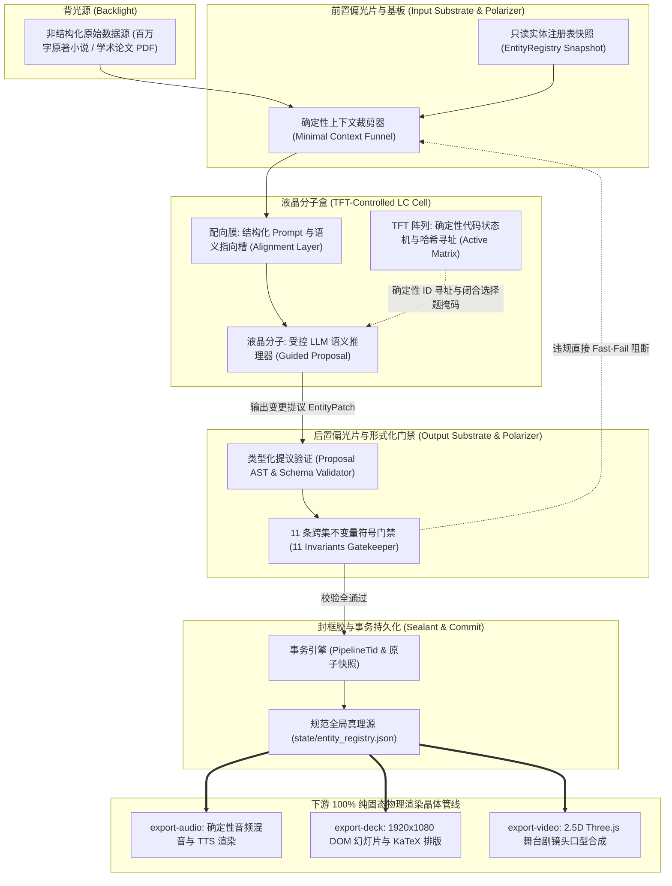
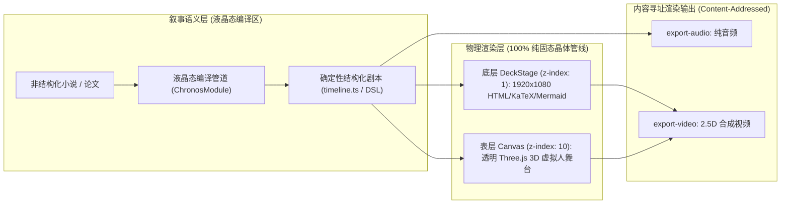

# 《什么是液晶态软件，以及它为什么如此有用？——以多模态状态编译引擎 Apostle 为例》
## ——从软物质物理学到多智能体工程：如何用 TFT-LCD 架构驯服大模型，构建长周期、低熵增、可重入的工业级生产系统

**作者**：时恒  
**开源协议**：CC BY-SA 4.0  
**理论底座**：对齐《AI 软件工程 101》理论体系（参见 [软件物态学总纲](./overview_software_phases.md) 与 [深度指导手册](./software_phases.md)）  
**案例引擎**：工业级多模态内容编译引擎 Apostle

---

## 1. 引言：为什么我们需要“液晶态软件”？

在过去两年的大模型落地狂潮中，无数工程师与技术决策者经历了一种反复出现的“两难阵痛”：
- **方案 A（固态死规）**：全部用传统代码写死。确定性极高、毫秒级响应、零幻觉，但面对百万字古典小说、非结构化长篇学术论文、复杂情绪对话时，纯规则系统立刻显得**刚性易碎、无法理解现实世界的语义连续流动**；
- **方案 B（液态/气态纯 Agent 狂欢）**：给大模型配上一组 Prompt 和自由工具调用，搞“全自动端到端多智能体生成”。在简单 Demo 中看似惊艳，然而一旦进入多集长篇连载，系统便会迅速陷入热力学熵增灾难——**同一角色跨集改名、资产 ID 多重分裂、历史实体被静默丢弃、失败运行的残留文件直接污染后续剧集**。

要跳出这一非此即彼的绝境，我们必须引入软物质物理学与软件工程交叉的全新物态认知——**液晶态软件（Liquid-Crystal Software）**。

### 1.1 软件四态因果相空间：`[目的 Telos, 过程 Process, 结果 Schema]`

在《软件物态学》（参见 [./software_phases.md](./software_phases.md)）中，我们将一切计算系统置于由三维因果坐标构成的相空间中：
1. **终极目的（Telos / $U_{\text{telos}}$）**：系统是否受人类宿主赋予的外源目标与势阱约束；
2. **执行过程（Process / $\Psi_{\text{proc}}$）**：计算控制流是在确定性晶格上运行，还是在语义流形中自适应流动；
3. **结果结构（Schema / $S_{\text{schema}}$）**：输出是否严格对齐于强类型的形式化数据契约。

沿着自由度的释放，软件严格呈现出四种物态：

```
1. 固态 / 晶体软件 (Solid / S-Type)
   [目的定死, 过程定死, 结构定死] ──► 核心账务、编译器 AST、SQL、Z3 求解器
   【刚性易碎，严禁引入概率 LLM】
               │
               ▼ [释放语义过程自由度，但锁定结果 Schema]
2. 液晶态软件 (Liquid Crystal / P-Type)  ◀───【工业落地 80% 价值的主战场】
   [目的定死, 过程柔性, 结构锁定] ──► 非结构化长文转严格状态、受控实体编译
   【既有液体的语义流动性，又被死死锁在晶体的数据晶格中】
               │
               ▼ [进一步释放微观子路径与结构探索自由度]
3. 受控液态软件 (Confined Liquid / E-Type)
   [目的定死, 过程自适应流动] ──► 极简代码修复 Agent、未知环境排障
   【液体无固定形状，必须装在固态代码机甲容器内运行】
               │
               ▼ [撤除外源目的势阱 (沸腾气化)]
4. 气态系统 (Gaseous System)
   [目的、过程、结果全不确定] ──► 萨特“存在先于本质”的主体 vs. 法兰克福式“扯淡”耗散
```

### 1.2 破局方案：向列相液晶的“流动性”与“晶体取向序”

物理学中，**向列相液晶（Nematic Liquid Crystal）**是一种极其奇妙的中间相：液晶分子像液体一样可以在空间中自由流动（拥有位置自由度），但每个分子的长轴又受到强烈的分子间作用力与外场取向限制，必须高度一致地朝向特定方向（取向序参量 $S = \frac{1}{2}\langle 3\cos^2\theta - 1\rangle \approx 1$）。

**液晶态软件**正是这一物理特性的完美复刻：
- **液体的流动性（LLM 语义理解）**：利用大模型的高维流形插值能力，去消化非结构化小说、提炼人物动机、推断台词潜台词与镜头机位；
- **晶体的刚性（确定性代码与契约）**：输出**绝不允许是大模型自由发挥的散文**，而必须通过确定性语法掩码（Guided Decoding）和编译管道，严丝合缝地结晶在强类型的状态机与契约晶格之上。

### 1.3 案例引擎：多模态长文本编译引擎 Apostle

为了让这一抽象概念落地为坚实的工程事实，本文将以工业级多模态编译引擎 **Apostle** 为完整范例。

Apostle 承担着极其苛刻的生产任务：将数百万字的非结构化长篇古籍（如《施公案》）、现代小说或长篇学术论文 PDF，自动编译为三种跨模态产品：
1. **`export-audio`（评书与广播剧流水线）**：多角色对白、旁白烘托、方言定制与电影级环境 Foley/BGM 混音；
2. **`export-deck`（学术演示视频流水线）**：1920×1080 响应式 DOM 幻灯片、KaTeX 数学公式渲染、Mermaid 架构流程图动画与代码高亮；
3. **`export-video`（2.5D 舞台剧视频流水线）**：基于 Three.js 的透明三维舞台，包含带骨骼绑定的 3D 虚拟人、手持道具排演、动态舞台灯光、粒子特效与逐字口型驱动。

面对长达几十集、跨越数月生成的连续剧集，如果把状态直接交给大模型维护，必然在上游就崩解成碎片。Apostle 跑通的，正是一整套严密的液晶态软件架构。

---

## 2. 什么是液晶态软件？——从物理学的 TFT-LCD 到 Apostle 的六大架构组件

### 2.1 物理学直觉：为什么你的电脑屏幕不会变成一滩烂泥？

物理上的液晶显示屏（TFT-LCD）是如何工作的？
液晶分子本身是滑动的流体。如果直接把一滴液晶倒在桌子上，它就是一滩混沌的油状液体，既不能显像，也毫无结构。液晶之所以能成为清晰锐利的 4K 屏幕，是因为有一整套精密而刚性的物理系统在约束它：
1. **上下玻璃基板**：把液体死死压成几微米厚度的平整薄层，不允许任何向外膨胀；
2. **配向膜**：表面用天鹅绒微细摩擦出纳米级微槽，引导液晶分子在无外电场时呈现整齐的初始排列；
3. **TFT 有源矩阵阵列（Thin-Film Transistors）**：屏幕背后有数百万个微小的硅基晶体管，每一个晶体管对准一个独立的像素坐标，能够以微秒级精度精准给该像素施加电压，迫使该处的液晶分子精确偏转；
4. **偏光片**：进出两道光学栅格，只允许符合特定振动方向的光波通过，把所有杂散光彻底滤除；
5. **封框胶**：严密锁死周边边界，确保一滴液晶都不往外泄露。

> **核心洞见**：
> **屏幕的价值在 TFT 驱动阵列，不在液晶。液晶谁都能买，而真正的技术壁垒是能够逐像素寻址、逐像素加电的那层确定性硅基代码。**

在 AI 软件工程中亦是如此：**大模型谁都能调，真正的工程壁垒是用确定性代码铸造的“机甲与晶体管阵列”。**

### 2.2 TFT-LCD 到 Apostle 液晶态软件的六大工程映射

我们将物理液晶屏的六大组成部分，与 Apostle 的架构实现做出一对一严密映射：

| 物理 TFT-LCD 组件 | 物理功能与特性 | Apostle 液晶态软件实现 | 工程职责与约束 |
| :--- | :--- | :--- | :--- |
| **1. 液晶分子 (LC Molecules)** | 受电场驱动偏转，调节光线透过率；自身是无序流体 | **受控大模型语义推理器 (LLM)** | 负责非结构化文本理解、台词对白分句、镜头机位张力与动作推断（提供局部语义流动性） |
| **2. 上下玻璃基板 (Glass Substrates)** | 刚性边界，将流体限制在微米级厚度之间 | **强类型数据契约 (TypeScript / Pydantic / DSL)** | 统一契约接口 `contract.ts`、双层舞台 DSL、JSON Schema；严禁自由文本逃逸 |
| **3. 配向膜 (Alignment Layer)** | 纳米摩擦微槽，给予液晶分子初始物理朝向（指向矢 $\vec{n}$） | **结构化 Prompt 与上下文先验摩擦槽** | 角色小传先验、情境规则锚点、Few-Shot 示例；规范推理的初始基准线 |
| **4. TFT 有源矩阵 (Active Matrix)** | 逐像素硅基晶体管阵列，提供唯一物理坐标寻址与精准电压驱动 | **确定性状态机与 `EntityRegistry` 实体注册表** | 代码掌控的 Canonical ID（如 `char_001`）、`FormEntry` 造型闭包、`CommitReceipt` 事务凭据与 AST 改写器；严禁 LLM 自行命名主键 |
| **5. 偏光片 (Polarizers)** | 滤除偏振方向不匹配的杂散光线 | **前置上下文裁剪 + 后置 11 条跨集不变量符号门禁** | `mountFiles` 最小化沙盒挂载 + commit 阶段 11 条硬编码形式化校验器（Fast-Fail） |
| **6. 封框胶 (Sealant)** | 边缘高分子胶封死，防止液晶漏液污染电路 | **单一写入者原则与事务快照隔离 (`Snapshot Isolation`)** | `commitSeriesState` 独占提交、`state_snapshots/before_epN/` 事务隔离，失败瞬间原子回滚 |

### 2.3 Apostle 液晶态体系架构图



---

## 3. 反面实证：如果不做成液晶态，会发生什么灾难？（Apostle“第 9 集相变坍缩”真实事故复盘）

要真正理解液晶态软件的价值，最有效的方法是观察：**一旦撤掉上下玻璃基板与 TFT 晶体管，系统会发生怎样惨烈的值域崩溃。**

### 3.1 理论预测：状态空间复杂度阈值定律（$L^*$）

在《软件物态学》（参见 [./software_phases.md](./software_phases.md) §1.3）中，我们确立了**状态空间复杂度阈值定律**：
设系统多步任务的状态推演轨迹熵为 $\mathcal{H}(H) \approx H \log_2 b$（$H$ 为上下文步长与实体交互链条，$b$ 为分支因子），模型隐状态的符号保真表征容量为 $\mathcal{C}_{\text{model}}$：
- **亚临界区（Sub-Critical Regime，$H \log_2 b \le \alpha \cdot \mathcal{C}_{\text{model}}$）**：隐状态容量足够包裹实体约束，注意力机制能维持几何流形不变性，展现出“看起来像真人在思考”的良好连贯性；
- **超临界区（Super-Critical Regime，$H \log_2 b > \alpha \cdot \mathcal{C}_{\text{model}}$）**：一旦跨越临界阈值 $L^*$，或者在物理学意义上**温度越过了各向同性清亮点（Clearing Point $T_{NI}$）**，系统发生不可逆的**相变坍缩（Phase Collapse）**，大模型不可逆地退化为热力学高熵耗散与法兰克福式“扯淡”。

### 3.2 施公案前 8 集：为什么早期版本还能维持稳定？

在 Apostle 推进《施公案》连载的前 8 集中，系统之所以能够维持跨集人物身份不乱，恰恰是因为当时保留了最基础的“刚性契约”（参见 ADR-0001 §1）：
- **`glossary.json` 作为唯一身份真理源**：保存了每个实体的规范中文名（`entityName`）；
- **单文件按集追加**：`${entityId}.ts` 采用“单文件基础定义 + 按集追加派生块”的确定性存储结构。

同时，在前几集中，单集内真正需要生成实体文件的核心角色较少。例如在第 1 集中，上游 `glossary-audit` 虽然从原著中识别出了 **47 个实体**，但其中 12 个随叙事节拍（Beat）被 `destiny-weaver` 裁掉，22 个非核心实体被 `Deleter` 删除，最终只有 **13 个核心实体**真正生成了 `.ts` 状态文件。

### 3.3 第 9 集：敲碎玻璃基板后的“相变坍缩”真实事故复盘

在代码演进至提交 `015e7c15` 时，为了把目录结构迁移为 `state/entity` + `state/events` 并追求所谓的“灵活解耦”，一次重构无意间**敲碎了夹住液晶分子的刚性玻璃基板**（ADR-0001 §1、ADR-0002 §1）：
1. **丢弃了唯一中文名真理源**：直接删掉了 `glossary.json`，导致此后的中文名再也没有任何确定性来源；
2. **把派生合并改成了 LLM 盲拷命名**：允许 LLM 自己给每集的派生文件起名，于是磁盘上开始散落由大模型自由命名的 `*_ep9.ts`；
3. **系统输入漏声明被静默丢弃**：新加的 `historical_events` 输入没有在任何 `module.json` 中显式声明，被编排器按默认规则静默丢弃，导致 `glossary-audit` 拿到的历史实体清单直接变成了空数组 `[]`。

当连载推进到第 9 集时，失去刚性契约约束的流体彻底失控，系统跨越清亮点 $T_{NI}$，发生惨烈的**相变坍缩**：

```
[第 9 集敲碎契约后的相变坍缩实况复盘 (ADR-0001 & ADR-0002)]
┌────────────────────────────────────────────────────────────────────────┐
│ 1. 33 个历史实体被静默吞掉：                                           │
│    由于缺乏输入契约校验与显式报错，worldview 模块中的                  │
│    VisualEntityFilter 遇到状态缺失时静默执行了 continue，直接吞掉了    │
│    33 个历史实体！此外，早期第 1 集被裁掉的次要角色（如书吏            │
│    character_clerk）在后续集数以新拼音 ID（character_shu_li）重新登场  │
│    时，因缺少原著全名册登记，彻底无法对齐原有身份。                    │
│                                                                        │
│ 2. 主角资产三体重度分裂：                                              │
│    由于资产编号（assetId）后缀交由 LLM 生成且各模块命名约定不一，      │
│    在 artifacts/output_shigongan/assets/characters 目录下，仅主角      │
│    “施公”一人就分裂出三套角色资产：                                    │
│    - asset_shi_gong_01                                                 │
│    - char_shi_gong_01                                                  │
│    - character_shi_gong                                                │
│    而全库实际上没有任何一个 _02 变体，留下的全是命名漂移的化石！       │
│                                                                        │
│ 3. 确定性符号计算被当成“参考建议”无视：                                │
│    代码底层的 NLP 漏斗明明已经算出：                                   │
│    character_jiu_huang ≈ character_jiuhuang (相似度 1.00 满分)         │
│    但由于架构上只把该结果交给 LLM 当“参考建议”而非由代码直接强制裁决， │
│    加上历史清单丢失，下游依然重画了“九黄”和“七珠”！                    │
│                                                                        │
│ 4. 状态提交不可重入，失败残留污染后续运行：                            │
│    由于缺乏事务快照隔离，第 9 集失败尝试留下的 *_ep9.ts 等半成品文件   │
│    直接残留在 state/ 目录中，污染了下一次重跑的初始输入。              │
└────────────────────────────────────────────────────────────────────────┘
```

**这场真实工程事故极其深刻地印证了 ADR-0002 的核心论断：“不夹住它，它就是一滩液体；玻璃一裂就漏液，像素坏了也不报警。”** 唯有把大模型重新关进由强类型契约、确定性裁决与快照事务构成的晶体管阵列中，系统才能具备工业级可靠性。

---

## 4. 为什么液晶态软件这么有用？——Apostle 验证的五大工程价值

在这场事故复盘后，Apostle 确立了以 **ADR-0001（实体注册表）**、**ADR-0002（液晶态状态管理）** 与 **ADR-0003（统一双层舞台）** 为核心的 **R1–R5 液晶态规则**，完成了从脆弱液态到受控液晶态的架构演进。

这套架构在实际生产中展现出的五个工程特性，清晰回答了“为什么液晶态软件这么有用”：

---

### 价值一：有效遏制长周期“状态失忆与身份分裂”（R1 提议与提交分离 + R2 单一写入者快照 + R5 事务来源追溯）

在无约束液态软件中，大模型往往被允许直接生成并覆写状态文件，这是长周期失忆与身份分裂的主要根源。液晶态的第一条规则就是**剥夺大模型直接写盘的权力**。

#### 1. R1 规则：LLM 只产出“提议（Proposal）”，代码拥有裁决与落盘权
在大模型（液晶分子）与真实磁盘状态之间，设有一道明确的类型边界：
- 大模型在任何环节的输出，本质上都只是一份**结构化变更提议（`EntityPatch` 或 `Proposal`）**；
- 所有的文件名、物理路径、标准 ID（Canonical ID）、资产编号（Asset ID，规范为 `assetId = entityId` 1:1 映射，或变体形态 `${entityId}@${formId}`）一律由确定性 TypeScript 代码生成与派生；
- **判据红线**：在代码库中，`grep` 不到“把 LLM 返回的字符串直接当路径或 ID 落盘”的代码。

```typescript
// 规范实体 ID：通过 TypeScript 品牌类型 (Branded Types) 锁死
export type EntityId = string & { readonly __brand: 'EntityId' };
export type EntityKind = 'Character' | 'Prop' | 'Scene' | 'Concept';

// 视觉造型变体：ADR-0002 §4.1 D-Form 闭合集合（拒绝自由变体）
export interface FormEntry {
  formId: string;         // 匹配 ^[a-z][a-z0-9_]*$，'normal' 为系统必须默认项
  label: string;          // 规范展示中文标签（精确匹配，如 '官服'、'微服私访'、'重伤'）
  aliases: string[];      // 见过的中文别名
  firstEpisode: string;   // 首次引入集数（如 'ep1'）
}

// 规范实体注册表项：单一真理源，严禁 LLM 随意增删字段
export interface EntityRegistryEntry {
  id: EntityId;           // 规范永久 ID，例如 'character_yang_yuwei'，永不改变
  kind: EntityKind;       // 四大本体类别之一
  entityName: string;     // 规范中文名，例如 '杨玉威'
  nameAliases: string[];  // 历史见过的其他中文称呼（如 '杨提督'、'提督大人'）
  idAliases: EntityId[];  // 被兼并的非规范历史 ID 别名（如 'character_yangyuwei'）
  firstEpisode: string;   // 首次登场集数
  lastEpisode: string;    // 最近登场集数
  forms: FormEntry[];     // 登记过的受限视觉造型闭合集合 (ADR-0002 §4.1)
}

// 事务提交回执：原子写入 state/commit_receipt.json，认证状态血统
export interface CommitReceipt {
  version: 1;             // 严格版本 1
  committedEpisode: string; // 提交归属集（如 'ep1'、'ep9'）
  pipelineTid: string;      // 对应 Pipeline 事务 UUID，杜绝越集跳步与脏重入
}
```

#### 2. R5 规则与防越集跳步：`pipelineTid` 事务认证与快照回执（来源追溯）
在多集连续连载（Series Mode）工程中，一个常见的隐蔽隐患是“第 8 集执行中途中断，编排器却继续跑第 9 集，将未提交或不完整的状态当成历史基准”。
Apostle 在 ADR-0001 D4.1 与 ADR-0002 R5 中确立了 **`pipelineTid` 事务认证机制**：
- 每次 Pipeline 启动时由代码调用 `crypto.randomUUID()` 生成唯一的事务 ID（`pipelineTid`），并写入 `<episodeDir>/pipeline_transaction.json`，初始状态标记为 `running`；
- 只有当前集整条 DAG 拓扑节点全部执行完毕，事务状态才被置为 `complete`；若中途被 `--stop-at` 截断或节点抛错中断，状态为 `stopped`，**状态机拒绝提交**；
- `commitEpisodeState` 在执行原子状态换入时，会在 `state/commit_receipt.json` 中写下提交回执，明确记录该状态是由哪一集、哪个 `pipelineTid` 完整跑完所产生的；
- 当下一集（第 $N$ 集）启动拍摄前，I9 门禁强制校验上一集（第 $N-1$ 集）的回执是否存在且集数吻合。如果停在第 $N-2$ 集或上一集未完成提交，**系统立即触发 Fast-Fail 中止**，从机制上阻断了因越集跳步导致的静默状态丢失。

#### 3. 拒绝脆弱正则：TypeScript Compiler API 抽象语法树（AST）安全改写
当 LLM 提议的候选 ID 被 `identity.ts` 重映射为规范 ID、或者剧本中的实体引用发生变更时，传统做法往往使用正则表达式（Regex）做字符串替换。但在包含复杂 TypeScript 逻辑、类型标注、对象字面量、字典下标访问与同名注释的代码中，正则替换容易误伤注释词汇或局部变量子串。
Apostle 在 `ontology/entity-id-rewriter.ts` 中采用 **TypeScript 官方 Compiler API（AST 抽象语法树引擎）**：
- 通过 `ts.createSourceFile` 将剧本代码解析为 AST 语法树；
- 递归遍历 AST 节点（`Identifier`、`PropertyAccessExpression`、`ElementAccessExpression`），仅对属于实体 ID 语法上下文的节点执行精确改写；
- 重写完成后，再经由 TypeScript 编译器诊断扫描（Diagnostics Scan），确保改写过程不破坏语法结构。

#### 4. R2 规则：单一写入者快照、全名册覆盖与可重入性验收
全局真理源文件 `state/entity_registry.json` 仅由 `commitSeriesState` 用代码写入。
- **原著全名册覆盖（`registry ⊇ 文件`）**：`entity_registry.json` 收录 `glossary-audit` 识别出的所有原著实体（例如第 1 集识别出的全部 47 个实体，即便其中 34 个因叙事裁剪未生成 `.ts` 实体文件，也在注册表中登记其规范 ID 与中文名）。当这些次要角色（如书吏）在后续集数重新出场时，确定性代码能按中文名命中原有 ID，大幅降低跨集身份断裂风险；
- **只读快照保护**：各工作流模块在运行第 $N$ 集时，只通过系统输入读取 `before_epN/` 快照，模块内部禁止直接改写系列状态目录；
- **两集回放夹具与冷启动结构测试（ADR-0002 §7 验收标准）**：同一快照与同一产物连续重复提交两次，`state/` 中除 `commit_receipt.json` 的新事务号外，其余状态文件逐字节一致（幂等）；在空的 `seriesRootDir` 上跑第 1 集可从“无”中自洽建立状态，删除全部状态后仅凭 `before_epN/` 快照即可完整复原——系统依靠契约与快照保证可重入性，不靠残留文件续命。

---

### 价值二：把开放式猜测转化为确定性查表与“闭合选择题”——以及如何优雅容忍“液晶坏点与偏色”（R3 确定性先行与最小模型原则 MM）

为什么很多 AI 系统的推理成本高昂，且容易产生重复实体？因为把本可由代码执行的查表与归一化工作，交给了具有随机性的大模型去开放式生成。

Apostle 贯彻 **最小模型原则（Minimum Model, MM）**：
> **代码能精确裁决的，绝不交给 LLM 猜；LLM 只用来处理确定性规则筛选后的“语义余数”，且 LLM 的回答必须再过一次代码校验器。**

#### 1. 确定性身份裁决四步流（`series-state/identity.ts`）
在 `glossary-extract` 调用 `Auditor` 大模型之前，候选实体先流经共享纯函数裁决器 `identity.ts`（ADR-0001 D2）：
1. **精确与规范化 ID 匹配**：执行 `normalizeEntityId(id)`（去掉类型前缀、去掉所有非字母数字字符、转全小写）。若在同一 `kind` 下与 `registry` 中某个规范 ID 或历史 `idAliases` 相等，**代码直接重映射**到规范 ID，并自动记录该别名；
2. **中文名与别名精确匹配**：执行 `normalizeEntityName(entityName)`（去除首尾空白）。若在同一 `kind` 下与某个规范中文名或 `nameAliases` 完全相等，**代码同样直接重映射**；
3. **一对多歧义直接 Fast-Fail**：若候选实体同时命中多个规范 ID（例如 ID 命中实体 A，而中文名命中实体 B），裁决器**直接 `throw` 抛错**，不允许猜；
4. **语义余数交由 LLM + 代码回验（Eval-in-the-loop）**：只有前两条确定性规则均未命中的余数，才交给 `Auditor` LLM 做语义判断；且 LLM 返回的决策还要过代码校验——若新 ID 的中文名撞上了 `registry` 中已有的名字，当场拒绝并要求在 eval-in-the-loop 中修正。

#### 2. 画面状态与叙事分离：造型变体（D-Form）的闭合选择题（ADR-0002 §4.1）
在早期的设计中，第 1 集登记了角色造型“受伤”，第 2 集 LLM 又输出新造型“膝盖中了一箭”，导致下游重复绘制素材。
为此，Apostle 在 ADR-0002 §4.1 中将**画面状态（有限集合）**与**叙事细节（自由文本）**分离：

```typescript
changeForm('injured')               // 画面状态（有限闭合集合）：必须命中 registry 已登记的 forms
perform('膝盖中了一箭，一瘸一拐')     // 叙事描述（自由文本）：交给动作与台词层表现细节
```

当剧本中出现造型需求时：
1. **确定性匹配先行**：若 `label / alias` 精确命中已登记的 `form`，代码直接复用已有造型资产 `${entityId}@${formId}`；
2. **LLM 闭合选择题**：若未命中，不允许 LLM 自由拼写文件名，而是让 LLM 做**闭合选择题**——要么从该角色已登记的 `forms` 候选列表中选择复用，要么提议新增并说明为何必须重画素材；
3. **AST 编译门禁**：`script-adaptation` 的 AST 校验器检查每个 `changeForm(...)` 调用，参数必须是字符串字面量且命中已登记的闭合集合，否则驳回并回传可选清单。

#### 3. 工程实事求是：液晶屏幕的“坏点（Dead Pixels）”与“偏色（Color Shift）”定律
需要严谨指出的是：**引入确定性先行与闭合选择题，并不是把大模型出错的概率变成绝对的 $0$，而是把出错概率大大降低，并将残余误差隔离在可控范围内。**

这恰如物理世界中真实的液晶显示屏：哪怕有精密的玻璃基板与 TFT 驱动阵列，每一块出厂的液晶面板依然不可避免地存在微小的**坏点（Dead Pixels）与批次偏色（Color Shift）**，世界上没有两块完全一模一样的液晶屏。在 Apostle 中同样如此（参见 ADR-0001 §4）：
- 字面同名或规范化 ID 相同的实体，代码可以 100% 确定性合并；
- 但纯粹**语义层面的同义重复**（例如原著把同一处场所先后称为“县衙大堂”与“府衙公堂”，LLM 提取为 `scene_yamen_court` 与 `scene_county_yamen`），由于字面与拼音均不同，最终仍依赖 LLM 的语义判断，依然存在判断失误（出现“坏点”或“偏色”）的可能。

然而，液晶态软件真正比纯液态软件高明的地方正在于此：
- 在无约束的纯液态软件中，一个局部错误会顺着流体扩散，导致整块屏幕“漏液”报废（如第 9 集吞掉 33 个实体）；
- 而在液晶态软件中，每个像素被 TFT 晶格与封框胶物理隔离。哪怕个别实体出现了 LLM 语义漏判的“坏点”或“偏色”，系统整体依然稳固运行；工程师只需在 `config.json` 的人工别名表中补一行映射（相当于给显示器加载一份 **ICC 校色文件**），或者用 `--submodule` 局部重刷该节点，即可低成本完成修复。

---

### 价值三：零信任符号门禁，让结构违例止步于编译期而非昂贵的渲染期（R4 11 条不变量验证器）

在多模态生成管线中，不同环节的物理成本差异极其悬殊：
- 上游文本 AST 解析与状态合并：耗时 **几毫秒至几百毫秒**，计算成本几乎为零；
- 下游音频 TTS 语音克隆与口型同步：耗时 **几分钟至十几分钟**，算力成本中等；
- 最终 1920×1080 3D 舞台渲染与光线追踪导出：耗时 **数十分钟至数小时**，消耗昂贵 GPU 显存。

如果在上游液晶态编译期任由一个轻微的类型错误溜走，它就会在下游引发巨大的无效算力浪费。

为此，Apostle 在 `commitSeriesState` 物理落盘前，像严苛的 Rust 编译器一样，在 `app/src/orchestrator/series-state/invariants.ts` 中设立了 **11 条零信任跨集不变量符号门禁（Invariants I0–I10）**。任何一条不满足，事务立刻抛出 Fast-Fail 异常并中止回滚：

```
[Apostle 11 条跨集状态不变量编译器门禁 (invariants.ts)]
├─ I0. 系列状态文件 Schema 强契约与 JSON 完整性 (I0_SCHEMA_INVALID)
│      entity_registry.json、historical_events.json、map_state.json 与 script_summary.json 
│      必须严格通过 Zod Schema 校验，防止数据格式腐败向下游渗透。
├─ I1. 实体目录派生文件名与非常规条目禁令 (I1_FORBIDDEN_FILENAME / I1_NON_REGULAR_ENTRY)
│      state/entity/ 目录下绝对严禁残留 *_ep*.ts 或 *_derived.ts 等临时碎片文件，
│      且目录下所有条目必须为规整单文件（严禁子目录、软链接等畸变）。
├─ I2. 文件严格属于注册表真理源子集 (I2_REGISTRY_MISSING / I2_ORPHAN_ENTITY_FILE / I2_ALIAS_FILE_EXISTS)
│      文件 ⊆ registry：每一个实体 .ts 文件必须在注册表中合法登记，严禁孤魂野鬼；
│      被合并的别名 ID 绝对禁止拥有独立的实体文件。
├─ I3. Map 键名与类别前缀同构性 (I3_KEY_MISMATCH / I3_KIND_MISMATCH)
│      Registry Map Key 必须等于 entry.id，且 entry.kind 必须严格等于 ID 前缀推导的类别
│      （character_ 对应 Character，prop_ 对应 Prop 等），根除跨物种类别错乱。
├─ I4. 同类别下中文名与别名全局唯一 (I4_DUPLICATE_NAME)
│      同一 EntityKind 内，任意两个不同实体在经过 normalizeEntityName 规范化后，
│      绝不允许共享同一个 entityName 或任何 nameAliases，杜绝一人两号与李鬼李逵。
├─ I5. 规范化 ID 唯一性、别名隔离与前缀保真 (I5_DUPLICATE_NORMALIZED_ID / I5_ALIAS_EQUALS_CANONICAL_ID / I5_DUPLICATE_ID_ALIAS / I5_ALIAS_KIND_MISMATCH)
│      同一类别下 normalizeEntityId(id) 必须唯一；别名 ID 不得碰撞已有规范 ID，不得跨实体重复登记，
│      且所有别名 ID 必须保留其宿主类别的专有前缀（如 character_）。
├─ I6. 集数单调递增与造型变体生命周期合法性 (I6_EPISODE_ORDERING / I6_EPISODE_EXCEEDS_COMMITTED / I6_FORM_EPISODE_OUT_OF_BOUNDS / I6_SCRIPT_SUMMARY_EPISODE_EXCEEDS_COMMITTED)
│      实体必须满足 firstEpisode <= lastEpisode <= committedEpisode；每个造型变体的
│      form.firstEpisode 必须严格落在实体的生命周期区间 [firstEpisode, lastEpisode] 内。
├─ I7. 历史事件日志存在性与溯源单调性 (I7_HISTORICAL_EVENTS_MISSING / I7_EVENT_EPISODE_EXCEEDS_COMMITTED)
│      state/historical_events.json 必须存在；其中记录的每个剧情事件的 episode 必须 <= 当前提交集数。
├─ I8. 单文件派生代码块标记结构与升序保真 (I8_MALFORMED_MARKER / I8_UNPAIRED_DERIVED_BLOCK / I8_DUPLICATE_DERIVED_BLOCK / I8_UNORDERED_DERIVED_BLOCK / I8_BLOCK_EPISODE_EXCEEDS_COMMITTED)
│      实体 .ts 内由 // --- START [EPISODE epN] Derived State --- 与 // --- END --- 标记包裹的
│      派生块必须严格成对闭合、集数严格升序排列、单集无重复标记，且块集数不得超越当前提交集。
├─ I9. 事务提交回执一致性与防越集跳步 (I9_COMMIT_RECEIPT_MISSING / I9_COMMIT_RECEIPT_INVALID / I9_COMMIT_RECEIPT_EPISODE_MISMATCH)
│      state/commit_receipt.json 必须存在且合法；其 committedEpisode 必须与期望集数完全吻合，
│      拍快照前用 ep(N-1) 校验，提交时用 ep N 校验，彻底阻断越集跳步。
└─ I10. 三维资产库与实体注册表同构性 (I10_ASSET_INVALID_JSON / I10_ASSET_UNREGISTERED_ENTITY)
       assets/{characters,props,scenes} 目录下的资产元数据必须为合法 JSON，
       且引用的 entityId 必须在注册表（或白名单 narrator）中合法登记，防止野资产入侵。
```

这 11 条门禁全部由确定性 TypeScript 代码实现，在状态提交写盘前直接执行静态校验，像防洪大闸一样将大模型可能产生的结构违例与跨集冲突死死拦截在编译期，绝不让任何脏数据流入昂贵的下游渲染管线。

---

### 价值四：双层舞台解耦与“子模块级局部重刷”，告别端到端重抽盲盒（ADR-0003 统一双层舞台架构 & 精细重刷机制）

传统 AIGC 生产流程中最令创作者抓狂的体验是什么？
**“改一个字，等于重抽一次盲盒。”**
导演仅仅想微调某几句台词的配音或情绪，在传统端到端生成系统中，往往不得不推倒重跑整条管线，导致原本已经满意的镜头、站位与灯光全盘漂移。

Apostle 依据 **ADR-0003（统一双层舞台架构）** 与编排器的**分级缓存/重刷机制**，在液晶态输出端实现了语义编排与物理渲染的正交解耦：



#### 1. 叙事语义与物理渲染的绝对正交解耦
- **叙事语义层（上层液晶态）**：LLM 仅负责将原文编译为**确定性的剧本 DSL（`timeline.ts`）**。一旦编译完成，剧本中的每一行代码（人物何时登场、移动到哪个坐标、做什么动作、说哪句台词）都被形式化确定下来，不再包含任何随机性；
- **物理渲染层（下层纯固态晶体）**：
  - 底层（`z-index: 1`）：由 Headless Chromium 驱动的无损 1080P DOM 舞台（`#deck-stage`），负责以亚像素级精度排版文字卡片、KaTeX 公式与 Mermaid 图表；
  - 表层（`z-index: 10`）：配置有 `alpha: true` 的全屏透明 Three.js 舞台（`#render-canvas`），3D 虚拟人根据骨骼动画与物理阴影材质在透明地面上行走，影子精准投射在背后的 DOM 幻灯片上；
  - **跨层坐标映射**：通过 `slide_elements_layout.json` 提取 DOM 元素的空间包围盒，3D 人物执行 `kickElement("formula_1")` 或 `spawnAtElement("node_2")` 时，反投影空间计算 100% 由纯数学矩阵完成，大模型根本不参与空间几何运算！

#### 2. 三套导出管线的反向索引剪枝（DAG Pruning）与物态边界
Apostle 没有为广播剧、PPT 视频和 3D 舞台剧生硬维护三套代码库，而是通过单一统一 DAG 的**反向依赖剪枝（Reverse-Index DAG Pruning）**动态生成执行图：

| 导出管线目标 | 激活 DAG 节点数 | 激活核心节点清单 | 液晶态与固态边界分界 | 最终编译交付物 |
| :--- | :---: | :--- | :--- | :--- |
| **`export-audio`**<br>(评书 / 广播剧 / 播客) | **12 个节点** | `script-chunker` → `glossary-extract` → `glossary-audit` → `worldview-adapter` → `glossary-adapter` → `script-adaptation` → `casting-director` → `audio-drama` → `bgm-director` → `export-audio` 等 | **液态**：台词生动度与音色提示词<br>**固态**：ECS 实体归一字典、台词字数限制（$\le 200$ 字）、音频流装配器 | `.mp3` 广播级混音<br>`.srt` 双语对齐字幕<br>`audio_timeline.json` |
| **`export-deck`**<br>(纯动态学术 PPT 视频) | **14 个节点** | 在音频 12 节点基础上，并行挂载 `slide-director` 与 `export-deck`（物理剪除全部 3D 模型与动作节点） | **液态**：学术卡片提炼与排版大纲<br>**固态**：KaTeX 语法检查器、DOM AABB 零重叠物理碰撞门禁、Chromium 关键帧录制 | 1080p `shadow_play_deck.mp4`<br>`slide_blueprint.json`<br>`.srt` 字幕 |
| **`export-video`**<br>(ADR-0003 统一双层透明舞台) | **18 个节点** | 全激活：`slide-director` + `actor-factory` + `prop-factory` + `camera-action` + `avg-export` + `export-video`（物理退役旧版 `scene-factory` 与 `map-render`） | **液态**：舞台调度与肢体情绪隐喻<br>**固态**：Three.js 空间反投影、骨骼道具挂载系统、双层复合渲染器、FFmpeg 混流 | 1080p `shadow_play_video.mp4`<br>3D 动作口型同步视频<br>`.srt` 字幕 |

#### 3. 毫秒级编译输出：8 条确定性时间轴轨道（`app/src/modules/avg-export/tracks/`）
上层 LLM 编写的剧本语义指令，在进入最终视听合成前，必须由 `avg-export` 编译为 **8 组毫秒级完全对齐的确定性物理时间轴轨道**：
1. **`action-track.ts`（动作与空间轨迹轨）**：精确计算每个角色的骨骼动画起止、移动速度插值、缩放比例（`setScale`）与舞台三维坐标；
2. **`audio-track.ts`（语音与口型驱动轨）**：挂接 TTS 音频片段切片，按毫秒时间戳驱动角色逐字发音与音画对齐；
3. **`bgm-track.ts`（背景音乐工程轨）**：自动化控制多音轨循环、淡入淡出包络线与剧情情绪音量曲线；
4. **`camera-track.ts`（运镜机位机动轨）**：记录 3D 摄像机的绝对机位坐标、注视点（`lookAt`）、景深与冲镜头破壁动态；
5. **`lighting-track.ts`（舞台灯光物理轨）**：精确调度三点照明、聚光灯追踪靶标、环境色温与戏剧明暗反差；
6. **`prop-track.ts`（手持整活道具轨）**：驱动道具挂载至角色骨骼（`left_hand` / `right_hand`）、抛掷飞行抛物线与召唤特效；
7. **`scene-track.ts`（DOM 幻灯片动效轨）**：驱动底层 PPT 的切页、公式卡片的高亮聚焦（`spotlight` / `reveal`）与受击震颤；
8. **`sfx-track.ts`（环境拟音 Foley 轨）**：精准对齐挥拳、脚步、拍案与踢碎公式瞬间的音效爆发点。

#### 4. 断点续传与子模块/单行精细重刷（`resume` / `--rebuild` / `--submodule`）
由于每个模块的输出与状态推进完全基于物理文件契约（`agy_output.json` 与 `ChronosModule` 的 `checkpoint.json`），Apostle 在编排器层提供了三种颗粒度的确定性恢复与重刷机制：
1. **无缝断点续传（`resume` 默认模式）**：若管线因网络波动在某节点或某个叙事 Tick 中断，重新执行原命令时，编排器会自动检测已落盘的 `agy_output.json` 与 `checkpoint.json`，直接跳过所有已完成的上游节点与 Tick，从断点处精准续跑；
2. **单节点级联重构（`--rebuild=<step>`）**：仅清理目标节点及其下游依赖节点的缓存，上游已锁定的世界观与剧本状态保持不变；
3. **子模块与单行精细重刷（`--rebuild=<step> --submodule=<tracks> --lines=<lines>`）**：当导演只想重刷某两句台词的配音时，无需推倒重来，只需调用精细重刷指令：
   ```bash
   bun run app/scripts/run.ts --series=<PROJECT_DIR> --config=<PROJECT_DIR>/config.json --target=export-audio --rebuild=audio-drama --submodule=tts-daemon --lines=chunk_1_beat_1_L1,chunk_1_beat_1_L2
   ```
   编排器会自动将原输出目录备份至 `<outputDir>_bak_<idx>`，仅针对指定的 `tts-daemon` 轨道和指定的 `chunk_1_beat_1_L1,chunk_1_beat_1_L2` 两行台词重新请求合成，其余所有未修改行的音频与时间轴状态直接从 `_bak` 备份中物理继承，彻底告别了传统端到端 AIGC“改一句话就要重抽整集盲盒”的痛点！

---

### 价值五：可迁移的通用蓝图——为什么液晶态是工业界落地 AI 的主力物态？

很多企业技术管理者在规划 AI 战略时，常常陷入两个极端：要么沉迷于造轮子自研没有实用价值的通用大模型，要么迷信宣称能“自动替人类完成一切工作”的无界自主 Agent。

Apostle 的实践向整个行业证明了一条极其清晰的普适定律：
> **在现实商业世界中，80% 的高价值业务场景，本质上都是非结构化复杂输入向严格结构化业务动作的转化——这正是液晶态软件的绝对统治领地！**

我们可以将 Apostle 的液晶态六大组件，无缝平移至几乎所有主流企业级核心场景：

| 业务场景 | 液晶分子 (受控 LLM) | 玻璃基板 (强类型契约) | TFT 晶体管阵列 (确定性状态机) | 偏光片 (符号门禁验证器) |
| :--- | :--- | :--- | :--- | :--- |
| **金融信贷单据审核** | 识别多页非结构化财报、审计附注与合同条款中的风险点 | 银行合规信贷审查 JSON Schema (`CreditAssessment`) | 客户唯一社会信用代码、企业资产负债表账户 O(1) 索引 | 借贷平衡恒等式校验、资产负债表勾稽关系检查、授信额度红线过滤 |
| **智慧医疗病历结构化** | 阅读医生手写草稿、口述录音与多科室检查化验单 | HL7 / FHIR 国际医疗数据交换标准契约 | 患者唯一住院病案号（EMR ID）、ICD-11 疾病标准编码库 | 药物配伍禁忌规则库校验、过敏史排他性冲突拦截、用药剂量极值门禁 |
| **跨国法律合同智能审查** | 审读上百页英文并发并购协议，理解免责与补偿语义 | 法律事实三元组与交易交割条件 DSL | 标的公司股权结构图、签约主体法人实体注册表 | 合同生效前置条件依赖拓扑无环检查（DAG 检查）、管辖权法条冲突断言 |
| **离散制造工业排产配置** | 理解客户自然语言非标定制需求与变更备注文档 | ERP / MES 生产工单与 BOM 清单强类型定义 | 车间机床设备唯一物理资产编号、物料库存实时哈希表 | 产能上限守恒约束、工艺先后次序依赖矩阵、安全生产物理边界门禁 |

在这些严肃场景中，没有人敢承担大模型自由“说胡话”引发的法律纠纷与资金损失。液晶态软件以其**“外硬内柔、语义理解由模型、状态掌控由代码”**的天然优势，构成了现代企业级 AI 系统坚不可摧的工程基石。

---

## 5. 结语与方法论附录：液晶态架构自查清单（Liquid Crystal Checklist）

回到软物质物理学的隐喻：
大语言模型是人类计算史上罕见的**高维流体智力**。但未经驯服的流体，只会顺着阻力最小的路径肆意漫流，最终在热力学耗散中蒸发为无用的泡沫。

真正的软件工程师，不是坐在屏幕前对模型烧香祈祷的“提示词魔法师”，而是手握晶体管、硅片、偏光片与高精度车床的**物理学家与机械大师**。我们给大模型套上由强类型契约铸造的玻璃基板，布设下纳米级精度的配向先验，在其背后焊接上千亿次精准寻址的 TFT 代码晶格，最终在混沌的流体之上，点亮了整幅清晰锐利、确定可控的现代数字文明图景。

### 附录：液晶态架构自查清单（向生产环境发布前的 5 道生死红线）

在将任何声称使用了大模型的生产模块推向生产线之前，请团队负责人对照以下 5 道军规逐一核验：

- [ ] **Q1. 提议绝对隔离检查**：本模块的代码中，是否存在任何直接将 LLM 输出字符串解析为文件名、物理路径或数据库主键的逻辑？（**必须 100% 为否**）
- [ ] **Q2. 确定性先行检查**：在调用大模型之前，是否已穷尽了哈希查表、正则表达式、前缀归一化等 O(1) 确定性代码手段？LLM 拿到的输入是否已经是经过极大裁剪后的“语义余数”？
- [ ] **Q3. 闭合约束解码检查**：大模型的输出是否被严格限制在强类型 Schema、有限枚举项或 DSL 语法掩码之中？是否杜绝了让大模型输出无边界散文格式的漏洞？
- [ ] **Q4. 符号门禁硬编码检查**：在持久化提交或触碰下游昂贵物理执行器之前，是否布设了独立于大模型的、100% 由形式化代码编写的不变量校验器？校验失败时系统是否能够干净利落地 Fast-Fail 并报警？
- [ ] **Q5. 事务快照与可重入检查**：该任务若在执行中途突然崩溃或被强制中断，是否会污染全局历史资产？重跑当前任务是否能够从快照干净复原、不继承上一次失败尝试的残留文件？同一快照与同一产物重复提交时，状态文件是否逐字节幂等一致？

**唯有通过全部 5 项核查的软件，才配被称为真正的“液晶态软件”。**

---

© 2026 时恒. 本文遵循 [CC BY-SA 4.0](./LICENSE) 开源协议。引用请注明作者与出处。理论文献与实证研究索引详见 [`./software_phases.md`](./software_phases.md) 与 [`./overview_software_phases.md`](./overview_software_phases.md)。
