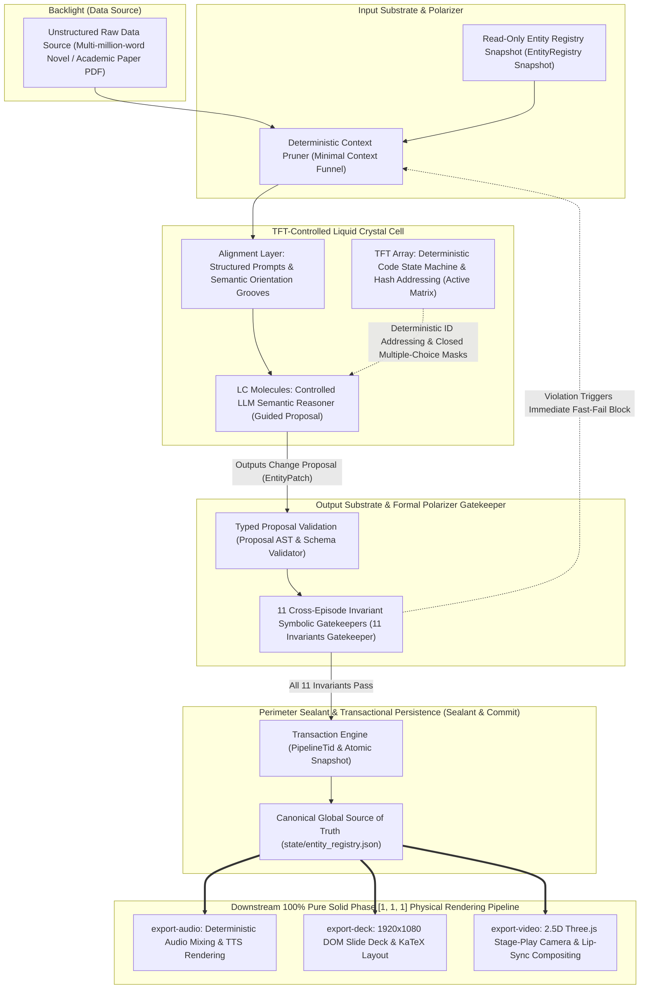
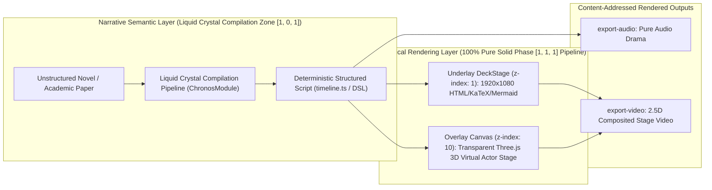

> 🌐 **Language**: **English** | **[简体中文 (`../case_study_liquid_crystal_apostle.md`)](../case_study_liquid_crystal_apostle.md)**

# What Is Liquid Crystal Software, and Why Is It So Useful? — An Engineering Case Study of the Apostle Multimodal State-Compilation Engine
## — From Soft Condensed Matter Physics to Multi-Agent Engineering: How to Tame Large Language Models with a TFT-LCD Architecture to Build Long-Horizon, Low-Entropy, Re-entrant Industrial Production Systems

**Author**: Shiheng (时恒)  
**License**: CC BY-SA 4.0  
**Theoretical Foundation**: Aligned with the *AI Software Engineering 101* theoretical framework (see [Executive Overview of Software Phase Theory](./overview_software_phases.md) and [In-Depth Guide to Software Phase Theory](./software_phases.md))  
**Case Study Engine**: Apostle, an Industrial-Grade Multimodal Content Compilation Engine

---

## 1. Introduction: Why Do We Need "Liquid Crystal Software"?

Over the past two years of wild excitement surrounding Large Language Model (LLM) deployment, countless engineers and technical decision-makers have suffered from a recurring "binary dilemma":
- **Option A (Rigid Solid Rules)**: Hardcode everything using traditional deterministic code. It offers ultra-high determinism, millisecond latency, and zero hallucinations—yet when confronted with multi-million-word classical novels, unstructured long-form academic papers, or emotionally nuanced dialogues, pure rule-based systems immediately become **rigid and brittle, incapable of comprehending the continuous semantic flow of the real world**;
- **Option B (Liquid/Gaseous Pure-Agent Euphoria)**: Equip an LLM with a set of prompts and unconstrained tool-calling to build "fully autonomous end-to-end multi-agent generation." It looks breathtaking in simple demos, yet once scaled to multi-episode long-form serialization, the system rapidly descends into a thermodynamic entropy disaster—**the same character changes names across episodes, asset IDs fracture into multiple duplicates, historical entities are silently dropped, and residual files from failed runs directly contaminate subsequent episodes**.

To break out of this either-or dead end, we must introduce a novel phase paradigm at the intersection of soft condensed matter physics and software engineering—**Liquid Crystal Software** (**Liquid Crystal Phase (Nematic LLM+ Structured Transformation)** `[1, 0, 1]`).

### 1.1 The Four-Phase Causal Phase Space of Software: `[Telos, Process, Schema]`

In *Software Phase Theory* (see [./software_phases.md](./software_phases.md)), we place all computational systems within a three-dimensional causal phase space defined by **Telos ($d_T$), Process ($d_P$), Schema ($d_S$)**:
1. **Ultimate Purpose (Telos / $U_{\text{telos}}$ / $d_T$)**: Whether the system is bound by exogenous goals and potential wells assigned by a human host;
2. **Execution Process (Process / $\Psi_{\text{proc}}$ / $d_P$)**: Whether computational control flow executes on a deterministic crystal lattice or flows adaptively within a semantic manifold;
3. **Result Structure (Schema / $S_{\text{schema}}$ / $d_S$)**: Whether outputs strictly conform to strongly typed formal data contracts.

Along the progressive release of degrees of freedom, software strictly exhibits four phases of matter:

```
1. Solid Phase (Formal Crystalline Software) [1, 1, 1] (Solid / S-Type)
   [Telos Fixed, Process Fixed, Schema Fixed] ──► Core ledgers, compiler ASTs, SQL, Z3 solvers
   [Rigid and brittle; probabilistic LLMs strictly forbidden]
               │
               ▼ [Release semantic process degrees of freedom, but lock output Schema]
2. Liquid Crystal Phase (Nematic LLM+ Structured Transformation) [1, 0, 1] (Liquid Crystal / P-Type)  ◀─── [Primary battlefield for 80% of industrial AI value]
   [Telos Fixed, Process Flexible, Schema Locked] ──► Unstructured long-text to strict state, controlled entity compilation
   [Combines the semantic fluidity of liquids with rigid confinement inside a crystalline data lattice]
               │
               ▼ [Further release microscopic sub-path and structural exploration degrees of freedom]
3. Bounded Liquid Phase (Containerized Agent) [1, 0, 0] (Confined Liquid / E-Type)
   [Telos Fixed, Process Adaptively Flowing] ──► Minimalist code-repair agents, troubleshooting in unknown environments
   [Liquids have no fixed shape; must run inside a Hard-Shell, Soft-Core Bounded Hybrid State Machine (M_hybrid) container]
               │
               ▼ [Remove exogenous teleological potential well (boiling & vaporization)]
4. Unbounded Gas Phase [0, 0, 0] (Gaseous System)
   [Telos, Process, and Schema all unfixed] ──► Sartrean "existence precedes essence" subject vs. Frankfurtian "Bullshit" dissipation
```

### 1.2 Breaking the Deadlock: "Fluidity" and "Crystalline Orientational Order" in Nematic Liquid Crystals

In physics, a **Nematic Liquid Crystal** is an extraordinarily fascinating mesophase: liquid crystal molecules flow freely through space like a liquid (possessing translational degrees of freedom), yet the long axis of every molecule is governed by strong intermolecular forces and external field alignment, compelling them to point with high uniformity along a specific director axis (with orientational order parameter $S = \frac{1}{2}\langle 3\cos^2\theta - 1\rangle \approx 1$).

**Liquid Crystal Software** is the exact engineering realization of this physical property:
- **Fluidity of a Liquid (LLM Semantic Comprehension)**: Leveraging the LLM's high-dimensional manifold interpolation capability to digest unstructured novels, extract character motivations, and infer subtext in dialogue and camera blocking;
- **Rigidity of a Crystal (Deterministic Code & Contracts)**: Outputs **are never allowed to be free-form prose improvised by the LLM**, but must crystallize seamlessly onto a strongly typed state machine and contract lattice via deterministic grammar masks (Guided Decoding) and compilation pipelines.

### 1.3 Case Study Engine: The Apostle Multimodal Long-Text Compilation Engine

To ground this abstract concept in concrete engineering reality, this article examines **Apostle**, an industrial-grade multimodal compilation engine, as a complete end-to-end case study.

Apostle undertakes an extraordinarily demanding production mission: automatically compiling multi-million-word unstructured classical texts (such as *The Cases of Judge Shi* (`《施公案》`)), modern novels, or long-form academic paper PDFs into three cross-modal product lines:
1. **`export-audio` (Pingshu Storytelling & Audio Drama Pipeline)**: Multi-character dialogue, narrator atmosphere building, dialect customization, and cinematic ambient Foley/BGM mixing;
2. **`export-deck` (Academic Presentation Video Pipeline)**: 1920×1080 responsive DOM slide decks, KaTeX mathematical formula rendering, Mermaid architecture flowchart animations, and syntax-highlighted code blocks;
3. **`export-video` (2.5D Stage-Play Video Pipeline)**: A transparent 3D stage powered by Three.js, featuring rigged 3D virtual actors, handheld prop choreography, dynamic stage lighting, particle effects, and word-by-word lip-sync animation.

When generating serialized shows spanning dozens of episodes over several months, entrusting state maintenance directly to an LLM inevitably causes the pipeline to disintegrate into fragments upstream. What Apostle successfully engineered is a rigorous **Liquid Crystal Phase (Nematic LLM+ Structured Transformation)** `[1, 0, 1]` software architecture.

---

## 2. What Is Liquid Crystal Software? — From Physical TFT-LCDs to Apostle's Six Architectural Components

### 2.1 Physical Intuition: Why Doesn't Your Computer Monitor Turn into a Puddle of Mud?

How does a physical Thin-Film Transistor Liquid Crystal Display (TFT-LCD) work?
Liquid crystal molecules themselves are a sliding fluid. If you pour a drop of liquid crystal directly onto a desk, it is nothing more than a chaotic puddle of oily liquid—incapable of displaying images and devoid of structure. Liquid crystal becomes a crisp, razor-sharp 4K display only because an entire precision-engineered, rigid physical apparatus constrains it:
1. **Upper and Lower Glass Substrates**: Clamp the liquid tightly into a flat, uniform layer just a few micrometers thick, forbidding any outward expansion;
2. **Alignment Layers**: Surfaces rubbed microscopically with velvet to carve nanometer-scale micro-grooves, guiding the liquid crystal molecules into a neat initial alignment in the absence of an external electric field;
3. **TFT Active Matrix Array (Thin-Film Transistors)**: Behind the screen sit millions of microscopic silicon-based transistors. Each transistor addresses an independent pixel coordinate and applies voltage with microsecond precision, forcing the liquid crystal molecules at that exact coordinate to tilt accurately;
4. **Polarizers**: Entry and exit optical gratings that allow only light waves matching a specific polarization axis to pass through, completely filtering out all stray light;
5. **Perimeter Sealant**: Hermetically seals the outer perimeter to ensure not a single drop of liquid crystal leaks out.

> **Core Insight**:
> **The value of a display lies in the TFT drive array, not in the liquid crystal fluid. Anyone can buy liquid crystal fluid; the true technological moat is the deterministic silicon-based circuitry capable of pixel-by-pixel addressing and pixel-by-pixel voltage control.**

The exact same law governs AI software engineering: **Anyone can call an LLM API; the true engineering moat is the "mecha armor and transistor array" forged from deterministic Solid Phase (`[1, 1, 1]`) code.**

### 2.2 The Six-Component Engineering Mapping from TFT-LCD to Apostle Liquid Crystal Software

We establish a strict one-to-one mapping between the six physical components of a TFT-LCD panel and Apostle's architectural implementation:

| Physical TFT-LCD Component | Physical Function & Characteristics | Apostle Liquid Crystal Software Implementation | Engineering Responsibility & Constraints |
| :--- | :--- | :--- | :--- |
| **1. Liquid Crystal Molecules (LC Molecules)** | Tilt under electric fields to modulate light transmittance; intrinsically an unordered fluid | **Controlled LLM Semantic Reasoner (LLM)** | Responsible for unstructured text comprehension, dialogue sentence segmentation, camera blocking tension, and action inference (providing local semantic fluidity) |
| **2. Upper & Lower Glass Substrates (Glass Substrates)** | Rigid boundaries confining the fluid within a micrometer-scale gap | **Strongly Typed Data Contracts (TypeScript / Pydantic / DSL)** | Unified contract interface `contract.ts`, dual-layer stage DSL, JSON Schema; strictly forbids free-text escape |
| **3. Alignment Layer (Alignment Layer)** | Nanometer rubbed micro-grooves providing initial physical orientation (director $\vec{n}$) | **Structured Prompts & Contextual Prior Friction Grooves** | Character biography priors, situational rule anchors, Few-Shot exemplars; standardizes the initial baseline of reasoning |
| **4. TFT Active Matrix (Active Matrix)** | Pixel-by-pixel silicon transistor array providing unique physical coordinate addressing and precise voltage drive | **Deterministic State Machine & `EntityRegistry`** | Code-governed Canonical IDs (e.g., `char_001`), `FormEntry` visual form closures, `CommitReceipt` transaction credentials, and AST rewriters; strictly forbids LLMs from inventing primary keys |
| **5. Polarizers (Polarizers)** | Filter out stray light waves whose polarization direction does not match | **Pre-Execution Context Pruning + Post-Execution 11 Cross-Episode Invariant Symbolic Gatekeepers** | `mountFiles` minimal sandbox mounting + 11 hardcoded formal validators at commit time (Fast-Fail) |
| **6. Perimeter Sealant (Sealant)** | Polymer perimeter seal preventing liquid crystal leakage from contaminating circuitry | **Single-Writer Principle & Transaction Snapshot Isolation (`Snapshot Isolation`)** | Exclusive commit via `commitSeriesState`, `state_snapshots/before_epN/` transaction isolation, instant atomic rollback upon failure |

### 2.3 Apostle Liquid Crystal Architecture Diagram



---

## 3. Empirical Counter-Example: What Disaster Strikes If We Don't Build It as a Liquid Crystal? (Post-Mortem of Apostle's Real-World "Episode 9 Phase Collapse")

To truly grasp the value of Liquid Crystal Software, the most effective method is to observe **what catastrophic codomain collapse occurs the moment the upper and lower glass substrates and TFT transistors are removed.**

### 3.1 Theoretical Prediction: The State-Space Complexity Threshold Law ($L^*$)

In *Software Phase Theory* (see [./software_phases.md](./software_phases.md) §1.3), we established the **State-Space Complexity Threshold Law**:
Let the trajectory entropy of a multi-step system task be $\mathcal{H}(H) \approx H \log_2 b$ (where $H$ is the context horizon and entity interaction chain length, and $b$ is the branching factor), and let the symbolic fidelity representation capacity of the model's hidden state be $\mathcal{C}_{\text{model}}$:
- **Sub-Critical Regime ($H \log_2 b \le \alpha \cdot \mathcal{C}_{\text{model}}$)**: Hidden-state capacity is sufficient to encapsulate entity constraints, and the attention mechanism maintains geometric manifold invariance, exhibiting coherent behavior that "looks like a real human thinking";
- **Super-Critical Regime ($H \log_2 b > \alpha \cdot \mathcal{C}_{\text{model}}$)**: Once the critical threshold $L^*$ is crossed—or in physical terms, once **temperature exceeds the isotropic clearing point ($T_{NI}$)**—the system undergoes an irreversible **Phase Collapse**, and the LLM irreversibly degrades into high-entropy thermodynamic dissipation and Frankfurtian "Bullshit."

### 3.2 The First 8 Episodes of *The Cases of Judge Shi* (`《施公案》`): Why Did Early Versions Remain Stable?

During the first 8 episodes of Apostle's serialized production of *The Cases of Judge Shi* (`《施公案》`), the system managed to preserve cross-episode character identity coherence precisely because it retained the most basic "rigid contracts" at the time (see ADR-0001 §1):
- **`glossary.json` as the Single Source of Truth for Identity**: Preserved the canonical Chinese name (`entityName`) of every entity;
- **Single-File Per-Episode Append**: `${entityId}.ts` used a deterministic storage structure consisting of a "single-file base definition + per-episode appended derived blocks."

At the same time, in those early episodes, the number of core characters requiring actual entity file generation within a single episode was small. For instance, in Episode 1, although upstream `glossary-audit` identified **47 entities** from the original text, 12 of them were pruned along narrative beats by `destiny-weaver`, and 22 non-core entities were removed by `Deleter`, leaving only **13 core entities** that actually generated `.ts` state files.

### 3.3 Episode 9: Real-World Post-Mortem of the "Phase Collapse" After Shattering the Glass Substrates

When the codebase evolved to commit `015e7c15`, in an effort to migrate the directory layout to `state/entity` + `state/events` and pursue so-called "flexible decoupling," a refactoring inadvertently **shattered the rigid glass substrates clamping the liquid crystal molecules** (ADR-0001 §1, ADR-0002 §1):
1. **Discarded the Single Source of Truth for Chinese Names**: Directly deleted `glossary.json`, leaving subsequent episodes without any deterministic source for canonical Chinese names;
2. **Replaced Derived Merging with Blind LLM File Naming**: Allowed the LLM to name each episode's derived files on its own, scattering LLM-improvised `*_ep9.ts` files across the disk;
3. **Undeclared System Inputs Silently Dropped**: The newly added `historical_events` input was not explicitly declared in any `module.json` and was silently dropped by the orchestrator's default rules, causing the historical entity list received by `glossary-audit` to become an empty array `[]`.

When serialization reached Episode 9, the fluid—stripped of its rigid contract constraints—spiraled completely out of control. The system crossed the clearing point $T_{NI}$ and suffered a catastrophic **Phase Collapse**:

```
[Live Post-Mortem of the Episode 9 Phase Collapse After Shattering Contracts (ADR-0001 & ADR-0002)]
┌────────────────────────────────────────────────────────────────────────┐
│ 1. 33 Historical Entities Silently Swallowed:                          │
│    Due to the lack of input contract validation and explicit error     │
│    reporting, VisualEntityFilter in the worldview module silently      │
│    executed `continue` when encountering missing state, directly       │
│    swallowing 33 historical entities! Furthermore, minor characters    │
│    pruned back in Episode 1 (such as the clerk `character_clerk`),     │
│    when re-appearing in later episodes under a new Pinyin ID           │
│    (`character_shu_li`), could no longer be aligned with their         │
│    original identity because there was no full-roster registration.    │
│                                                                        │
│ 2. Severe Three-Way Asset Split of the Protagonist:                    │
│    Because asset ID (`assetId`) suffixes were handed over to the LLM   │
│    to generate and naming conventions varied across modules, inside    │
│    `artifacts/output_shigongan/assets/characters`, the protagonist     │
│    "Judge Shi" ("施公") alone fractured into three separate asset sets:│
│    - asset_shi_gong_01                                                 │
│    - char_shi_gong_01                                                  │
│    - character_shi_gong                                                │
│    Meanwhile, not a single `_02` variant existed anywhere in the       │
│    repository—what remained were pure fossils of naming drift!         │
│                                                                        │
│ 3. Deterministic Symbolic Computation Ignored as a "Mere Suggestion":  │
│    The underlying NLP funnel in the code had already computed:         │
│    character_jiu_huang ≈ character_jiuhuang (similarity score: 1.00)   │
│    Yet because the architecture passed this result to the LLM merely   │
│    as a "reference suggestion" rather than enforcing it via code,      │
│    combined with the lost historical roster, downstream modules        │
│    redrew "Jiu Huang" ("九黄") and "Qi Zhu" ("七珠") from scratch!     │
│                                                                        │
│ 4. Non-Reentrant State Commits & Failed Residuals Contaminating Runs:  │
│    Due to the absence of transactional snapshot isolation, half-baked  │
│    files like `*_ep9.ts` left behind by failed Episode 9 attempts      │
│    remained directly inside `state/`, contaminating the initial input  │
│    of the very next rerun.                                             │
└────────────────────────────────────────────────────────────────────────┘
```

**This real-world engineering incident profoundly validated the core thesis of ADR-0002: "If you don't clamp it down, it is just a puddle of liquid; the moment the glass cracks, the liquid leaks out, and dead pixels don't even trigger an alarm."** Only by locking the LLM back inside a transistor array built from strongly typed contracts, deterministic adjudication, and snapshot transactions can the system achieve industrial-grade reliability.

---

## 4. Why Is Liquid Crystal Software So Useful? — Five Engineering Values Validated by Apostle

Following that post-mortem, Apostle established the **R1–R5 Liquid Crystal Rules** centered around **ADR-0001 (Entity Registry)**, **ADR-0002 (Liquid Crystal State Management)**, and **ADR-0003 (Unified Dual-Layer Stage)**, completing its architectural evolution from a fragile liquid state to a controlled **Liquid Crystal Phase (Nematic LLM+ Structured Transformation)** `[1, 0, 1]`.

Five engineering properties demonstrated by this architecture in production clearly answer why Liquid Crystal Software is so useful:

---

### Value 1: Effectively Containing Long-Horizon "State Amnesia and Identity Split" (R1 Proposal-Commit Separation + R2 Single-Writer Snapshot + R5 Transaction Provenance Tracing)

In unconstrained liquid software, LLMs are often allowed to directly generate and overwrite state files—the primary root cause of long-horizon amnesia and identity splitting. The very first rule of Liquid Crystal Software is to **strip the LLM of the power to write directly to disk**.

#### 1. Rule R1: The LLM Only Produces "Proposals"; Deterministic Code Holds Exclusive Adjudication and Disk-Write Authority
Between the LLM (liquid crystal molecules) and the actual on-disk state stands an explicit type boundary:
- At every stage, the output of the LLM is strictly a **structured change proposal (`EntityPatch` or `Proposal`)**;
- All filenames, physical paths, Canonical IDs, and Asset IDs (standardized as a 1:1 mapping `assetId = entityId`, or variant form `${entityId}@${formId}`) are exclusively generated and derived by deterministic TypeScript code;
- **Red-Line Criterion**: Across the entire codebase, `grep` must return zero instances of code that "takes a raw string returned by the LLM and writes it directly to disk as a file path or ID."

```typescript
// Canonical Entity ID: locked down via TypeScript Branded Types
export type EntityId = string & { readonly __brand: 'EntityId' };
export type EntityKind = 'Character' | 'Prop' | 'Scene' | 'Concept';

// Visual Form Variant: ADR-0002 §4.1 D-Form closed set (free-form variants rejected)
export interface FormEntry {
  formId: string;         // Matches ^[a-z][a-z0-9_]*$, 'normal' is the mandatory system default
  label: string;          // Canonical display Chinese label (exact match, e.g., '官服' [Official Robe], '微服私访' [Incognito], '重伤' [Severely Injured])
  aliases: string[];      // Previously encountered Chinese aliases
  firstEpisode: string;   // Episode where first introduced (e.g., 'ep1')
}

// Canonical Entity Registry Entry: Single Source of Truth; LLM is strictly forbidden from adding/removing fields
export interface EntityRegistryEntry {
  id: EntityId;           // Canonical permanent ID, e.g., 'character_yang_yuwei', never changes
  kind: EntityKind;       // One of the four ontological categories
  entityName: string;     // Canonical Chinese name, e.g., '杨玉威' (Yang Yuwei)
  nameAliases: string[];  // Other Chinese appellations seen in history (e.g., '杨提督', '提督大人')
  idAliases: EntityId[];  // Merged non-canonical historical ID aliases (e.g., 'character_yangyuwei')
  firstEpisode: string;   // First appearance episode
  lastEpisode: string;    // Most recent appearance episode
  forms: FormEntry[];     // Registered closed set of constrained visual forms (ADR-0002 §4.1)
}

// Transaction Commit Receipt: atomically written to state/commit_receipt.json, certifying state lineage
export interface CommitReceipt {
  version: 1;               // Strict version 1
  committedEpisode: string; // Episode owning the commit (e.g., 'ep1', 'ep9')
  pipelineTid: string;      // Corresponding Pipeline transaction UUID, preventing episode skipping and dirty re-entry
}
```

#### 2. Rule R5 & Anti-Episode-Skipping Guard: `pipelineTid` Transaction Certification and Snapshot Receipt (Provenance Tracing)
In multi-episode serialized production (Series Mode), a subtle yet common hazard occurs when "Episode 8 aborts midway through execution, yet the orchestrator proceeds to run Episode 9, treating uncommitted or incomplete state as the historical baseline."
In ADR-0001 D4.1 and ADR-0002 R5, Apostle established the **`pipelineTid` Transaction Certification Mechanism**:
- Every time a Pipeline starts, deterministic code calls `crypto.randomUUID()` to generate a unique transaction ID (`pipelineTid`) and writes it to `<episodeDir>/pipeline_transaction.json` with an initial status of `running`;
- Only when every single topological node in the current episode's DAG finishes execution is the transaction status set to `complete`; if truncated midway via `--stop-at` or aborted by a node exception, the status becomes `stopped`, and **the state machine refuses to commit**;
- When `commitEpisodeState` performs the atomic state swap-in, it writes a commit receipt to `state/commit_receipt.json`, explicitly recording which episode and which `pipelineTid` ran to completion to produce that state;
- Before the next episode (Episode $N$) begins filming, Gatekeeper Invariant I9 strictly verifies that the receipt for the previous episode (Episode $N-1$) exists and matches the expected episode number. If the state stopped at Episode $N-2$ or the previous episode failed to complete its commit, **the system immediately triggers a Fast-Fail abort**, structurally eliminating silent state loss caused by episode skipping.

#### 3. Rejecting Fragile Regexes: Safe Abstract Syntax Tree (AST) Rewriting via the TypeScript Compiler API
When candidate IDs proposed by the LLM are remapped to canonical IDs by `identity.ts`, or when entity references in a script change, traditional approaches often rely on regular expressions (Regex) for string replacement. However, in code containing complex TypeScript logic, type annotations, object literals, dictionary bracket accesses, and comments sharing the same words, regex replacement easily corrupts comment words or local variable substrings.
In `ontology/entity-id-rewriter.ts`, Apostle uses the **official TypeScript Compiler API (AST engine)**:
- Parses script code into an Abstract Syntax Tree via `ts.createSourceFile`;
- Recursively traverses AST nodes (`Identifier`, `PropertyAccessExpression`, `ElementAccessExpression`), performing exact rewrites exclusively on nodes that belong to an entity ID syntactic context;
- After rewriting, runs a full TypeScript compiler Diagnostics Scan to guarantee that the rewrite process never breaks syntactic structure.

#### 4. Rule R2: Single-Writer Snapshot, Full-Roster Coverage, and Re-entrancy Verification
The global source-of-truth file `state/entity_registry.json` is written exclusively by deterministic code in `commitSeriesState`.
- **Original Text Full-Roster Coverage (`registry ⊇ files`)**: `entity_registry.json` records all original-text entities identified by `glossary-audit` (for example, all 47 entities identified in Episode 1; even though 34 of them did not generate `.ts` entity files due to narrative beat pruning, their canonical IDs and Chinese names are permanently registered in the registry). When those minor characters (such as the clerk) reappear in later episodes, deterministic code matches their original ID by Chinese name, drastically reducing cross-episode identity fracture;
- **Read-Only Snapshot Protection**: When workflow modules execute Episode $N$, they read the `before_epN/` snapshot strictly via system inputs and are forbidden from directly mutating the series state directory from inside a module;
- **Two-Episode Replay Fixture & Cold-Start Structural Test (ADR-0002 §7 Acceptance Criteria)**: Submitting the exact same snapshot and artifacts twice in a row produces byte-for-byte identical state files inside `state/` (idempotency), except for the new transaction UUID in `commit_receipt.json`; running Episode 1 on an empty `seriesRootDir` bootstraps state self-consistently from scratch, and deleting all state files allows complete restoration solely from the `before_epN/` snapshot—the system guarantees re-entrancy through formal contracts and snapshots rather than relying on leftover files to survive.

---

### Value 2: Transforming Open-Ended Guessing into Deterministic Table Lookup and "Closed Multiple-Choice Questions"—And How to Gracefully Tolerate "Dead Pixels and Color Cast" (R3 Determinism-First & Minimum Model Principle MM)

Why do so many AI systems suffer from exorbitant inference costs and frequent duplicate entities? Because they hand over table lookups and normalization tasks—which deterministic code can execute in $O(1)$ time—to stochastic LLMs for open-ended generation.

Apostle enforces the **Minimum Model Principle (MM)**:
> **Whatever deterministic code can adjudicate with exact precision is never handed to an LLM to guess; the LLM is invoked only to process the "semantic remainder" left after deterministic rule filtering, and the LLM's answer must pass through a deterministic code validator once again.**

#### 1. Four-Step Deterministic Identity Adjudication Flow (`series-state/identity.ts`)
Before `glossary-extract` ever invokes the `Auditor` LLM, candidate entities pass through the shared pure-function adjudicator `identity.ts` (ADR-0001 D2):
1. **Exact & Normalized ID Match**: Executes `normalizeEntityId(id)` (strips type prefixes, removes all non-alphanumeric characters, converts to lowercase). If, within the same `kind`, it equals a canonical ID or historical `idAliases` entry in `registry`, **deterministic code remaps it directly** to the canonical ID and automatically records the alias;
2. **Exact Chinese Name & Alias Match**: Executes `normalizeEntityName(entityName)` (trims leading/trailing whitespace). If, within the same `kind`, it equals a canonical Chinese name or `nameAliases` entry, **deterministic code likewise remaps it directly**;
3. **One-to-Many Ambiguity Triggers Immediate Fast-Fail**: If a candidate entity simultaneously hits multiple canonical IDs (e.g., its ID hits Entity A while its Chinese name hits Entity B), the adjudicator **immediately `throw`s an exception**—guessing is strictly forbidden;
4. **Semantic Remainder Handed to LLM + Code Re-Verification (Eval-in-the-loop)**: Only the remainder that misses both deterministic rules is handed to the `Auditor` LLM for semantic judgment; moreover, the decision returned by the LLM must pass code validation—if a newly proposed ID's Chinese name collides with an existing name in `registry`, it is rejected on the spot and forced to self-correct within an eval-in-the-loop cycle.

#### 2. Separating Visual State from Narrative Detail: Closed Multiple-Choice Questions for Visual Form Variants (D-Form, ADR-0002 §4.1)
In early designs, Episode 1 registered a character visual form `"injured"`, and in Episode 2 the LLM output a new form `"shot in the knee with an arrow"`, causing downstream modules to redraw character assets unnecessarily.
To solve this, Apostle (ADR-0002 §4.1) decouples **Visual State (finite closed set)** from **Narrative Detail (free text)**:

```typescript
changeForm('injured')                                // Visual state (finite closed set): must hit forms already registered in registry
perform('膝盖中了一箭，一瘸一拐')                      // Narrative description (free text): handed to action and dialogue layers for expressive detail ("shot in the knee with an arrow, limping")
```

When a visual form requirement arises in the script:
1. **Deterministic Match First**: If `label / alias` exactly hits a registered `form`, deterministic code directly reuses the existing visual asset `${entityId}@${formId}`;
2. **LLM Closed Multiple-Choice Question**: If no exact match is found, the LLM is forbidden from freely spelling out filenames; instead, it must answer a **closed multiple-choice question**—either selecting an existing form to reuse from the character's registered `forms` candidate list, or proposing a new form along with an explicit justification for why redrawing assets is necessary;
3. **AST Compilation Gatekeeper**: The AST validator in `script-adaptation` inspects every `changeForm(...)` call; its argument must be a string literal that hits the registered closed set, otherwise it is rejected and returned with the list of valid options.

#### 3. Engineering Realism: The Law of "Dead Pixels" and "Color Cast" in Liquid Crystal Displays
It is important to state with scientific rigor: **Introducing determinism-first filtering and closed multiple-choice masks does not reduce the probability of LLM errors to an absolute $0$; rather, it drastically reduces error probability and quarantines residual errors within a bounded, controllable blast radius.**

This mirrors real-world physical TFT-LCD panels: even with precision glass substrates and TFT drive arrays, every manufactured LCD panel inevitably exhibits microscopic **Dead Pixels and batch-level Color Cast (Color Shift)**—no two LCD screens in the world are 100% identical down to every molecule. The exact same phenomenon occurs in Apostle (see ADR-0001 §4):
- Entities sharing identical literal names or normalized IDs are merged with 100% determinism by code;
- However, purely **semantic synonymous duplicates** (for instance, when the original classical text refers to the exact same location first as `"县衙大堂"` [County Magistrate's Main Hall] and later as `"府衙公堂"` [Prefectural Court Hall], which the LLM extracts as `scene_yamen_court` and `scene_county_yamen`), having neither literal characters nor Pinyin in common, ultimately rely on the LLM's semantic judgment—where the possibility of a misjudgment (a "Dead Pixel" or "Color Cast") still exists.

Yet this is precisely where Liquid Crystal Software proves vastly superior to pure liquid software:
- In unconstrained pure liquid software, a local error propagates through the fluid, causing the entire screen to "leak liquid" and fail catastrophically (such as Episode 9 swallowing 33 historical entities);
- In Liquid Crystal Software, every pixel is physically isolated by the TFT lattice and perimeter sealant. Even if an individual entity suffers an LLM semantic miss ("Dead Pixel" or "Color Cast"), the overall system continues operating stably; an engineer simply adds a one-line mapping to the manual alias table in `config.json` (equivalent to loading an **ICC color calibration profile** onto a monitor) or reruns that specific node locally via `--submodule` to repair it at minimal cost.

---

### Value 3: Zero-Trust Symbolic Gatekeepers That Stop Structural Violations at Compile Time Rather Than Expensive Render Time (R4 11 Invariant Validators)

In a multimodal generation pipeline, physical computational costs vary by orders of magnitude across stages:
- Upstream text AST parsing and state merging: takes **milliseconds to hundreds of milliseconds**, at virtually zero compute cost;
- Midstream audio TTS voice cloning and lip-sync alignment: takes **several minutes to over ten minutes**, at moderate compute cost;
- Final 1920×1080 3D stage rendering and ray-traced video export: takes **tens of minutes to several hours**, consuming expensive GPU VRAM.

If a minor type error is allowed to slip through during upstream liquid-crystal compilation, it triggers massive wasted compute downstream.

To prevent this, right before `commitSeriesState` writes physically to disk, Apostle enforces **11 Zero-Trust Cross-Episode Symbolic Invariant Gatekeepers (Invariants I0–I10)** inside `app/src/orchestrator/series-state/invariants.ts`, acting like a strict Rust compiler. If even a single invariant is violated, the transaction immediately throws a Fast-Fail exception and aborts with a full rollback:

```
[Apostle's 11 Cross-Episode State Invariant Compiler Gatekeepers (invariants.ts)]
├─ I0. Series State File Schema Strong Contract & JSON Integrity (I0_SCHEMA_INVALID)
│      entity_registry.json, historical_events.json, map_state.json, and script_summary.json
│      must strictly pass Zod Schema validation, preventing corrupted data formats from seeping downstream.
├─ I1. Entity Directory Derived Filename & Non-Regular Entry Prohibition (I1_FORBIDDEN_FILENAME / I1_NON_REGULAR_ENTRY)
│      Inside state/entity/, residual temporary fragment files such as *_ep*.ts or *_derived.ts are strictly
│      forbidden, and every entry in the directory must be a regular single file (subdirectories, symlinks, etc. forbidden).
├─ I2. Files Strictly Subset of Registry Source of Truth (I2_REGISTRY_MISSING / I2_ORPHAN_ENTITY_FILE / I2_ALIAS_FILE_EXISTS)
│      files ⊆ registry: Every entity .ts file must be legitimately registered in the registry (no orphan files);
│      merged alias IDs are strictly forbidden from possessing independent entity files.
├─ I3. Map Key and Kind Prefix Isomorphism (I3_KEY_MISMATCH / I3_KIND_MISMATCH)
│      The Registry Map Key must equal entry.id, and entry.kind must strictly match the category derived from
│      the ID prefix (character_ maps to Character, prop_ maps to Prop, etc.), eradicating cross-species category confusion.
├─ I4. Global Uniqueness of Chinese Names and Aliases Within the Same Kind (I4_DUPLICATE_NAME)
│      Within the same EntityKind, no two distinct entities—after normalization via normalizeEntityName—are ever
│      allowed to share the same entityName or any nameAliases, eliminating duplicate accounts and impostor entities.
├─ I5. Normalized ID Uniqueness, Alias Isolation & Prefix Fidelity (I5_DUPLICATE_NORMALIZED_ID / I5_ALIAS_EQUALS_CANONICAL_ID / I5_DUPLICATE_ID_ALIAS / I5_ALIAS_KIND_MISMATCH)
│      Within the same kind, normalizeEntityId(id) must be unique; alias IDs must never collide with existing canonical IDs
│      or be registered across multiple entities, and all alias IDs must preserve their host kind's dedicated prefix (e.g., character_).
├─ I6. Monotonic Episode Ordering & Visual Form Lifecycle Validity (I6_EPISODE_ORDERING / I6_EPISODE_EXCEEDS_COMMITTED / I6_FORM_EPISODE_OUT_OF_BOUNDS / I6_SCRIPT_SUMMARY_EPISODE_EXCEEDS_COMMITTED)
│      Every entity must satisfy firstEpisode <= lastEpisode <= committedEpisode; every visual form variant's
│      form.firstEpisode must fall strictly within the entity's lifecycle interval [firstEpisode, lastEpisode].
├─ I7. Historical Events Log Existence & Provenance Monotonicity (I7_HISTORICAL_EVENTS_MISSING / I7_EVENT_EPISODE_EXCEEDS_COMMITTED)
│      state/historical_events.json must exist; every plot event recorded inside it must have episode <= current committedEpisode.
├─ I8. Single-File Derived Code Block Marker Structure & Ascending Order Fidelity (I8_MALFORMED_MARKER / I8_UNPAIRED_DERIVED_BLOCK / I8_DUPLICATE_DERIVED_BLOCK / I8_UNORDERED_DERIVED_BLOCK / I8_BLOCK_EPISODE_EXCEEDS_COMMITTED)
│      Inside entity .ts files, derived blocks wrapped by // --- START [EPISODE epN] Derived State --- and // --- END --- markers
│      must be strictly paired and closed, ordered in strictly ascending episode sequence, free of duplicate markers per episode, and never exceed committedEpisode.
├─ I9. Transaction Commit Receipt Consistency & Anti-Episode-Skipping Guard (I9_COMMIT_RECEIPT_MISSING / I9_COMMIT_RECEIPT_INVALID / I9_COMMIT_RECEIPT_EPISODE_MISMATCH)
│      state/commit_receipt.json must exist and be valid; its committedEpisode must match the expected episode number—
│      verified against ep(N-1) before taking a snapshot and against ep N upon commit, completely blocking episode skipping.
└─ I10. 3D Asset Repository & Entity Registry Isomorphism (I10_ASSET_INVALID_JSON / I10_ASSET_UNREGISTERED_ENTITY)
       Asset metadata under assets/{characters,props,scenes} must be valid JSON, and every referenced entityId
       must be legitimately registered in the registry (or the whitelisted narrator), preventing rogue assets from invading.
```

All 11 gatekeepers are implemented in 100% deterministic TypeScript code and execute static verification right before state commits hit the disk—acting like floodgates that intercept structural violations and cross-episode conflicts at compile time, never allowing dirty data to flow into the expensive downstream rendering pipeline.

---

### Value 4: Dual-Layer Stage Decoupling and "Submodule-Level Local Re-rendering," Ending End-to-End Blind-Box Gacha Rerolls (ADR-0003 Unified Dual-Layer Stage Architecture & Fine-Grained Rebuild Mechanism)

What is the single most maddening experience for creators in traditional AIGC production workflows?
**"Changing a single word means re-pulling the entire gacha blind box."**
When a director merely wants to tweak the voice acting or emotional delivery of two lines of dialogue, traditional end-to-end generation systems often force a full pipeline rerun from scratch—causing camera angles, actor blocking, and stage lighting that were already approved to drift completely.

Guided by **ADR-0003 (Unified Dual-Layer Stage Architecture)** and the orchestrator's **hierarchical caching and fine-grained rebuild mechanism**, Apostle achieves orthogonal decoupling between semantic choreography and physical rendering at the output boundary of the liquid crystal phase:



#### 1. Absolute Orthogonal Decoupling Between Narrative Semantics and Physical Rendering
- **Narrative Semantic Layer (Upper Liquid Crystal Phase `[1, 0, 1]`)**: The LLM is solely responsible for compiling the raw source text into a **deterministic script DSL (`timeline.ts`)**. Once compilation completes, every single line of code in the script (when a character enters, which coordinate they walk to, what gesture they perform, which line of dialogue they speak) is formally fixed and contains zero randomness;
- **Physical Rendering Layer (Lower Pure Solid Phase `[1, 1, 1]`)**:
  - **Underlay (`z-index: 1`)**: A lossless 1080P DOM stage (`#deck-stage`) driven by Headless Chromium, responsible for laying out typography cards, KaTeX mathematical formulas, and Mermaid diagrams with sub-pixel precision;
  - **Overlay (`z-index: 10`)**: A full-screen transparent Three.js stage (`#render-canvas`) configured with `alpha: true`, where 3D virtual actors walk across a transparent floor with skeletal animation and physical shadow-catcher materials, casting shadows cleanly onto the DOM slide deck behind them;
  - **Cross-Layer Coordinate Projection**: By extracting spatial bounding boxes of DOM elements via `slide_elements_layout.json`, when a 3D actor executes `kickElement("formula_1")` or `spawnAtElement("node_2")`, spatial unprojection calculations are performed 100% by pure mathematical matrices—the LLM never participates in spatial geometry math!

#### 2. Reverse-Index DAG Pruning Across Three Export Pipelines and Phase Boundaries
Rather than maintaining three separate codebases for audio dramas, academic slide videos, and 3D stage plays, Apostle dynamically generates execution graphs from a single unified DAG via **Reverse-Index DAG Pruning**:

| Export Pipeline Target | Active DAG Nodes | Active Core Node Roster | Liquid Crystal vs. Solid Phase Boundary | Final Compiled Deliverables |
| :--- | :---: | :--- | :--- | :--- |
| **`export-audio`**<br>(Pingshu / Audio Drama / Podcast) | **12 Nodes** | `script-chunker` → `glossary-extract` → `glossary-audit` → `worldview-adapter` → `glossary-adapter` → `script-adaptation` → `casting-director` → `audio-drama` → `bgm-director` → `export-audio`, etc. | **Fluid Core**: Dialogue vividness & voice timbre prompts<br>**Solid Shell**: ECS entity normalization dictionary, dialogue length cap ($\le 200$ chars), audio stream assembler | `.mp3` broadcast-grade mix<br>`.srt` bilingual aligned subtitles<br>`audio_timeline.json` |
| **`export-deck`**<br>(Dynamic Academic Slide Video) | **14 Nodes** | Builds on the 12 audio nodes by mounting `slide-director` and `export-deck` in parallel (physically pruning all 3D model and action nodes) | **Fluid Core**: Academic card distillation & layout outline<br>**Solid Shell**: KaTeX syntax checker, DOM AABB zero-overlap physical collision gatekeeper, Chromium keyframe capture | 1080p `shadow_play_deck.mp4`<br>`slide_blueprint.json`<br>`.srt` subtitles |
| **`export-video`**<br>(ADR-0003 Unified Dual-Layer Transparent Stage) | **18 Nodes** | Fully activated: `slide-director` + `actor-factory` + `prop-factory` + `camera-action` + `avg-export` + `export-video` (physically retiring legacy `scene-factory` and `map-render`) | **Fluid Core**: Stage blocking & physical emotion metaphors<br>**Solid Shell**: Three.js spatial unprojection, skeletal prop attachment system, dual-layer composite renderer, FFmpeg muxer | 1080p `shadow_play_video.mp4`<br>3D action & lip-sync video<br>`.srt` subtitles |

#### 3. Millisecond-Precision Compiled Output: 8 Deterministic Timeline Tracks (`app/src/modules/avg-export/tracks/`)
Before entering final audiovisual synthesis, semantic script instructions authored by the upper-layer LLM must be compiled by `avg-export` into **8 millisecond-aligned deterministic physical timeline tracks**:
1. **`action-track.ts` (Action & Spatial Trajectory Track)**: Precisely computes skeletal animation start/end times, movement velocity interpolation, scaling ratios (`setScale`), and 3D stage coordinates for every character;
2. **`audio-track.ts` (Voice & Lip-Sync Drive Track)**: Mounts sliced TTS audio segments and drives character word-by-word viseme articulation and audio-visual synchronization at millisecond timestamps;
3. **`bgm-track.ts` (Background Music Engineering Track)**: Automates multi-track looping, fade-in/fade-out envelopes, and dramatic emotional volume ducking curves;
4. **`camera-track.ts` (Camera Blocking & Maneuver Track)**: Records absolute 3D camera coordinates, look-at targets (`lookAt`), depth of field, and fourth-wall-breaking rush-zoom dynamics;
5. **`lighting-track.ts` (Stage Lighting Physics Track)**: Precisely schedules three-point lighting, spotlight tracking targets, ambient color temperature, and dramatic chiaroscuro contrast;
6. **`prop-track.ts` (Handheld Prop Choreography Track)**: Drives prop attachment to character bones (`left_hand` / `right_hand`), parabolic throwing trajectories, and summoning particle effects;
7. **`scene-track.ts` (DOM Slide Animation Track)**: Drives underlay slide transitions, formula card spotlight/reveal focus (`spotlight` / `reveal`), and impact shake animations when struck;
8. **`sfx-track.ts` (Ambient Foley Sound Effects Track)**: Aligns sound-effect burst points to the exact millisecond of punches, footsteps, gavel slams, and shattered formulas.

#### 4. Checkpoint Resume and Submodule / Single-Line Surgical Re-rendering (`resume` / `--rebuild` / `--submodule`)
Because every module's output and state progression is grounded strictly in physical file contracts (`agy_output.json` and `ChronosModule`'s `checkpoint.json`), Apostle provides three granularities of deterministic recovery and surgical re-rendering at the orchestrator layer:
1. **Seamless Checkpoint Resume (`resume` default mode)**: If a pipeline is interrupted midway through a node or narrative Tick due to network fluctuations, re-running the original command automatically detects existing on-disk `agy_output.json` and `checkpoint.json` files, skips all completed upstream nodes and Ticks, and resumes execution from the exact breakpoint;
2. **Single-Node Cascading Rebuild (`--rebuild=<step>`)**: Cleans the cache only for the target node and its downstream dependents, while keeping upstream locked worldview and script states untouched;
3. **Submodule & Single-Line Surgical Rebuild (`--rebuild=<step> --submodule=<tracks> --lines=<lines>`)**: When a director only wants to re-record the voice acting for two specific lines of dialogue, there is no need to start over—simply invoke the surgical rebuild command:
   ```bash
   bun run app/scripts/run.ts --series=<PROJECT_DIR> --config=<PROJECT_DIR>/config.json --target=export-audio --rebuild=audio-drama --submodule=tts-daemon --lines=chunk_1_beat_1_L1,chunk_1_beat_1_L2
   ```
   The orchestrator automatically backs up the original output directory to `<outputDir>_bak_<idx>`, requests re-synthesis exclusively for the specified `tts-daemon` track and the two specified dialogue lines (`chunk_1_beat_1_L1,chunk_1_beat_1_L2`), and physically inherits the audio and timeline state for all other unmodified lines directly from the `_bak` backup—permanently eliminating the traditional end-to-end AIGC pain point where "changing a single sentence forces re-pulling the entire episode gacha"!

---

### Value 5: A Transferable Universal Blueprint—Why the Liquid Crystal Phase Is Industry's Primary Workhorse for AI Deployment

When planning AI strategy, many enterprise technology leaders fall into one of two extremes: either obsessing over reinventing the wheel by training general-purpose foundation models with zero practical differentiation, or blindly trusting unbounded autonomous agents that claim to "automatically do all human work."

Apostle's engineering practice demonstrates a crystal-clear universal law for the entire industry:
> **In the real commercial world, 80% of high-value business scenarios are fundamentally transformations from complex unstructured inputs into strictly structured business actions—and this is the absolute sovereign territory of Liquid Crystal Software (`[1, 0, 1]`)!**

We can seamlessly transplant Apostle's six liquid-crystal architectural components into virtually any mission-critical enterprise scenario:

| Business Scenario | Liquid Crystal Molecules (Controlled LLM) | Glass Substrates (Strongly Typed Contracts) | TFT Transistor Array (Deterministic State Machine) | Polarizers (Symbolic Gatekeeper Validators) |
| :--- | :--- | :--- | :--- | :--- |
| **Financial Credit Document Auditing** | Identify risk factors across multi-page unstructured financial statements, audit footnotes, and contract clauses | Bank compliance credit review JSON Schema (`CreditAssessment`) | Unified Social Credit Code, enterprise balance-sheet account $O(1)$ index | Debit-credit accounting identity check, balance-sheet reconciliation verification, credit-limit red-line filter |
| **Smart Healthcare Medical Record Structuring** | Parse physician handwritten notes, dictated audio transcripts, and multi-department lab reports | HL7 / FHIR international healthcare data exchange standard contracts | Unique inpatient medical record number (EMR ID), ICD-11 standard disease coding dictionary | Drug-drug interaction contraindication rule check, allergy history mutual-exclusion conflict interception, dosage extreme-value gatekeeper |
| **Cross-Border Legal Contract Review** | Review hundreds of pages of concurrent English M&A agreements, comprehending indemnification and liability semantics | Legal fact triples and transaction closing condition DSL | Target company cap-table graph, contracting legal entity registry | Closing condition precedent dependency DAG acyclicity check, governing-law statute conflict assertion |
| **Discrete Manufacturing Production Scheduling** | Comprehend natural-language custom client requirements and engineering change-order notes | ERP / MES production work-order and BOM strongly typed definitions | Shop-floor machine tool unique physical asset IDs, real-time material inventory hash table | Capacity ceiling conservation constraint, process precedence dependency matrix, occupational safety physical boundary gatekeeper |

In these high-stakes environments, no organization can afford the legal liabilities and financial losses triggered by an LLM freely "hallucinating nonsense." With its natural advantage of **"hard shell, soft core—semantic comprehension by the model, state governance by deterministic code,"** Liquid Crystal Software forms the indestructible **Institutional Crystal** and engineering bedrock of modern enterprise AI systems.

---

## 5. Conclusion & Methodological Appendix: The Liquid Crystal Architecture Self-Check Checklist

Returning to our soft condensed matter physics metaphor:
Large Language Models represent a rare form of **high-dimensional fluid intelligence** in the history of human computation. Yet an untamed fluid merely spills along the path of least resistance, ultimately evaporating into useless foam through thermodynamic dissipation.

True software engineers are not "prompt magicians" burning incense and praying before a terminal screen; they are **physicists and master machinists** wielding transistors, silicon wafers, optical polarizers, and precision lathes. By encasing Large Language Models within glass substrates forged from strongly typed contracts, laying down nanometer-precision alignment priors, and welding a TFT code lattice capable of billions of exact pixel addressings right behind them, we illuminate a crisp, deterministic, and controllable landscape of modern digital civilization atop a chaotic fluid.

### Appendix: Liquid Crystal Architecture Checklist (5 Life-or-Death Red Lines Before Production Release)

Before pushing any production module that claims to use an LLM onto the production line, team leads must verify it item by item against these five military rules:

- [ ] **Q1. Absolute Proposal Isolation Check**: Does any logic in this module's codebase directly parse a raw LLM output string as a filename, physical file path, or database primary key? (**Must be 100% NO**)
- [ ] **Q2. Determinism-First Check**: Before invoking the LLM, have all $O(1)$ deterministic code mechanisms—such as hash-table lookups, regular expressions, and prefix normalization—been exhausted? Is the input handed to the LLM already a heavily pruned "semantic remainder"?
- [ ] **Q3. Closed Constrained Decoding Check**: Is the LLM's output strictly confined within a strongly typed Schema, a finite enum set, or a DSL grammar mask? Have all loopholes allowing the LLM to emit unbounded free-form prose been eliminated?
- [ ] **Q4. Hardcoded Symbolic Gatekeeper Check**: Prior to persistent state commit or invoking expensive downstream physical actuators, is there an LLM-independent invariant validator written 100% in formal deterministic code? Does the system cleanly Fast-Fail and raise an explicit alarm when validation fails?
- [ ] **Q5. Transactional Snapshot & Re-entrancy Check**: If this task crashes suddenly midway through execution or is forcibly terminated, will it contaminate global historical assets? Can re-running the current task recover cleanly from a snapshot without inheriting residual files from the failed attempt? When the exact same snapshot and artifacts are committed repeatedly, are the resulting state files byte-for-byte idempotent?

**Only software that passes all five checks deserves to be called true "Liquid Crystal Software."**

---

© 2026 Shiheng (时恒). This work is licensed under the [CC BY-SA 4.0](../LICENSE) open-source license. Please attribute the author and source when citing. For theoretical literature and empirical research indices, see [`./software_phases.md`](./software_phases.md) and [`./overview_software_phases.md`](./overview_software_phases.md).
