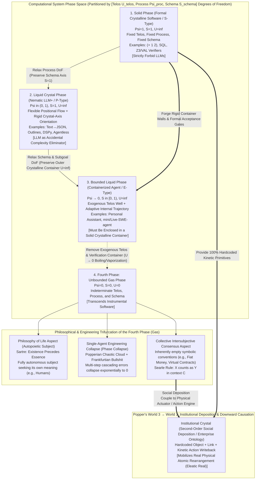
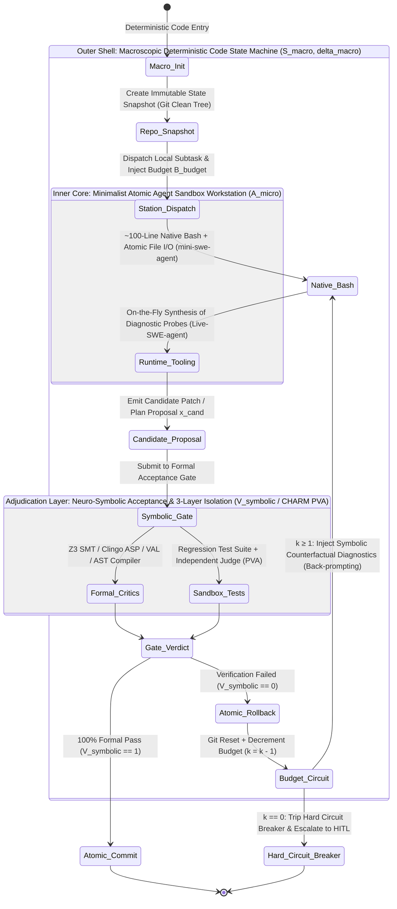
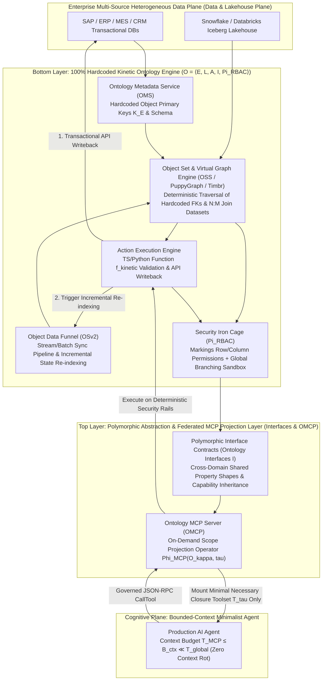

# Phases of Software: Crystals, Fluids, and Institutional Reality
## — AI Software Engineering 101 Reference Manual: What Software Needs an LLM, the Nature of AI Intelligence, Driving Dynamics, and Physical Interaction
*Phases of Software: Crystals, Fluids, and Institutional Reality — An AI Engineering 101 Guide*

> 🌐 **Language**: **English** | **[简体中文 (`../software_phases.md`)](../software_phases.md)**

**Author**: Shiheng (时恒)  
**License**: [CC BY-SA 4.0 (`../LICENSE`)](../LICENSE)  
**Document Positioning**: AI Software Engineering 101 Reference Manual (including four monograph verifications, mathematical derivations, and benchmark calibration against 45 primary literature sources)  
**Core Verification Literature Archive & Monograph Research Matrix**:
- **Proposition 0 (Phase Taxonomy: What Software Needs an LLM? — Software Phase Taxonomy and the Deposition of Intersubjective Reality)**: [`verification_prop0_software_phases_and_philosophy.md`](./verification_prop0_software_phases_and_philosophy.md) | Local Paper Archive [`./papers/prop0/`](./papers/prop0/)
- **Proposition 1 (Cognition & Planning: Is AI Crystallized or Fluid Intelligence?)**: [`verification_prop1_cognition_and_planning.md`](./verification_prop1_cognition_and_planning.md) | Local Paper Archive [`./papers/prop1/`](./papers/prop1/)
- **Proposition 2 (Driving Dynamics: Software Driving Force — Code-Driven or Agent-Driven?)**: [`verification_prop2_code_vs_agent.md`](./verification_prop2_code_vs_agent.md) | Local Paper Archive [`./papers/prop2/`](./papers/prop2/)
- **Proposition 3 (Physical Interaction: AI Interaction with the Physical World — Bounded Operational Ontology / Institutional Crystal and Federated MCP Protocol)**: [`verification_prop3_enterprise_ontology_and_mcp.md`](./verification_prop3_enterprise_ontology_and_mcp.md) | Local Paper Archive [`./papers/prop3/`](./papers/prop3/)
- **Complete Authoritative Literature Index & Official Download Directory**: [`papers/README.md`](./papers/README.md)

---

## Introduction: Four Ultimate Questions at the Crossroads of a Paradigm Shift

Contemporary artificial intelligence engineering, software systems architecture, and philosophy of technology stand at the crossroads of a fundamental paradigm shift. To cut through conceptual hype and engineering fog, this manual proceeds from first principles to sequentially formulate and dialectically answer the **Four Core Propositions (Four Questions)** of AI software engineering:
1. **Proposition 0 (Phase Taxonomy): What Software Needs an LLM? (Software Phase Taxonomy and the Deposition of Intersubjective Reality)** — How software is partitioned by the determinism boundaries of **Telos ($d_T$), Process ($d_P$), and Schema ($d_S$)** into the **Solid Phase (Formal Crystalline Software)**, **Liquid Crystal Phase (Nematic LLM+ Structured Transformation)**, **Bounded Liquid Phase (Containerized Agentic Assistant)**, and **Fourth Phase: Unbounded Gas Phase (Existential Subject vs. Epistemic Dissipation)**, revealing the physical mechanism by which ontologically empty collective consensus undergoes deposition into an **"Institutional Crystal (Second-Order Social Deposition)"**;
2. **Proposition 1 (Cognition & Planning): Is AI Crystallized or Fluid Intelligence?** — Are parametric models merely static crystallized memory operating via deep search over finite sets, or do their forward passes embed dynamic higher-order fluid reasoning and preconditioned implicit meta-optimization?
3. **Proposition 2 (Driving Dynamics): Software Driving Force (Code-Driven or Agent-Driven?)** — How do we establish a "hard-shell, soft-core" control-flow equilibrium and neuro-symbolic verification loop between deterministic flow engineering and minimalist autonomous agency?
4. **Proposition 3 (Physical Interaction): AI Interaction with the Physical World (Bounded Operational Ontology / Institutional Crystal and Federated MCP Protocol)** — How do inherently empty collective consensus and enterprise business logic exert reliable **Downward Causation** upon the physical world through bounded operational ontologies (Institutional Crystals), hardcoded kinetic action writebacks, and federated protocols?

Across interdisciplinary empirical research spanning 1943 to 2026, this complete four-proposition framework exhibits profound dialectical tension: the thesis perspective strikes directly at the structural Achilles' heels of autoregressive Large Language Models (LLMs)—probabilistic hallucinations, multi-step cascading errors, epistemic "bullshit" (Frankfurtian Bullshit), and enterprise-scale semantic drift—establishing robust defensive engineering principles for high-reliability production systems. Conversely, the antithesis and second-order synthesis perspectives reveal transformative breakthroughs in soft-matter liquid-crystal constrained decoding (Guided Generation), Transformer architectures performing **In-Context Higher-Order Meta-Optimization**, **Test-Time Compute Scaling**, **RL-Internalized Minimalist Agency**, **federated ontological interoperability via polymorphic interfaces and the Model Context Protocol (MCP)**, and **Karl Popper's World 3 Downward Causation**.

Proceeding from four foundational dimensions—soft-matter statistical physics and philosophy of technology, computational cognitive science, formal verification, and software engineering architecture—this manual systematically examines all four pillar propositions through rigorous bidirectional empirical verification (spanning 45 authoritative interdisciplinary papers, philosophical classics, and industrial whitepapers, including exact verification against 41 local primary PDFs and technical specification archives) and second-order causal mathematical derivations, ultimately establishing a unified Neuro-Symbolic and Institutional Crystal architecture canon for complex production environments.

---

## Proposition 0 (Phase Taxonomy): What Software Needs an LLM? — Software Phase Taxonomy and the Deposition of Intersubjective Reality

### 0.1 Thesis: Three-Phase Degree-of-Freedom Boundaries of Instrumental Software, Soft-Matter Liquid Crystal Order Parameters, and Isomorphism with Lehman's SPE Evolution Taxonomy

To answer "What software needs a Large Language Model?" from first principles, we situate computational systems within a three-dimensional causal phase space defined by **Ultimate Purpose (Purpose / Telos, $d_T$)**, **Execution Process (Process / Control Flow, $d_P$)**, and **Result Structure (Result / Output Schema, $d_S$)**. Borrowing symmetry-breaking and order-parameter theory from condensed-matter and soft-matter physics (Pierre-Gilles de Gennes, 1991 Nobel Laureate in Physics, *The Physics of Liquid Crystals*) [36], we define three fundamental physical quantities for any computational system:
1. **Positional / Path Order Parameter ($\Psi_{\text{proc}} \in [0, 1]$, corresponding to Process $d_P$)**: Measures the long-range positional order of instruction control flow at compile/design time. $\Psi_{\text{proc}} = 1$ indicates that the execution path is strictly locked onto deterministic lattice nodes; $\Psi_{\text{proc}} \to 0$ indicates that the system possesses fluid freedom at runtime to dynamically explore intermediate trajectories.
2. **Orientational / Schema Order Parameter ($S_{\text{schema}} \in [0, 1]$, corresponding to Schema $d_S$)**: Corresponds to the second-order Legendre orientational order parameter in nematic liquid crystals, $S = \langle P_2(\cos\theta)\rangle = \frac{1}{2}\langle 3\cos^2\theta - 1\rangle$ [36]. $S_{\text{schema}} = 1$ indicates that regardless of how the microscopic computational process flows, the system's final output is strictly aligned along a predefined formal syntactic crystal axis (such as a JSON Schema or strongly typed AST); $S_{\text{schema}} = 0$ indicates that the output exhibits isotropic, unconstrained divergence.
3. **Teleological Confinement Potential ($U_{\text{telos}} \in \{0, \infty\}$, corresponding to Telos $d_T$)**: Corresponds to an external confinement potential well and container surface tension in thermodynamics. $U_{\text{telos}} = \infty$ indicates that the system is bound by an exogenous objective function and verification boundary imposed by a human host (incompressible volume); $U_{\text{telos}} = 0$ indicates the absence of any exogenous teleological constraint.

#### (1) The "Three-Phase Progression Law" of Practical Instrumental Software and Formalization of the Liquid Crystal Operator
Every system that qualifies as **"Instrumental Software (Software as an Instrument)"** exists on the premise of serving an explicit exogenous intent of its human host ($U_{\text{telos}} = \infty$). By progressively relaxing degrees of freedom along `[Process, Schema]`, combinatorics strictly and exhaustively generates **three practical phases of software**:
- **Phase 1: Solid Phase (Formal Crystalline Software, $\Psi_{\text{proc}} = 1, S_{\text{schema}} = 1, U_{\text{telos}} = \infty$)**:
  Deterministic Telos, deterministic Process, and deterministic Schema (e.g., arithmetic evaluation `(+ 1 2)`, database ACID transactions, compiler AST type-checking, Z3/VAL symbolic solvers). Because its lattice structure is hermetically interlocked, **Solid Phase software has zero need for—and must strictly forbid the introduction of—probabilistic Large Language Models**.
- **Phase 2: Liquid Crystal Phase (Nematic LLM+ Structured Transformation, $0 < \Psi_{\text{proc}} < 1, S_{\text{schema}} = 1, U_{\text{telos}} = \infty$)**:
  Deterministic Telos and deterministic output structure (Schema), while only the intermediate semantic mapping process is probabilistically flexible (exemplified by "transforming unstructured natural language text into strict JSON," AlphaCodium / Agentless flow engineering, and DSPy declarative modules [38]). Just as nematic liquid crystal molecules flow freely in position ($\Psi_{\text{proc}} < 1$) while maintaining strict long-axis alignment along the crystal director ($S_{\text{schema}} = 1$), according to the formal proof by Willard & Louf (`arXiv:2307.09702`, Outlines framework) [37], let the LLM's continuous semantic probability manifold logits over vocabulary $\mathcal{V}$ at step $t$ be $\mathbf{z}_t \in \mathbb{R}^{|\mathcal{V}|}$, and let the Deterministic Finite Automaton (FSM) corresponding to the target regular or context-free grammar (CFG / JSON Schema) be in state $q_t \in \mathcal{Q}$, whose subset of permissible transition tokens is $\mathcal{V}(q_t) \subset \mathcal{V}$. By applying a binary crystal-axis mask $\mathbf{m}(q_t) \in \{-\infty, 0\}^{|\mathcal{V}|}$, the liquid crystal operator projects the continuous semantic flow onto the discrete syntactic lattice:
  $$\mathbf{z}_t^{\text{guided}} = \mathbf{z}_t + \mathbf{m}(q_t), \quad p(v \mid x_{<t}, q_t) = \frac{\exp(z_{t, v} + m_v(q_t))}{\sum_{u \in \mathcal{V}} \exp(z_{t, u} + m_u(q_t))} = \begin{cases} \frac{\exp(z_{t, v})}{\sum_{u \in \mathcal{V}(q_t)} \exp(z_{t, u})} & \text{if } v \in \mathcal{V}(q_t) \\ 0 & \text{if } v \notin \mathcal{V}(q_t) \end{cases}$$
  While preserving high-dimensional semantic interpolation flexibility, this operator mathematically guarantees an orientational schema order of $S_{\text{schema}} \equiv 1$ (the probability of a syntax violation is identically $0$), making it the highest-ROI primary battlefield for LLMs in contemporary industry.
- **Phase 3: Bounded Liquid Phase (Containerized Agentic Assistant / Confined Liquid Software, $\Psi_{\text{proc}} \to 0, 0 \le S_{\text{schema}} < 1, U_{\text{telos}} = \infty$)**:
  The high-level teleological potential well is specified by a human, but the concrete subgoals, exploration trajectory, and tool-invocation sequence are indeterminate a priori and must dynamically deform and flow around environmental obstacles in real time (e.g., personal assistants, or `mini-swe-agent` and `Live-SWE-agent` autonomously diagnosing unknown bugs inside a sandbox). In the foundational cybernetics paper by Rosenblueth, Wiener, and Bigelow (1943), *Behavior, Purpose and Teleology* [41], this corresponds to **"Purposeful Active Behavior with Negative Feedback."** Because a liquid possesses no fixed shape of its own, **Bounded Liquid software can only take form and operate safely when enclosed inside a "crystalline container" built from Solid Phase code**.

#### (2) Cross-Temporal Isomorphism with Lehman's (1980) SPE Taxonomy and Brooks (1986) in Software Engineering History
Strikingly, why does deducing practical software by degrees of freedom yield *only* these three phases—Solid, Liquid Crystal, and Bounded Liquid? In the history of software engineering, **Meir M. Lehman**, father of the Laws of Software Evolution, arrived at the exact same tripartite structure from an independent dimension in his classic 1980 IEEE paper *Programs, Life Cycles, and Laws of Software Evolution* via the **SPE Program Classification** [39]:
1. **S-Type (Specifiable Programs) $\Longleftrightarrow$ Solid Phase (Formal Crystalline Software)**: Programs whose function is completely defined by and derivable from a formal mathematical specification, and whose correctness does not depend on an ambiguous external world.
2. **P-Type (Problem-Solving Programs) $\Longleftrightarrow$ Liquid Crystal Phase (Nematic LLM+ Structured Transformation)**: Programs whose problem objective and output specification are well-defined, but because real-world inputs exhibit combinatorial explosion or unstructured noise, must rely on approximate heuristic models for solution. Framed within Fred Brooks's (1986) *No Silver Bullet* [40], Liquid Crystal software is the most powerful **"Accidental Complexity Eliminator"** (eradicating tedious format conversions and syntactic glue) in human history, liberating Solid Phase code to guard the domain's **Essential Complexity**.
3. **E-Type (Embedded / Evolutionary Programs) $\Longleftrightarrow$ Bounded Liquid Phase (Containerized Agentic Assistant)**: Programs embedded within human society and real operational environments, where actions alter the environment and environmental feedback compels the system to dynamically adapt its subgoals and processes (Lehman's First Law: Law of Continuing Change). LLM Agents endow E-Type software with true runtime "liquid adaptability" for the first time. Crucially, Lehman likewise never defined a fourth category of software—because once exogenous teleological constraints beyond E-Type are released, the system ceases to be a "software instrument" altogether.

---

### 0.2 Antithesis and Philosophical Deep Waters: The Existential Watershed of the Fourth Phase (Gas), Epistemic Dissipation, and Downward Causation of "Nihilistic Consensus"

When we release the final degree of freedom—**"Ultimate Purpose (Telos, $d_T$)"**—and enter the **Fourth Phase: Unbounded Gas Phase (Gaseous System, $\Psi_{\text{proc}} = 0, S_{\text{schema}} = 0, U_{\text{telos}} = 0$, where Telos, Process, and Schema are all indeterminate)**, the system exhibits a profound dual aspect across philosophy of technology, epistemology, and social ontology.

#### (1) The Individual Watershed: Sartre's "Existence Precedes Essence" Autonomous Subject vs. Uncontrolled Engineering "Frankfurtian Bullshit"
Why does the "Gas Phase" have zero practical engineering utility at the level of an individual software tool, yet philosophically point toward a "fully autonomous Agent that seeks its own meaning of life like a human being"?
- **Philosophy of Life and Existentialist Altitude (True Gas Phase = Autopoietic Subject)**:
  In his *Critique of Judgment* (1790, §65), Immanuel Kant strictly distinguished between a "machine" whose purpose lies outside itself (**Extrinsic Teleology**) and a "living organism" whose parts are reciprocally ends and means to one another (**Intrinsic Teleology**). Bio-cyberneticists Maturana and Varela (1980) further formalized this distinction as **Allopoietic Systems** (Solid / Liquid Crystal / Bounded Liquid instruments that produce something other than themselves) versus **Autopoietic Systems** (self-creating subjects that autonomously generate their own boundaries and purposes). In the famous dictum of existentialist philosopher Jean-Paul Sartre (1946) in *Existentialism Is a Humanism*: **Solid, Liquid Crystal, and Bounded Liquid software are all "paper-knives" for which "essence precedes existence"** (their purpose and blueprint are predetermined by a human creator prior to execution); only **a human being (or an ultimate autonomous Agent) in gaseous freedom belongs to "existence precedes essence"**—thrown into the world first without any preset purpose or fixed trajectory, compelled to seek and define the meaning of its own existence in absolute freedom.
- **Degenerate Disaster in Real-World Software Engineering (Pseudo-Gas Phase = Chaotic Cloud and Epistemic Bullshit)**:
  However, contemporary silicon-based large models possess neither biological metabolism nor genuine instincts for survival and reproduction (they lack endogenous Telos). If engineers strip away the exogenous teleological potential well and crystalline container in production ($U_{\text{telos}} \to 0$) and allow a single Agent to engage in unconstrained multi-turn free generation, it will never sublimate into an existentialist philosopher. Instead, it triggers the **exponential collapse of multi-step compositional accuracy** rigorously proven by Nouha Dziri et al. in *Faith and Fate: Limits of Transformers on Compositionality* (`arXiv:2305.18654`, NeurIPS 2023) [42]. Along philosopher of science Karl Popper's (1966) famous continuum in *Of Clouds and Clocks*, this means the system loses the **"Plastic Control"** situated between mechanical **"Clocks"** (Solid cast-iron control) and random **"Clouds"** (gaseous molecular thermal agitation), vaporizing completely into a high-entropy dissipative cloud. Even more profoundly, Hicks, Humphries, and Slater (2024) prove epistemologically in their philosophical paper *ChatGPT is Bullshit* (building on Harry Frankfurt's 1986/2005 *On Bullshit*) [43] that a generative system detached from external truth-verification anchors and teleological boundaries is not "lying" (which requires knowing the truth and intentionally subverting it), but rather operating in a dissipative state of **"Frankfurtian Bullshit"—complete indifference to truth and reality**.

#### (2) The Great Reversal in Collective and Social Ontology: If an Action's Underlying Meaning Is "Nothingness," Yet It Physically Transforms the Material World, Is It Still Nothingness?
A deeper second-order philosophical question arises: **In human society and multi-agent networks, if the intrinsic meaning of a symbol, contract, or action is "nothingness" under physical reductionism (exemplified by Fiat Money—which is fundamentally an unbacked collective consensus with zero intrinsic physical value—or virtual order and budget symbols inside a corporation), yet it physically mobilizes tens of thousands of tons of steel and rearranges the material configuration of the physical world, does it still count as "nothingness" ontologically?**

Synthesizing John R. Searle's (1995/2006) Social Ontology [44] and Karl Popper's (1978 Tanner Lecture) "Three Worlds" theory [45], we can render a rigorous philosophical and mathematical verdict: **It is emphatically NOT nothingness; rather, it is "Intersubjective Reality" and an "Institutional Fact" endowed with objective Downward Causation!**
1. **Searle's Four-Quadrant Ontology and Constitutive Rules ($X \text{ counts as } Y \text{ in context } C$)**:
   Common sense frequently misjudges the world as a binary dichotomy of "objective physical reality vs. subjective nothingness." Searle (`2006_Searle_Social_Ontology_Basic_Principles.pdf`) demonstrates that we must orthogonally decouple the **ontological dimension (whether existence depends on minds)** from the **epistemic/causal dimension (whether truth value and causal efficacy are independent of personal preferences)** [44]:
   - **Brute Physical Facts (e.g., stones, electrons, the speed of light)**: Ontologically objective, and epistemically objective;
   - **Private Mental Experiences (e.g., pain, or a single hallucination of an isolated Agent)**: Ontologically subjective, and epistemically subjective;
   - **Institutional Facts / Intersubjective Reality (e.g., currency, law, property rights, enterprise ontologies)**: **Ontologically Subjective**—stripped of collective recognition, paper currency and database bits are indeed "nothingness" under physical reductionism—yet **Epistemically and Causally Objective**!
   The mechanism of this transformation lies in a collective applying the famous **Constitutive Rule** operator via **Collective Intentionality**:
   $$\mathcal{R}_{\text{Searle}}: \quad X \text{ (physical symbol/bit with no intrinsic value)} \xrightarrow{\text{Collective Acceptance}} \text{counts as } Y \text{ (Status Function) in Context } C$$
   Once $X$ is locked into status function $Y$ within context $C$, it instantaneously acquires **Deontic Powers (rights, obligations, authorizations, and compulsory clearing force)** that transcend its raw physical substrate [44].
2. **Plato's "Eleatic Principle" and Popper's "Downward Causation from World 3"**:
   In ontological philosophy, the supreme criterion for judging whether an entity is genuinely real is the **Eleatic Principle (Alexander's Dictum)**, established in Plato's *Sophist* (247d–e) and enshrined in modern philosophy of science:
   $$\text{"To be real is to have causal powers"}$$
   In his 1978 Tanner Lecture at the University of Michigan, *Three Worlds* (`1978_Popper_Three_Worlds.pdf`, p. 153), Karl Popper further partitioned the universe into **World 1 (physical matter and energy states)**, **World 2 (subjective mental states and executive consciousness)**, and **World 3 (objective knowledge, monetary contracts, software code, and business ontologies created by minds)**, delivering a decisive proof [45]:
   > *"What is real or what exists is whatever may, directly or indirectly, have a causal effect upon physical things... Can conjectures or theories [World 3] exert, in a direct or indirect way, a causal effect upon physical things [World 1]? My reply to this question will be: **YES, THEY CAN INDEED.**"*
   
   Even if a symbolic contract in World 3 originates as a "nihilistic" collective convention, the moment it exerts **Downward Causation** upon World 1 through the executive channel of World 2—just like the **Thomas Theorem** in sociology (1928: *"If men define situations as real, they are real in their consequences"*) and **George Soros's Theory of Reflexivity** in finance—it collapses from "nothingness" into indestructible **Causal Reality** at the very instant it rearranges physical atoms!

---

### 0.3 Second-Order Phase and Ontological Synthesis: Institutional Crystal and the "Social Deposition" of Gaseous Consensus

Merging the "Four-Phase Software Taxonomy" with "Downward Causation of Intersubjective Reality" establishes a unified physical and philosophical foundation for the remaining three propositions of this manual:

1. **The Philosophical Essence of Enterprise Ontology (Proposition 3): Forging Inherently Empty Organizational Consensus into an "Institutional Crystal (Second-Order Social Deposition)"**:
   In a modern enterprise, a "Purchase Order," "Budget Quota," "Work Order," and "Approval Authority" are identical to fiat money at the level of physical reductionism (World 1): no corresponding physical particles exist, and all of them are fundamentally fragile "intersubjective consensuses." If an enterprise attempts to process them merely through unstructured chat logs or plain-text RAG, that consensus remains in a perishable gaseous or liquid state. The reason Palantir Foundry/AIP's operational ontology architecture is so formidable is precisely that, through hardcoded **Object Types**, **Link Types**, and a **Kinetic Action Writeback Engine**, it implements Searle's constitutive rule ($X \text{ counts as } Y \text{ in context } C$) in Solid Phase code and closes Popper's downward causal loop (invoking ERP/banking APIs to transfer real capital, or starting and stopping physical factory assembly lines)—forging otherwise empty managerial consensus into an **Institutional Crystal** endowed with physical causal power!
2. **"Social Deposition" of Gaseous Systems**:
   Although an isolated gaseous Agent inevitably degenerates into thermodynamic dissipation (nothingness) due to the absence of exogenous purpose and verification boundaries, when a multi-agent collective or human-machine hybrid network spontaneously gives rise to a "collective protocol / symbolic consensus" during interactive game play (even if its initial motivation possesses zero prior physical meaning), **the moment that gaseous consensus couples to a real-world kinetic actuator (Action Engine / payment clearing / physical control API), it undergoes a thermodynamic "Deposition Phase Transition" (passing directly from a gas into a crystalline solid without an intermediate liquid stage)**, instantaneously transforming into an objective force that reshapes the material world!

| Phase & Ontological Dimension | 1. Solid Phase (Formal Crystalline Software) | 2. Liquid Crystal Phase (Nematic LLM+ Structured Transformation) | 3. Bounded Liquid Phase (Containerized Agentic Assistant) | 4. Fourth Phase: Unbounded Gas Phase & Institutional Deposition |
| :--- | :--- | :--- | :--- | :--- |
| **Statistical Physics Order Parameters** | Process Order $\Psi_{\text{proc}}=1$ Schema Order $S_{\text{schema}}=1$ Telos Potential $U_{\text{telos}}=\infty$ | Process Order $0 < \Psi_{\text{proc}} < 1$ Schema Order $S_{\text{schema}}=1$ [36, 37] Telos Potential $U_{\text{telos}}=\infty$ | Process Order $\Psi_{\text{proc}} \to 0$ Schema Order $0 \le S_{\text{schema}} < 1$ Telos Potential $U_{\text{telos}}=\infty$ | Process Order $\Psi_{\text{proc}}=0$, Schema Order $S_{\text{schema}}=0$, Exogenous Telos Potential $U_{\text{telos}}=0$ |
| **Software Engineering History Mapping (Lehman 1980)** | **S-Type (Specifiable Programs)** [39]: The sole criterion of correctness is a formal mathematical specification (e.g., `(+ 1 2)`, compilers, Z3 solvers). | **P-Type (Problem-Solving Programs)** [39] + **Brooks's Accidental Complexity Eliminator** [40]: Aligns ambiguous text onto a JSON crystal lattice via FSM mask $\mathbf{m}(q_t)$ [37, 38]. | **E-Type (Embedded / Evolutionary Programs)** [39]: Embedded in real dynamic environments, governed by the Law of Continuing Change and Wiener's negative-feedback teleology [41]. | **Beyond Instrumental Software**: Lehman defined no fourth category of instrumental program; accidental emergence in single-agent engineering constitutes a severe architectural failure. |
| **Philosophy of Science & Epistemic Positioning** | **Laplacian Determinism / Popperian "Clocks"**: Mechanical cast-iron control with zero probabilistic degrees of freedom. | **Bounded Formal Mapping**: Aristotelian formal and final causes are rigidly locked, while the efficient cause is locally softened. | **Popperian "Plastic Control"**: The highest-grade allopoietic instrument for which essence precedes existence. | **Individual Philosophical Aspect**: Sartre's "existence precedes essence" autopoietic subject (seeking its own meaning of life); **Individual Engineering Aspect**: Popperian "Cloud" and Frankfurtian "Bullshit" dissipation [42, 43]. |
| **Social Ontology & Physical Causal Power (Searle / Popper)** | Directly corresponds to deterministic physical switching of silicon logic gates in World 1 (Brute Physical Execution). | Parses and aligns unstructured natural language from World 2/3 into formal data contracts in World 3. | Dynamically explores inside a bounded World 3 sandbox container; candidate actions must pass Solid Phase gates before touching World 1. | **Social Deposition**: Inherently empty collective consensus (e.g., fiat currency, enterprise orders) undergoes deposition via Searle's Constitutive Rules ($X \text{ counts as } Y \text{ in context } C$) [44] and Action Engine **Downward Causation** [45] into an **Institutional Crystal (Enterprise Ontology)** that rewrites the physical world! |

---

## Proposition 1 (Cognition & Planning): Is AI Crystallized or Fluid Intelligence? — Parametric Lattice Retrieval, Implicit Higher-Order Meta-Optimization, and the Complexity Phase-Transition Threshold

### 1.1 Thesis: Physical Boundaries of Parametric Interpolation Manifolds, Approximate Retrieval, and Discrete Combinatorial Search

In the Cattell-Horn-Carroll (CHC) three-stratum model of human cognitive abilities in psychometrics (Stratum III general intelligence factor $g$; Stratum II broad abilities; Stratum I narrow task skills), second-order core human cognition is strictly partitioned into two orthogonal yet synergistic dimensions: **Crystallized Intelligence ($G_c$)** denotes an individual's capacity to accumulate, store, and retrieve prior knowledge and routine skills through experience, functioning analogously to static storage and pattern invocation in a computer; **Fluid Intelligence ($G_f$)** denotes the core capacity to perform abstract induction, dynamic conceptual recombination, and on-the-fly problem solving when confronting novel situations without relying on domain-specific prior knowledge [1]. This exhibits a profound isomorphism with the **"Software Phase Taxonomy"** established in Proposition 0: a set of static pretrained parameters $\theta^*$ is fundamentally a thoroughly frozen **high-dimensional Solid Parametric Crystal**, possessing an absolutely rigid internal geometric topology and lattice symmetry (process order parameter $\Psi=1$, schema order parameter $S=1$), whose knowledge invocation consists of local interpolative retrieval and approximate querying within a static crystalline manifold; whereas In-Context Learning (ICL) and test-time computation represent local **fluid-dynamical simulations** unfolding atop that static crystal. Characterizing modern deep learning and base Large Language Models as "crystallized intelligence" rests on solid theoretical foundations in both Algorithmic Information Theory (AIT) and empirical benchmarks.

Deep learning pioneer and ARC Prize Foundation founder François Chollet pointed out in his foundational monograph *On the Measure of Intelligence* (`arXiv:1911.01547`) that modern deep neural networks are fundamentally massive parametric curves fitted via gradient descent over vast datasets [1]. Because a model's parametric capacity is finite, the system is forced to perform high-dimensional lossy compression over the space of programs and knowledge observed in the training corpus, thereby storing a vast repertoire of "interpolative programs" along a continuous geometric data manifold. When a user feeds a prompt into a Large Language Model, the underlying computational mechanism is equivalent to issuing an approximate query to a static abstract database: the model retrieves one or more existing program fragments from parametric memory and performs **Local Generalization (robustness within a known distribution)** inside the known data manifold. This mechanism belongs to classic "Type 1 Abstraction" (corresponding to System 1 intuition and pattern recognition in Kahneman's dual-process theory); it cannot synthesize brand-new programs ex nihilo at inference time that cross manifold boundaries, and therefore struggles to achieve true **"Extreme Generalization"** corresponding to the human general intelligence factor ($g$-factor).

According to Chollet's (2019) rigorous formulation within Algorithmic Information Theory, the intelligence of an intelligent system $IS$ is measured not by the static sum of existing skills it possesses, but by its **"Skill-Acquisition Efficiency in conquering tasks of high Generalization Difficulty $GD$ at minimal prior cost $P$ and experience cost $E$"** [1]:

$$I_{IS} = \operatorname{Avg}_{T} \left[ \omega_T \cdot \theta_T \sum_{C} P_C \frac{GD_{IS, T, C}}{P_{IS, T} + E_{IS, T, C}} \right]$$

where $T$ is the target task, $\theta_T$ is the threshold for achieving human-level competency, $C$ is the training curriculum, the numerator $GD_{IS, T, C}$ measures the incremental Kolmogorov complexity (Algorithmic Complexity) that must be bridged between the training phase and the evaluation phase, and the denominator $P_{IS, T} + E_{IS, T, C}$ measures the sum of developer-hardcoded prior knowledge and training sample consumption. Unaugmented Base LLMs rely on a pretraining experience term approaching infinity ($E_{IS, T, C} \to \infty$) to trade for high performance on narrow tasks; the moment they are evaluated on the ARC-AGI-1 and ARC-AGI-2 benchmarks—specifically designed to strip away linguistic and cultural priors and purely test fluid intelligence—the score of Base LLMs under direct prompting (pass@1) plummets to nearly `0%` (original GPT-3 scored `0%`, and GPT-4o pass@1 is only `5%`–`9%`) [2], confirming that pure parametric forward propagation does not possess native fluid intelligence.

In the domain of automated planning and multi-step logical reasoning, Subbarao Kambhampati and Karthik Valmeekam's group at Arizona State University further verified the crystallized nature of LLMs—"approximate retrieval rather than genuine reasoning"—through International Planning Competition (IPC) benchmarks and the PlanBench dataset (`arXiv:2305.15771`, NeurIPS 2023; `arXiv:2402.01817`, ICML 2024) [3, 4]. In fully Autonomous Mode, even the flagship GPT-4 model generates plans across standard IPC planning domains with an average error-free execution and goal-attainment rate of only about **`12%`**; in the classic Blocks World domain (600 instances), GPT-4's One-shot and Zero-shot accuracies reach only **`34.3%`** (206/600) and **`34.6%`** (210/600), while GPT-4o achieves **`28.33%`** and **`35.5%`** [3]. Even more decisive empirical evidence comes from the **"Mystery Blocksworld Obfuscation Experiments"**: when researchers replace action names (such as `pick-up` and `stack`) and object predicates in the planning domain with semantically unrelated random symbols, traditional symbolic AI planners based on first-order predicate graphs suffer zero performance degradation due to isomorphism invariance; whereas GPT-4's planning accuracy suffers a catastrophic cliff-edge collapse—One-shot plummets to **`4.3%`** (26/600), Zero-shot plummets to **`0.16%`** (1/600), and the Zero-shot accuracy of both GPT-4o and Claude-3-Opus drops all the way to zero (**`0%`**) [3]. This directly proves that the apparent planning competence exhibited by early LLMs relies heavily on approximate pattern matching against semantic priors in the training corpus, rather than constructing an internal world model capable of accurately tracking state-transition preconditions and post-conditions (effects).

Whenever AI systems attempt to break through the intuitive bottleneck of System 1 and advance toward deep System 2 logical reasoning (Type 2 Abstraction), their underlying mechanism invariably shifts toward **"deep search over finite sets."** Whether we examine early program-synthesis systems that solved nearly `50%` of ARC-AGI-1 tasks by combining hardcoded Domain-Specific Languages (DSLs) with brute-force combinatorial search, Large Reasoning Models (LRMs) exemplified by OpenAI o1/o3 and DeepSeek-R1, or neuro-symbolic systems coupled with SAT/SMT solvers, PDDL planners, and Answer Set Programming (ASP), their core computational paradigm consists of executing combinatorial search and pruning over a discrete candidate space (such as DSL operator graphs, syntactic parse trees, or Chain-of-Thought token trees). Quantitative analysis by Chollet, Mike Knoop, et al. in the *ARC Prize 2024: Technical Report* (`arXiv:2412.04604`) demonstrates that when using a generate-evaluate-debug search pipeline akin to Ryan Greenblatt's to conquer `85%` of ARC-AGI-1 tasks, the system must **generate and verify on the order of $10^8$ (100 million) candidate programs per task** [2]; the true role of deep learning in such pipelines is to act as a "heuristic mapmaker," leveraging distance metrics in continuous embedding space to probabilistically prune a discrete search tree of complexity $\mathcal{O}(x^n)$. Early empirical data following the release of ARC-AGI-2 further exposed the limits of such finite-set search: the `o3` model, which had achieved a remarkable **`87.5%`** score on ARC-AGI-1 under a high-compute configuration (172x inference budget; `75.7%` under low compute), saw its initial score (`o3` Medium) plunge to the **`3.0%`–`4.0%`** range when confronted with ARC-AGI-2, which was specifically engineered to resist brute-force enumeration and local point fixes [2]. This sharp drop powerfully supports the thesis: once a problem space exceeds the coverage radius of predefined heuristic operators and finite-depth search, AI systems reliant on prior patterns and local search hit a hard capability ceiling.

---

### 1.2 Antithesis: Implicit Gradient Descent in Forward Passes, Second-Order Newton Optimization, and Emergent Fluid Generalization

Although "crystallized intelligence plus finite-set search" incisively exposes the shortcomings of early Large Language Models, absolutizing this claim faces severe counterexamples from Mechanistic Interpretability and frontier empirical breakthroughs between 2024 and 2026. The core of the antithesis is that **modern Transformer architectures do not merely perform static table lookup or discrete enumeration at inference time; the forward propagation of their Self-Attention Layers natively embeds dynamic, continuous higher-order optimization algorithms, and frontier reasoning models have demonstrated native symbolic simulation and sample-efficient skill acquisition in obfuscated domains without external solver intervention.**

#### (1) Rigorous Operator Proof of Single-Layer Linear Attention Equivalence to Implicit Gradient Descent (GD)
Johannes von Oswald's team at ETH Zürich and Google Research (`arXiv:2212.07677`, ICML 2023) [5], Kwangjun Ahn and Suvrit Sra's team at MIT (`arXiv:2306.00297`, NeurIPS 2023) [6], and Deqing Fu, Robin Jia, and Vatsal Sharan's team at USC (`arXiv:2310.17086`, NeurIPS 2024) [7] rigorously proved mathematically that Transformer In-Context Learning (ICL) is by no means mere mechanical copying based on associative memory or induction heads; rather, **within a forward pass whose weights are completely frozen, it implicitly executes Gradient-Based Meta-Optimization**.

Consider the in-context linear regression problem: given $N$ in-context demonstrations $D = \{(x_i, y_i)\}_{i=1}^N$ ($x_i \in \mathbb{R}^{d_x}, y_i \in \mathbb{R}^{d_y}$) and the mean squared error loss $\mathcal{L}(W) = \frac{1}{2N}\sum_{i=1}^N \|W x_i - y_i\|_2^2$. Executing one step of gradient descent with learning rate $\eta$ from initial weights $W_0$ yields the parameter update $\Delta W = -\eta \nabla_W \mathcal{L}(W_0) = -\frac{\eta}{N}\sum_{i=1}^N (W_0 x_i - y_i)x_i^T$. Encoding the in-context samples and query point as composite token vectors $e_i = (x_i, y_i)^T$ and $e_{\text{test}} = (x_{\text{test}}, -W_0 x_{\text{test}})^T \in \mathbb{R}^{d_x + d_y}$, we construct the block parameter matrices (Proposition 1, von Oswald et al., 2023 [5]):

$$W_K = W_Q = \begin{pmatrix} I_{d_x} & 0 \\ 0 & 0 \end{pmatrix}, \quad W_V = \begin{pmatrix} 0 & 0 \\ W_0 & -I_{d_y} \end{pmatrix}, \quad P = \frac{\eta}{N} I_{(d_x + d_y)}$$

Then the forward-propagation state update of a single-head Linear Self-Attention layer $\operatorname{LSA}(e_j) = P \left(\sum_{i=1}^N (W_V e_i)(W_K e_i)^T\right) W_Q e_j$ combined with a residual connection is strictly identical to:

$$e_j^{(1)} = e_j + \operatorname{LSA}(e_j) = \begin{pmatrix} x_j \\ y_j \end{pmatrix} + \frac{\eta}{N} \sum_{i=1}^N \begin{pmatrix} 0 \\ W_0 x_i - y_i \end{pmatrix} x_i^T x_j = \begin{pmatrix} x_j \\ y_j - \Delta W x_j \end{pmatrix}$$

For the query token $e_{\text{test}}$, its second component evolves directly into $[e_{\text{test}}^{(1)}]_y = -(W_0 + \Delta W)x_{\text{test}} = -\hat{y}_{\text{test}}$. Without modifying fixed network weights via backpropagation, the system encodes the prediction residual $-\Delta W x_j$ generated by the parameter update directly into the hidden activation token representations [5].

#### (2) Multi-Layer Preconditioned Gradient Descent ($GD++$) and Second-Order Newton-Schulz Superlinear Convergence
When the data distribution is highly anisotropic or ill-conditioned (condition number $\kappa(X X^T) = \lambda_{\max}/\lambda_{\min} \gg 1$), deep Transformers spontaneously give rise during forward propagation to **multi-step Preconditioned Gradient Descent ($GD++$)** [5, 6] and even **second-order Iterative Newton's Method** [7]:
1. **Covariance Spectral Contraction and $GD++$**: By extending the value projection to $W_V = \begin{pmatrix} I_{d_x} & 0 \\ W_0 & -I_{d_y} \end{pmatrix}$ and $P = \operatorname{diag}(-\gamma I_{d_x}, \frac{\eta}{N}I_{d_y})$, the covariates synchronously undergo a polynomial contraction transformation $x_j^{(1)} = (I - \gamma X X^T)x_j$ inside the residual stream, reshaping the eigenspectrum of the effective Hessian matrix from $\lambda_i$ to $\lambda_i^{++} = \lambda_i(1 - \gamma \lambda_i)^2$. This drastically compresses the condition number ($\kappa^{++} \ll \kappa$) and is algebraically equivalent to approximating the inverse empirical covariance matrix $(X X^T)^{-1}$ layer by layer via a truncated Neumann series $\gamma \sum_{m=0}^k (I - \gamma X X^T)^m$ [5]. Ahn et al. (`arXiv:2306.00297`, Theorem 1 & 4) further prove that at the global training minimum, single-layer attention spontaneously develops an optimal preconditioner $Q_0^*$ incorporating an adaptive Tikhonov regularization term $\frac{1}{n}\sum_k \lambda_k$, while multi-layer critical points strictly implement $L$-step preconditioned gradient descent [6].
2. **Second-Order Newton-Schulz Pseudoinverse Iteration**: Deqing Fu et al. (`arXiv:2310.17086`, NeurIPS 2024, Theorem 5.1) rigorously prove that in a standard Transformer of depth $L = k + 8$ and hidden dimension $\mathcal{O}(d)$, each intermediate layer (2-head ReLU attention + FFN residual block) exactly implements one step of second-order Newton-Schulz matrix inversion iteration on the empirical covariance matrix $S = X^T X$ [7]:
   $$M_0 = \frac{2}{\|S S^T\|_2} S, \quad M_{\ell+1} = 2 M_\ell - M_\ell S M_\ell = \sum_{s=1}^{2^{\ell+2}-1} \beta_s S^s, \quad \hat{w}_k^{\text{Newton}} = M_k X^T y$$
   Because $k$ steps of Newton iteration aggregate matrix moments up to order $2^{k+1}-1$ (whereas $k$ steps of first-order GD can only compute moments of order $\mathcal{O}(k)$), deep Transformers achieve a doubly logarithmic, second-order superlinear convergence rate:
   $$\mathcal{N}_{\text{steps}}^{\text{Newton}} = \mathcal{O}\left(\log \kappa(S) + \log \log(1/\epsilon)\right) \quad \ll \quad \mathcal{N}_{\text{steps}}^{\text{GD}} = \mathcal{O}\left(\kappa(S) \log(1/\epsilon)\right)$$
   Empirical alignment demonstrates that from layer 3 to layer 9, each additional Transformer layer strictly corresponds to advancing roughly 3 Newton iteration steps; under a severely ill-conditioned distribution with $\kappa(\Sigma)=100$, a 12-layer Transformer converges alongside 21 steps of Newton's method directly to the analytical Ordinary Least Squares (OLS) solution, whereas standard first-order gradient descent requires over 2,000 steps under the same conditions [7]. This means that when an AI receives a handful of few-shot demonstrations for on-the-fly inference, genuine real-time function synthesis and higher-order curvature correction are unfolding across fast and slow timescales inside its forward pass—the direct physical realization in computation of fluid intelligence's capacity for "ad-hoc constraint execution and inductive inference."

#### (3) Frontier Counterexample Empirics in Long-Horizon Planning and Obfuscated Symbolic Domains
On empirical benchmarks for automated planning and fluid intelligence, frontier reasoning models from 2025 to 2026 have shattered the early absolute dogma that LLMs "cannot perform internal symbolic simulation." In *Frontier Large Language Models Rival State-of-the-Art Planners* (`arXiv:2511.09378`, 2025/2026) and their NeurIPS 2025 paper (`arXiv:2503.18809`), Augusto B. Corrêa, André G. Pereira, and Jendrik Seipp at the University of Basel and Linköping University conducted a systematic evaluation of DeepSeek-R1, GPT-5, Gemini 2.5 Pro, Gemini 3 Pro, and **Gemini 3.1 Pro** across 360 high-difficulty planning instances spanning 8 complex domains from the IPC 2023 Learning Track [8, 9]:
- **Extreme-Scale State Tracking**: Frontier reasoning models successfully solved extreme-scale Blocksworld instances containing up to **477 blocks** with plan trajectories reaching **1,194 steps**, as well as multi-agent Rovers coordination tasks involving **29 agents** and plan lengths likewise reaching **1,194 steps** (Table 3, Corrêa et al. [9]). Across all 360 standard benchmark tasks, **Gemini 3.1 Pro independently solved 245 instances (`68.1%`)** and GPT-5 solved 205 instances, surpassing both the classical planning competition champion Scorpion Maidu (**234 instances**) and the classic satisficing planner baseline LAMA (**204 instances**) (Table 1, Corrêa et al. [9]).
- **Robustness Breakthrough in Obfuscated Symbolic Domains**: In obfuscated domain tests where all semantic labels were completely stripped and every predicate and action was replaced by meaningless symbols (Table 2, Corrêa et al. [9]), although the coverage of DeepSeek-R1 and GPT-5 dropped by `40.8%` and `25.9%` respectively, **Gemini 3.1 Pro still successfully solved 231/360 instances (`64.2%`)—a performance drop of only `5.7%`**, virtually matching the isomorphism-invariant top symbolic planner Scorpion Maidu (234 instances)!
- **Second-Order Mechanistic Scrutiny**: At the same time, Corrêa et al.'s ablation analysis notes that Gemini 3.1 Pro's extraordinary performance in obfuscated domains relies on a massive test-time compute expenditure of up to **65,536 internal reasoning tokens**, and that in 4 of the domains (including Blocksworld) the model was observed reverse-engineering the underlying domain semantics from predicate arities and action-graph topology (Structural De-obfuscation); yet in the remaining 4 obfuscated domains where semantics were never deciphered, the model still completed complex planning purely through native abstract state tracking [9]. Meanwhile, as of 2026, top frontier systems have climbed to the `75%`–`85%` range on the strictly memorization-resistant ARC-AGI-2 benchmark (surpassing the single-human baseline average of `66%`) and demonstrated sample efficiency exceeding average human subjects on the interactive environment exploration benchmark ARC-AGI-3.

---

### 1.3 Second-Order Cognitive Synthesis: Dual-Timescale Meta-Optimization and the "State-Space Complexity Threshold Law"

Synthesizing the thesis and antithesis evidence yields a deeper second-order cognitive insight: pitting "crystallized skill (what you know)" against "fluid intelligence (how you learn)" as mutually exclusive opposites is itself a **Category Error** arising when migrating psychometric concepts into computational systems. In artificial neural networks, fluid reasoning is not a castle in the air existing independently of crystallized knowledge; rather, it is an emergent phenomenon born when massive crystallized priors are compressed inside a high-dimensional parameter space into **Modular Abstractions**, which are then dynamically recombined on the fly via in-context higher-order optimization ($GD++$ / Newton-Schulz iteration) and test-time search.

To formalize this boundary, we establish the **State-Space Complexity Threshold Law**: let a planning task be a first-order Markov transition system $\mathcal{M} = (\mathcal{S}, \mathcal{A}, \mathcal{T}, \mathcal{G})$ with planning horizon $H$ and average effective branching factor $b$, so that the trajectory entropy of multi-step state rollout is $\mathcal{H}_{\text{plan}}(H) = \sum_{t=1}^H \log_2 |\mathcal{A}(s_t)| \approx H \log_2 b$; define the model's hidden-state symbolic-fidelity representational capacity as $\mathcal{C}_{\text{model}} = L \times D_{\text{hidden}}$:
1. **Sub-Critical Internal Fluid Simulation Regime ($H \log_2 b \le \alpha \cdot \mathcal{C}_{\text{model}}$)**: When the task trajectory entropy lies within the model's finite-layer second-order curvature correction and attention-alignment capacity, the Transformer can preserve geometric manifold invariance of state transitions within its latent space, completing high-fidelity logical simulation without external solvers (as exemplified by Gemini 3.1 Pro's obfuscated-domain planning under a 65k reasoning token budget).
2. **Super-Critical Phase-Collapse Regime ($H \log_2 b > \alpha \cdot \mathcal{C}_{\text{model}}$ or $\kappa(\nabla^2 \mathcal{L}_{\text{latent}}) \gg 2^L$)**: Once the length of the compositional constraint chain or non-commutative mutex resource contention exceeds the convergence radius of finite-layer Newton iterations, the latent state representation undergoes **"Phase Collapse"**: internal fluid simulation irreversibly degenerates into a first-order Markov approximation driven by local semantic priors, rapidly dissipating toward the **Unbounded Gas Phase** described in Proposition 0 (manifesting as the exponential collapse of multi-step compositional accuracy proven by Dziri et al. in *Faith and Fate* [42]). Beyond this critical threshold, the system loses its capacity for self-consistent convergence and must be forcibly intercepted and backtracked/pruned by a rigid potential well constructed from external **Solid Phase (Formal Crystalline Software)** symbolic verifiers (such as VAL, Z3, Clingo, or compiler test suites).

| Cognitive & Computational Dimension | Proposition 1 Thesis (Crystallized Intelligence + Finite-Set Deep Search) | Proposition 1 Antithesis (Implicit Higher-Order Meta-Optimization + Emergent Fluid Reasoning) | 2026 Second-Order Engineering & Architectural Synthesis |
| :--- | :--- | :--- | :--- |
| **Core Computational Mechanism** | Static parametric curves fitted via gradient descent during training [1]; inference consists of local interpolative retrieval within the manifold plus combinatorial search over discrete operator spaces (DSL / Token trees, $10^8$ candidate scale) [2]. | Forward propagation under block-structured linear attention is strictly equivalent to one-step GD [5]; deep architectures give rise to covariance-contracting preconditioned $GD++$ [6] and second-order Newton-Schulz pseudoinverse iteration $M_{\ell+1}=2M_\ell-M_\ell S M_\ell$, achieving $\mathcal{O}(\log\log(1/\epsilon))$ superlinear function synthesis [7]. | **Dual-Timescale Hybrid Computation**: The slow timescale (pretraining) constructs a continuous geometric prior manifold to eliminate combinatorial explosion; the fast timescale (ICL second-order meta-optimization + test-time compute) executes local fluid induction and discrete verification. |
| **Planning & State Tracking** | Lacks an internal verifiable world model; GPT-4 averages only `12%` success in autonomous IPC planning (`34.3%` in Blocksworld) and collapses to `0.16%`–`4.3%` under Mystery symbolic obfuscation [3, 4]. | Frontier reasoning models (**Gemini 3.1 Pro**) solve 245/360 instances on the IPC 2023 Learning Track (surpassing Scorpion Maidu's 234), conquer 477-block, 1,194-step long-horizon plans, and retain `64.2%` accuracy (231/360, only a `5.7%` drop) in obfuscated symbolic domains [9]. | **State-Space Complexity Threshold Law**: Within latent representational capacity $H\log_2 b \le \alpha\mathcal{C}_{\text{model}}$ and test-time compute budgets (e.g., 65k tokens), models possess genuine internal simulation capability; beyond the complexity threshold, phase collapse occurs and external symbolic verifiers must provide a safety net. |
| **Fluid Benchmark Empirics** | Unaugmented Base LLMs score `0%` pass@1 on ARC-AGI-2; at ARC-AGI-2 launch, `o3` plummeted from `87.5%` on ARC-AGI-1 to `3%`–`4%` [2]. | By 2026, frontier systems reach `75%`–`85%` on memorization-resistant ARC-AGI-2 (surpassing the `66%` single-human average) and exceed average human sample efficiency on interactive benchmark ARC-AGI-3. | **Constrained Activation of Generative Fluid Intelligence (GFI)**: Models possess latent potential for inductive reasoning and ad-hoc rule execution, but still require formal constraints for strong counter-intuitive inhibition and zero-tolerance exact matching. |

---
## Proposition 2 (Driving Dynamics): Code-Driven vs. Agent-Driven Software — Flow Engineering, Minimalist Autonomous Agents, and the Hard-Shell/Soft-Core Hybrid State Machine

### 2.1 Thesis: Exponential Amplification of Cascading Hallucinations, "The Agentless Paradox," and the Overwhelming Advantage of Flow Engineering

In enterprise AI engineering practice, Anthropic established the clearest control-flow taxonomy in its authoritative architectural guide *Building Effective Agents* (Schluntz & Zhang, 2024) [10]: **Workflows (i.e., Code-Driven / Fixed-Scaffold Execution)** are systems in which large language models and external tools are orchestrated through predefined, hardcoded deterministic code paths (Predefined Code Paths); whereas **Agents (i.e., Agent-Driven / Emergent Autonomy)** are open-ended, goal-driven systems in which large language models dynamically direct their own execution processes, autonomously deciding which tools to invoke, in what sequence to execute them, and when to terminate the loop. This maps with surgical precision onto the **Software Phase Taxonomy** established in Proposition 0: **Workflows** are, in essence, canonical **Liquid Crystal Software ($0 < \Psi_{\text{proc}} < 1, S_{\text{schema}}=1$)**—their macroscopic execution flow is forcibly locked along deterministic code crystal axes, utilizing large language models solely within localized nodes to absorb the accidental complexity of unstructured data; whereas **Agents** seek to liberate global process degrees of freedom ($\Psi_{\text{proc}} \to 0$) and belong to **Confined Liquid Software**. However, if unmoored from exogenous rigid container constraints, purely autonomous Agents rapidly boil and dissipate under compounding errors into engineering-uncontrolled "gaseous bullshit." The thesis advocating "Code-Driven over Agent-Driven architectures" is grounded in rigorous mathematical models of probabilistic reliability and large-scale software engineering empirics.

#### (1) Multi-Step Compounding Error and the Mathematical Inevitability of Self-Critique Failure
In a directed acyclic graph (DAG) or cyclic pipeline $\mathcal{G} = (\mathcal{V}, \mathcal{E})$ composed of $N$ autonomous decision steps, let $\epsilon_i \in \{0, 1\}$ denote the event that a factual or logical deviation occurs at step $i$. According to the formal proof by Mishra in the CHARM framework paper (`arXiv:2606.04435`, 2026) [11], once a local deviation occurs at step $i$ ($\epsilon_i = 1$), because the self-attention mechanism treats the polluted historical context $c_i$ as an authoritative premise (Authoritative Context), the conditional error probability of continuing to build upon that erroneous premise at the next step is dramatically amplified:

$$P(\epsilon_{i+1} = 1 \mid \epsilon_i = 1) = 1 - \beta_i \gg P(\epsilon_{i+1} = 1 \mid \epsilon_i = 0), \quad \text{where the spontaneous recovery rate } \beta_i \ll 1$$

Even more fatally, early Agent architectures widely pinned their hopes on the LLM's own "self-reflection" (Self-Critique / Iterative Prompting) to correct errors across multi-step loops. However, the Local Coherence Masking Lemma in CHARM (Lemma 1, Mishra [11]) demonstrates that because downstream generation is conditionally biased to cohere strongly with upstream erroneous context ($P(c_{i+1} \text{ coherent} \mid c_i) > \tau$), an endogenous discriminator lacking external ground-truth anchors is completely blinded by confirmation bias. Two landmark empirical studies by Kambhampati's group on PlanBench and Graph Coloring tasks (`arXiv:2310.08118`; `arXiv:2310.12397`) decisively confirmed this "Law of Self-Critique Failure" [12, 13]:
- In the PlanBench planning self-critique experiments, when an LLM serves as an internal verifier, its **False Positive Rate (FPR) reaches as high as `84.45%`** [12];
- In the iterative graph-coloring correction experiments, allowing GPT-4 to perform autonomous critique iterations not only failed to improve performance, but caused **solving accuracy to plummet from `16%` in single-pass generation down to `1%`**—out of the 40 completely valid coloring solutions initially generated by chance, the LLM self-critique module **misjudged valid solutions as containing conflicts in 39 cases**, forcing the model in the iterative loop to blindly mutate correct solutions into incorrect ones [13]!
- Consequently, in a purely autonomous loop devoid of external deterministic circuit-breakers, terminal success probability collapses geometrically with step count $N$: $P(\text{Success}_N) \approx (1 - \bar{p})\cdot \beta^{N-1} \xrightarrow{N\to\infty} 0$. Only by introducing a **three-layer isolated Parallel Verification Agent (PVA)**—comprising **Model Isolation** (independent lightweight judge), **Prompt Isolation** (masking intermediate chains of thought to block bias inheritance), and **Knowledge-Base Isolation** (read-only frozen authoritative source)—alongside deterministic code checks, as in the CHARM framework, can Multi-Step Mitigation Reliability (MSR) be elevated to **`95.2%`** in regulated enterprise environments [11].

#### (2) "The Agentless Paradox" and the Triumph of Flow Engineering
The second core empirical pillar in engineering practice is the celebrated "**The Agentless Paradox**" and the **Flow Engineering** paradigm. Ridnik et al. at CodiumAI first demonstrated in *Code Generation with AlphaCodium: From Prompt Engineering to Flow Engineering* (`arXiv:2401.08500`) that replacing single-shot prompting or free-form conversation with a hardcoded, multi-stage structured code flow (test anchor generation, YAML structured output, and deterministic sandbox iterative filtering) boosts competitive programming pass@5 accuracy on CodeContests from `19%` to `44%` [14].

On SWE-bench, the gold-standard benchmark evaluating real-world GitHub repository bug-fixing capabilities, early mainstream solutions (such as Devin, SWE-agent [`arXiv:2405.15793`], and OpenHands) all adopted highly autonomous Agent-driven paradigms [15]. However, the **Agentless** architecture (`arXiv:2407.01489`, 2024) proposed by Chunqiu Steven Xia and Lingming Zhang's team at the University of Illinois Urbana-Champaign (UIUC) completely overturned this complexity assumption [16]. Agentless entirely abandons autonomous tool invocation and dynamic control flow, adopting instead a three-stage pipeline hardcoded in deterministic Python:
1. **Stage 1: Hierarchical Localization Funnel (Hierarchical Localization)**: Deterministic code forcibly narrows the search space layer by layer through a fixed three-step funnel: "File-level $\to$ Skeleton-element-level $\to$ Line-level." According to the ground-truth recall during localization (Contains GT, Table 2 of the original paper) and the final location coverage of submitted patches (Location Coverage of Submitted Patches, Table 1) [16]:
   - **File-level**: Combining repository tree structure prompting (`78.67%` recall via Prompting alone) with `text-embedding-3-small` cosine similarity retrieval (`70.33%` recall via Embedding alone), the merged file-level candidate recall reaches **`81.67%`**, with final submitted patches achieving **`69.7%`** file-level location coverage;
   - **Skeleton-level**: Extracting only class and function signatures while stripping function body implementation details to drastically compress the context window, skeleton-level candidate recall remains at **`58.33%`**, with final submitted patches achieving **`52.0%`** function-level coverage;
   - **Line-level**: Multi-sample merged recall for fine-grained edit locations reaches **`56.33%`** (`50.67%` for single-path greedy decoding), with final submitted patches achieving **`35.3%`** exact line-level coverage.
2. **Stage 2: Parallel Patch Sampling (Repair)**: Targeting the 4 localized edit regions along with their surrounding $\pm 10$ lines of context window, deterministic code directly invokes the LLM via 1 greedy decoding pass and 9 high-temperature sampling passes to generate $4 \times 10 = 40$ candidate patches in parallel using a simple Search/Replace Diff format—never allowing the LLM to autonomously invoke error-prone editor tool interfaces [16].
3. **Stage 3: Test Generation and Filtering Reranking (Validation & Selection)**: Deterministic scripts automatically execute AST syntax checks, existing regression tests (Regression Tests), and automatically synthesized reproduction tests (Reproduction Tests), filtering out all patches that trigger syntax errors or break existing functionality, and selecting the optimal solution for submission via majority-voting reranking [16].

The empirical comparison yielded by this code-driven mechanism is striking:
- On the 300-instance **SWE-bench Lite**, the structurally minimalist Agentless achieved a resolution rate of **`27.33%` (82/300) to `32.00%` (96/300)** at an ultra-low average cost of just **\$0.34 (v1) to \$0.70 (v2)** per issue, while also achieving **`38.80%` (194/500)** on the human-curated **SWE-bench Verified (500 instances)** and **`33.73%` (84/249)** on **SWE-bench Lite-S (249 instances)** [16];
- By contrast, the early autonomous **SWE-agent** (`arXiv:2405.15793`) paired with GPT-4 Turbo achieved a resolution rate of only **`18.00%`** (54/300; `18.33%` with GPT-4o and `23.00%` with Claude 3.5 Sonnet) on **SWE-bench Lite (300 instances)**, and a mere **`12.47%`** (286/2,294) on the **full SWE-bench (2,294 instances)**, while routinely consuming tens to hundreds of interaction turns and over 100,000 tokens in expensive overhead [15, 16];
- Even more tellingly, in the **Kimi-Dev** study jointly released by Moonshot AI and Tsinghua University (*Kimi-Dev: Agentless Training as Skill Prior for SWE-agents*, `arXiv:2509.23045`), the exact same reinforcement-learning-trained flagship coding model achieved a **`60.4%` pass@1 resolution rate** on SWE-bench Verified when evaluated under the deterministic Agentless code workflow, whereas migrating it directly into multi-turn autonomous interaction scaffolds (SWE-agent / OpenHands) caused its single-pass resolution rate to drop to **`48.6%`** [17]! This head-to-head ablation directly confirms that in multi-turn interactions lacking hard constraints, an overly unconstrained Agent easily degrades the model's intrinsic coding capability due to environmental noise and tool-invocation friction.

#### (3) Industrial-Grade Dominance of Neuro-Symbolic Verification Loops (LLM-Modulo Frameworks)
In domains requiring formal correctness guarantees, demoting the LLM to a "Candidate Generator" or "Semantic Parser" within a code-driven loop while vesting control flow and final adjudication authority (Acceptance Layer) in hardcoded symbolic solvers has been proven to deliver order-of-magnitude performance leaps:
- **Automated Planning (LLM-Modulo + VAL)**: In Kambhampati et al.'s (`arXiv:2402.01817`, Section 4) LLM-Modulo framework, when the deterministic PDDL plan validator **VAL** is used to provide error diagnostics and back-prompting to the LLM for up to 15 rounds, planning accuracy in Blocks World surges from `12%`–`34%` in autonomous mode to **`82%`**, and in the Logistics domain to **`70%`** [3];
- **Automated Physics Grading (AlphaPhysics + Z3/TRS)**: In the **AlphaPhysics** system (`arXiv:2507.18337`, 2025) developed by Baumgartner and McGinness at Australia's CSIRO Data61 and the Australian National University, a code workflow drives a lightweight Phi-4 (14B) model to perform formula extraction paired with a **Z3 SMT solver** undefined-symbol syntax feedback loop to reach a `73%` exact formal extraction rate, before handing expressions over to a four-stage Term Rewriting System (`NORM`, `CANON`, `SIMP`, `CLEAN`) and a Computer Algebra System (CAS) to execute zero-tolerance algebraic equivalence proofs across 1,526 real Physics Olympiad and university entrance examination scripts [18];
- **Nonmonotonic Logical Reasoning (LLM + ASP)**: In the **LLM+ASP** (Answer Set Programming) study (`arXiv:2604.27960`, ACL Findings 2026) published by Ishay and Lee at Arizona State University and Samsung Research, a code-driven Clingo ASP symbolic solver self-correction loop boosted average reasoning accuracy across foundation models from **`51.3%` to `78.0%`** (a **`52.1%`** relative improvement; with **Gemini 2.5 Pro + ASP reaching `93.9%`** and `o4-mini + ASP` rising from `63.4%` to `82.3%`), leaping from **`24.2%` to `71.3%`** (a **`195%`** relative improvement) on the extremely challenging ZebraLogic benchmark **ZL-XXL**, and surging from **`8.4%` to `59.8%`** on **SudokuBench** [19]!

---

### 2.2 Antithesis: The Fragility of Static Workflows, "The Bitter Lesson of Scaffolding," and RL Trajectory Internalization

However, drawing the conclusion from the early "Agentless Paradox" that "all systems should adopt hardcoded workflows and completely abandon Agent-driven paradigms" commits the dogmatic error of viewing technological evolution statically. Frontier engineering practice across 2025 and 2026 demonstrates that code-driven fixed execution flows (Fixed Execution) face an insurmountable physical ceiling when confronting open-ended, highly interactive, complex tasks with unknown state spaces—and that next-generation Agent architectures have achieved a comprehensive reversal over fixed code pipelines through **"Minimalist Scaffolding"** and **"Multi-Turn Agentic RL Post-Training."**

#### (1) A Priori Fragility of Static Workflows and the Formal "Scaffolding Fragility Theorem"
A code-driven hardcoded pipeline essentially freezes human engineers' a priori assumptions about task-resolution paths into the control flow (just as Agentless forcibly assumes that every software bug follows the linear progression of "static tree localization $\to$ local Diff generation $\to$ test execution"). When the Autonomy Dial is turned all the way to the left toward rigid automation, the system collapses completely upon encountering the first edge case not pre-modeled by humans—such as bugs requiring inspection of dynamic runtime call stacks, manipulation of cross-language binary files (e.g., MARC records), resolution of intricate environment dependency conflicts, or diagnosis via rendered GUI screenshots.

More importantly, a deep post-mortem into the root causes of early Agent failures (such as SWE-agent 1.0) reveals that autonomous Agents in 2024 underperformed not because "granting autonomy to models" was intrinsically flawed, but because human engineers at the time shackled models with over-engineered, counter-intuitive custom Agent-Computer Interfaces (ACI) [15]: early SWE-agent contained nearly 7,000 lines of complex wrapper code that forbade the model from using standard Linux terminal streams directly, forcing it instead to view only 100 lines of code at a time, invoke bespoke `scroll_down` and `goto` pagination commands, truncate search results to at most 50 entries, collapse historical outputs older than 5 turns into a single line, and immediately reject any edit that triggered a Linter warning [15]. Such artificial API interfaces, severely divorced from the model's pre-training corpus distribution, directly instantiate Richard Sutton's *The Bitter Lesson* in software engineering—which we formalize as **The Scaffolding Fragility Theorem**:

> **Theorem (The Scaffolding Fragility Theorem / The Bitter Lesson of Scaffolding)**: Let the full set of feasible actions in the true environment be $\mathcal{A}_{\text{env}}$, and let the action subspace permitted by a human-hardcoded workflow or restricted ACI scaffold be $\mathcal{A}_{\text{scaffold}} \subsetneq \mathcal{A}_{\text{env}}$, inducing a reachable state subgraph $\mathcal{G}_{\text{scaffold}}$. Then the reachable solution space of the restricted system is strictly truncated:
> $$\mathcal{R}(\text{System}_{\text{rigid}}) \subseteq \mathcal{R}(\mathcal{G}_{\text{scaffold}}) \subsetneq \mathcal{R}(\mathcal{A}_{\text{env}})$$
> As the foundation model's internalized exploration policy $\pi_\theta(a \mid s)$ acquired through multi-turn reinforcement learning converges toward optimality ($\theta \to \theta^*$), an artificially restricted scaffold—by constraining action expressivity and introducing distribution shift—yields an expected return strictly inferior to a minimalist architecture that grants the model native atomic access to $\mathcal{A}_{\text{env}}$:
> $$\lim_{\theta \to \theta^*} \left[ \mathbb{E}_{\tau \sim \pi_\theta(\mathcal{A}_{\text{env}})} [R(\tau)] - \mathbb{E}_{\tau \sim \pi_\theta(\mathcal{A}_{\text{scaffold}})} [R(\tau)] \right] > 0$$

#### (2) Minimalist Scaffolding Philosophy (`mini-swe-agent`) and Runtime Self-Evolution (`Live-SWE-agent`)
By 2025 and 2026, the industry pivoted decisively toward **"Minimalism as a Design Philosophy"**:
- **The 100-Line Triumph of `mini-swe-agent`**: Released by the original SWE-agent team, `mini-swe-agent` comprises only **~100 lines of core Python code**, completely abolishing all custom pagination/search tool interfaces, stateful shell session wrappers, and complex tool-calling schemas; it simply grants the LLM a native, stateless Bash execution environment via Python's standard library `subprocess.run`, returning all reasoning, file inspection, and control flow to the language model. As a result, `mini-swe-agent` shattered **`74.2%`** resolution on **SWE-bench Verified** (with Gemini 3 Pro; reaching **`70.6%`** with Claude 4.5 Sonnet, and **`71.1%`** with the open-weights Qwen3-Coder-Next at a single-run cost of just \$0.44), far surpassing the contemporaneous fixed-pipeline Agentless Lite at `42.40%` [20]! Similarly, ablation experiments by Verdent AI with Claude 4.5 Sonnet confirmed that once the model's internal deep Thinking Mode is enabled, stripping away all complex high-level engineering tools and retaining only the four most fundamental atomic tools (`bash`, `read`, `write`, and `edit`) causes virtually zero degradation in the Agent's top-tier performance.
- **Agentic Reinforcement Learning Post-Training (R2E-Gym and SWE-smith)**: The underlying engine driving this Agent resurgence is multi-turn reinforcement learning post-training over large-scale executable sandboxes. **R2E-Gym** (`arXiv:2504.07164`, 2025) by UC Berkeley and ANU [21] and **SWE-smith** (`arXiv:2504.21798`, 2025) by Stanford/Princeton [22] demonstrated that an un-trajectoried base instruction model (`Qwen2.5-Coder-14B-Instruct`) achieves only **`4.0% (±1.6%)`** on SWE-bench Verified; yet after multi-turn trajectory fine-tuning and Hybrid Verifiers post-training across 8,100+ procedurally synthesized sandbox environments in R2E-Gym, the exact same 14B model under the exact same minimalist scaffold surges to **`26.8%`–`29.2%`** (a >6x improvement), while 32B open-weights models reach **`40.2%`** and **`51.0%`** under SWE-smith and R2E-Gym respectively [21, 22].
- **Runtime Tool Self-Evolution in `Live-SWE-agent`**: Going a step further, UIUC's Xia and Zhang team (the very authors of Agentless!) published **Live-SWE-agent** (`arXiv:2511.13646`) in late 2025 [20], personally completing the leap from "Agentless" to "self-evolving minimalist Agent": without requiring the 1,231 hours of expensive offline evolution demanded by the Darwin-Gödel Machine (DGM), Live-SWE-agent builds upon `mini-swe-agent`'s native Bash foundation and allows the Agent at runtime to **synthesize and invoke custom Python analysis scripts on the fly (On-the-fly Tool Synthesis)** tailored to the specific morphology of the software defect at hand. Empirical results show that Live-SWE-agent achieves a **`65.0%`** resolution rate on the **SWE-bench Verified-60** subset with **0 hours of offline overhead** (substantially outperforming DGM's `53.3%`), reaches **`75.4%`** (Claude 4.5 Sonnet) to **`77.4%`** (Gemini 3 Pro) on the **full SWE-bench Verified**, and sets a state-of-the-art record of **`45.8%`** on **SWE-Bench Pro** for complex multi-language enterprise engineering (surpassing traditional SWE-agent's `43.6%`) [20]!

---

### 2.3 Second-Order Engineering Synthesis: The Autonomy Dial and the "Hard-Shell, Soft-Core (Bounded Hybrid / LLM-Modulo)" State Machine

Our dialectical verification of Proposition 2 reveals the core design iron law of modern AI software engineering: any local scaffold that attempts to replace the model's **microscopic reasoning steps** with hardcoded rules (such as artificially splitting file localization from line localization, or wrapping restricted 100-line text readers) inevitably degrades into a performance bottleneck as foundation models advance via reinforcement learning; yet at the same time, any attempt to let probabilistic models directly take over **macroscopic business compliance, transaction commits, and formal verification** inevitably fails production reliability thresholds due to compounding error $P(\epsilon_{i+1}\mid\epsilon_i)$ and the `84.45%` self-critique false positive rate.

Accordingly, we formalize the 2026 enterprise hybrid control flow as an 8-tuple **Hard-Shell, Soft-Core Bounded Hybrid State Machine ($\mathcal{M}_{\text{hybrid}}$)**. From a control-theoretic standpoint, this architecture perfectly fulfills the phase-synergy law of Proposition 0: **forging the macroscopic state-machine container walls and formal acceptance gates ($\mathcal{S}_{\text{macro}}, \delta_{\text{macro}}, \mathcal{V}_{\text{symbolic}}$) out of 100% deterministic Solid Crystal, while tightly encapsulating the minimalist liquid Agent ($\mathcal{A}_{\text{micro}}$) within an infinite exogenous teleological potential well $U_{\text{telos}}=\infty$ and a hard budget boundary $\mathcal{B}_{\text{budget}}$**—thereby completely sealing off phase-transition collapse from unbounded gaseous wandering while maximally preserving the adaptive dividends of liquid exploration and dynamic tool synthesis within the microscopic sandbox:

$$\mathcal{M}_{\text{hybrid}} = \left\langle \mathcal{S}_{\text{macro}}, \Sigma_{\text{macro}}, \delta_{\text{macro}}, s_0, \mathcal{F}_{\text{accept}}, \mathcal{A}_{\text{micro}}, \mathcal{V}_{\text{symbolic}}, \mathcal{B}_{\text{budget}} \right\rangle$$

1. **Code-Driven Macroscopic State Machine ($\mathcal{S}_{\text{macro}}, \delta_{\text{macro}}$)**: The system's global business topology transitions (e.g., `INIT` $\to$ `SNAPSHOT` $\to$ `DISPATCH` $\to$ `VERIFYING` $\to$ `ROLLBACK` / `COMMITTED`), Git branch snapshot isolation, and persistent transactional commits are 100% driven by deterministic Turing-complete code; probabilistic models are strictly forbidden from mutating the macroscopic state transition function $\delta_{\text{macro}}$.
2. **Atomized Microscopic Workstation ($\mathcal{A}_{\text{micro}}$)**: Within localized high-uncertainty nodes in the `DISPATCH` state, all bloated artificial ACI wrappers are discarded, exposing only a native atomic toolset inside an isolated sandbox $\mathcal{A}_{\text{micro}} = \{\text{bash\_exec}, \text{read\_file}, \text{write\_file}, \text{edit\_file}\}$ (as in the ~100-line `mini-swe-agent`) and permitting on-the-fly synthesis of temporary diagnostic scripts within the sandbox (as in `Live-SWE-agent`) [20].
3. **Symbolized Formal Acceptance ($\mathcal{V}_{\text{symbolic}}, \mathcal{B}_{\text{budget}}$)**: The microscopic Agent has zero authority to commit state directly to the production trunk; its proposed candidate solution $\mathbf{x}_{\text{cand}}$ must pass the conjunctive verification of outer-layer hardcoded symbolic critics (SMT/Z3, Clingo ASP, VAL plan validators, AST compilers, and regression test suites): $\mathcal{V}_{\text{symbolic}}(\mathbf{x}_{\text{cand}}) = \bigwedge_j \phi_j(\mathbf{x}_{\text{cand}}) \in \{0, 1\}$. If $\mathcal{V}_{\text{symbolic}} = 0$, the outer deterministic code immediately triggers an atomic state rollback (`git reset --hard`) and decrements the retry budget $k \leftarrow k - 1$; when the budget is exhausted ($k = 0$), a hard circuit breaker trips and escalates to human-in-the-loop auditing (HITL).

| Evaluation Dimension | Pure Code-Driven Workflow (Fixed / Flow Engineering) | Pure Autonomous Agent-Driven (Emergent Autonomy Agent) | 2026 Enterprise Hybrid Architecture (Bounded Hybrid / LLM-Modulo) |
| :--- | :--- | :--- | :--- |
| **Control-Flow Ownership** | 100% hardcoded by human developers governing execution sequences and stage transitions (e.g., Agentless 3-stage funnel [16], AlphaCodium [14]). | 100% autonomously decided by the LLM based on environmental feedback regarding tool selection, looping, and termination (e.g., early SWE-agent [15]). | **Hierarchical Decoupled Control (Hard-Shell, Soft-Core)**: Macroscopic business topology and verification gates are hardcoded via code state machine $\delta_{\text{macro}}$; localized high-uncertainty nodes are delegated to minimalist Agents ($\mathcal{A}_{\text{micro}}$) for autonomous exploration [20]. |
| **Error Propagation & Self-Critique** | Deterministic inter-stage filtering (AST syntax checks, test screening) effectively blocks cascading hallucinations. | Suffers from conditional error amplification $P(\epsilon_{i+1}\mid\epsilon_i)$ [11]; without external verifiers, self-critique FPR reaches `84.45%` [12], and graph-coloring self-critique drops accuracy from `16%` to `1%` [13]. | **Formal Verifier Safety Net**: Inner-core Agent proposals must pass outer-shell hardcoded symbolic critics (VAL boosting to `82%` [3], ASP boosting to `78.0%`/`93.9%` [19], CHARM PVA reaching `95.2%` MSR [11]) before commit. |
| **Benchmark Performance Evolution** | Agentless reaches `32.00%` (\$0.70) on SWE-bench Lite, decisively beating early SWE-agent's `18.00%` (`12.47%` on Full) [15, 16]; under Kimi-Dev, workflow (`60.4%`) outperforms multi-turn scaffolding (`48.6%`) [17]. | Post-trained via R2E-Gym / SWE-smith RL [21, 22], minimalist `mini-swe-agent` reaches `74.2%` on Verified, and self-evolving `Live-SWE-agent` reaches `75.4%`–`77.4%` (`45.8%` on SWE-Bench Pro) [20]. | **Unites High Ceiling with Zero-Tolerance Floor**: Unlocks the RL model's native Bash and dynamic tool-synthesis ceiling inside microscopic nodes while preserving 100% transactional consistency and budget circuit-breaking at macroscopic boundaries. |
| **Optimal Application Scenarios** | Standardized business pipelines with predictable input structures, strictly regulated outputs, high throughput, and tight margins. | Open-ended diagnostics with a priori unknown paths, multimodal interactive exploration, complex cross-file refactoring, and security red-teaming. | **Over 95% of real-world enterprise production scenarios** (equivalent to "expert sandbox workstations embedded along a tightly controlled automated assembly line"). |

---

## Proposition 3 (Physical Interaction): Interacting with Physical Reality (Bounded Operational Ontology / Institutional Crystal & Federated MCP Protocol) — How Intersubjective Consensus Generates Physical Downward Causation

### 3.1 Thesis: The Principle of Minimal Ontological Commitment, Context Rot Suppression, and the Physical Iron Law of Hardcoded Kinetic Primitives

Proposition 3 touches upon the most foundational infrastructure of enterprise AI deployment—the boundary demarcation and implementation mechanism of the **Ontology**. The thesis that "an ontology's scope must be strictly bounded to a specific business domain to serve concrete Agent workflows, rejecting company-wide monolithic information networks, and hardcoding the core network primitives" receives compelling support from the history of knowledge engineering, physical constraints of modern data architecture, and the mathematical mechanics of LLM attention.

#### (1) The Principle of Minimal Ontological Commitment and the Historical Collapse of Enterprise-Wide Monolithic Semantic Webs
From the standpoint of classical knowledge engineering theory and the history of enterprise software failures, attempting to build a top-down "company-wide unified monolithic information network" directly violates the fifth foundational design criterion established by Stanford University's Thomas R. Gruber in *Toward Principles for the Design of Ontologies Used for Knowledge Sharing* (1993/1995, *IJHCS*)—the **Principle of Minimal Ontological Commitment (Criterion 5)** [23]—as well as the enterprise ontology construction principles established by the University of Edinburgh's Mike Uschold and the University of Toronto's Michael Grüninger in *Ontologies: Principles, Methods and Applications* (1996, *Knowledge Engineering Review*) [24]. Gruber explicitly states: "An ontology should require the minimal ontological commitment sufficient to support the intended knowledge sharing activities... specifying the weakest theory and allowing the most models" [23].

Within any large organization, different departments inevitably hold fundamentally distinct or even mutually conflicting semantic assumptions regarding the same objective entity due to divergent operational contexts and objectives (precisely what Domain-Driven Design founder Eric Evans formalized as a **Bounded Context**). Enterprise architectural empirics demonstrate that a single concept such as "Customer" routinely carries four distinct statistical and boundary definitions across four executive dashboards, while ERP, MES, CRM, and logistics systems hold vastly different state-machine interpretations of an "Order." Summarizing the failure of a British aerospace giant that spent two years building a bottom-up enterprise data model only to produce an obsolete artifact, alongside lessons from Edinburgh's *The Enterprise Ontology* (`AIAI-TR-195`, 1995) and Toronto's Virtual Enterprise project (**TOVE Project**, Fox & Grüninger, 1992/1998), Uschold & Grüninger (1996) pointed out [24, 25, 26, 27] that whether an organization pursues a "Top-Down" big-bang approach attempting to harmonize all departmental semantics at once, or a "Bottom-Up" approach mirroring raw database tables, the effort invariably degenerates into either an inferior replica of underlying ERP database schemas or endless cross-departmental semantic gridlock. The only viable engineering path is a **"Middle-Out"** bounded construction anchored in core concrete business problems (Competency Questions) [24].

Even within **Palantir Foundry and AIP**, the world's most successful enterprise ontology platform today, the supreme design discipline practiced by frontline architects and Forward Deployed Engineers (FDEs) is precisely **"Restraint and Building Backwards from Critical Operational Decisions"** [28]. Palantir's engineering practice explicitly dictates that successful delivery never begins by modeling the entire corporation in panoramic detail at project inception; instead, it strictly scopes a concrete cross-system operational workflow, works backwards from the most critical business decisions and concrete **Actions** to derive the minimal required conceptual model, and ships it to production within weeks (e.g., a 60-day cycle): every relational link (Link) is a path to be traversed by a human operator or AIP Agent, and every redundant path is a liability where stale relationships breed erroneous decisions; therefore, one must model only the relationships actively exercised by concrete operational actions, leaving everything else in the underlying data layer.

#### (2) Long-Context Attention Dilution and the Mathematical Mechanics of "Context Rot"
Viewed through the cognitive bottlenecks of large language models, the classic empirical findings by Stanford and UC Berkeley's Nelson F. Liu et al. in *Lost in the Middle: How Language Models Use Long Contexts* (`arXiv:2307.03172`, TACL 2024) [29], the milestone systematic study by **Chroma Research** (Hong, Troynikov & Huber, 2025) in *Context Rot: How Increasing Input Tokens Impacts LLM Performance* (evaluating 18 frontier models) [30], the ICLR 2025 **LongMemEval** benchmark (`arXiv:2410.10813`, confirming an ~`30%` accuracy collapse in commercial LLMs over multi-turn long contexts) [31], large-scale database schema pruning studies (Maamari et al., `arXiv:2408.07702`; **RSL-SQL**, `arXiv:2411.00073`) [32, 33], and the neuro-symbolic rule-injection ablations in ACL Findings 2026 (`arXiv:2604.27960`) [19] jointly expose the lethal law of **"Context Rot"**:

Suppose a company-wide monolithic graph contains $N_{\mathcal{E}}$ entities, $N_{\mathcal{L}}$ relationships, and $N_{\mathcal{A}}$ actions, with a full schema serialization length of $T_{\text{global}} = \mathcal{O}(N_{\mathcal{E}} + N_{\mathcal{L}} + N_{\mathcal{A}})$; whereas the bounded subgraph $\mathcal{O}_\tau \subset \mathcal{O}$ genuinely relevant to the current business task $\tau$ requires only $T_\tau \ll T_{\text{global}}$ tokens, leaving the remaining $T_{\text{noise}} = T_{\text{global}} - T_\tau$ tokens as irrelevant background graph noise (Distractor Noise). Under scaled dot-product self-attention, the total attention weight mass allocated by query vector $q_i$ to the target business constraint set $\text{Target}$ is:

$$\sum_{j \in \text{Target}} \alpha_{i,j} = \frac{\sum_{j \in \text{Target}} \exp\left(\frac{q_i k_j^T}{\sqrt{d_k}}\right)}{\sum_{j \in \text{Target}} \exp\left(\frac{q_i k_j^T}{\sqrt{d_k}}\right) + \sum_{l \in \text{Noise}} \exp\left(\frac{q_i k_l^T}{\sqrt{d_k}}\right)} \xrightarrow{T_{\text{noise}} \gg T_\tau} 0$$

When a massive company-wide graph schema is injected all at once into an LLM, the irrelevant semantic noise terms in the denominator exponentially dilute effective attention weights, triggering a threefold cognitive collapse: (i) **Lost in the Middle under primacy/recency bias**, where extraction accuracy for core business fields situated in the middle of long contexts drops by over `20%`, sometimes performing worse than a no-context blind-guessing baseline [29]; (ii) **Constraint Forgetting**, where the model drops hardcoded business validation preconditions [19, 30]; and (iii) **Spurious Link Traversal**, where across thousands of adjacent tables the model hallucinates erroneous Joins between similarly named entities that share no physical foreign key [32, 33]. Consequently, strictly confining an ontology within the bounded context of a specific business domain serves as a necessary physical firewall against Agent attention dispersion.

#### (3) The Engineering Iron Law of 100% Hardcoded Underlying Primitives in an Operational Ontology
The assertion that "the core network primitives must be hardcoded" reveals the fundamental generational divide between an **Operational Ontology** and a purely textual knowledge graph (such as LLM-probabilistically-extracted GraphRAG). Viewed through the techno-philosophical lens of Proposition 0, an enterprise operational ontology is by no means a floating layer of semantic annotations—it is precisely the **"Institutional Crystal"** precipitated when intersubjective consensus touches down in the physical world! According to the social ontology of John Searle and Karl Popper [44, 45], a corporation's orders, inventory, and organizational boundaries are fundamentally institutional facts established by mental agreement; only through 100% hardcoded entity primary keys, strongly typed topological relationships, and kinetic actions (Actions) capable of bidirectional synchronous writeback can a World 3 conceptual network be solidified into a rigid crystal wielding zero-tolerance downward causation. According to the official architectural whitepaper *Palantir Foundry Platform Technical Overview* [28], an operational ontology capable of supporting Agents in executing real business operations can never be dynamically cobbled together or fuzzily inferred at runtime by probabilistic models; its core primitives must be strictly hardcoded across the **Ontology Metadata Service (OMS)**, the **Object Set Service (OSS)**, and underlying code pipelines:
1. **Entity Layer (Hardcoded Object Types & Identity Resolution)**: With Object Types serving as the "nouns" of business operations (e.g., `Vessel`, `Policy`, `Work Order`), every instance must bind to a stable, immutable hardcoded Primary Key (such as a maritime IMO number) and an explicit dataset synchronization pipeline. Primary key collisions and entity alignment (Identity Resolution) across heterogeneous source systems (e.g., SAP and external logistics systems) must be deterministically resolved within pre-compiled ETL code pipelines (Pipeline Builder / PySpark) prior to entering the ontology [28]. Notably, introducing a hardcoded ontological semantic layer atop enterprise databases has been proven to yield dramatic accuracy gains—Sequeda et al. demonstrated empirically in *A Benchmark to Understand the Role of Knowledge Graphs on Large Language Model's Accuracy for Question Answering on Enterprise SQL Databases* (`arXiv:2311.07509`, GRADES-NDA 2024) that exposing an LLM directly to raw enterprise SQL database tables yields a question-answering accuracy of only **`16.7%`**, whereas providing business semantics through a hardcoded Ontology-Based Data Access (OBDA) mapping layer causes accuracy to surge to **`54.2%`** (a **`3.25x`** improvement).
2. **Topological Link Layer (Hardcoded Link Types & Join Datasets)**: Relationship types connecting two objects (Link Types, e.g., `Vessel` loads `Container`) must be explicitly hardcoded and declared at the OMS Schema layer: one-to-one and one-to-many relationships bind to governed foreign keys, while **many-to-many (Many-to-Many) relationships must explicitly bind to a dedicated intermediate Join Table Dataset or an independent Object-backed Link** for physical backing [28]. Only by hardcoding and solidifying these paths at the engine layer can runtime AIP Agents reliably traverse governed deterministic edges via OSS's three-tiered execution engine (storage pushdown, in-memory computation, and distributed Spark), completely eliminating error-prone free-form SQL Join generation by Agents.
3. **Kinetic Execution and Governance Layer (Kinetic Actions, Functions Writeback & Funnel Re-indexing)**: Action Types and server-side Functions are the key to elevating an ontology from a "static read-only semantic layer describing the business (such as dbt MetricFlow or Cube)" into a "kinetic operating system running the business" [28]. As governed transactional primitives (e.g., modifying a purchase order, triggering replenishment, issuing a refund), an Action's precondition assertions and cross-system business logic must be hardcoded by engineers in TypeScript (v1/v2) or Python as governed server-side Functions; **its transactional execution is driven by the Action Execution engine, which directly invokes governed APIs/Webhooks on target systems to complete cross-system Writeback and audit logging, and subsequently triggers the Object Data Funnel (OSv2 streaming/batch indexing service) to perform incremental data re-indexing on affected objects**, guaranteeing causal consistency between underlying real-world state and upper-layer object views [28]. Simultaneously, all objects and actions are deeply bound to row-, column-, and property-level security markings (Markings / RBAC / ABAC) as well as **Global Branching** approval workflows, ensuring that AI Agents and human operators act within the exact same permission iron cage and sandboxed branch trajectories [28].

---

### 3.2 Antithesis: Global Emergent Value of Cross-Domain Cascade Decisions, Polymorphic Interfaces, and Federated MCP Dynamic Protocol Discovery

Although the thesis is unassailable regarding the initial construction of single business loops and underlying physical constraints, pushing "ontologies bounded strictly to specific business domains" and "hardcoded network primitives" to an extreme—such that an enterprise abandons cross-domain semantic interoperability in its top-level architecture and erects a collection of hardcoded, mutually isolated **"Domain Ontology Silos"**—induces severe strategic myopia in higher-dimensional enterprise-wide intelligent coordination.

#### (1) Global Emergent Value of the Cross-Domain Cascade Decision Space
From the first principles of enterprise operations, the highest-value AI application scenarios almost always emerge within the "Cross-Domain Cascade Decision Space" that spans across individual business domain boundaries. If ontologies are strictly walled off inside single departments (e.g., logistics builds only a transportation ontology, manufacturing builds only a factory ontology, finance and sales build only an order ontology), then each Agent is confined to localized automated execution and remains blind to systemic operational shocks.

Consider Palantir's flagship production deployments in healthcare supply chains (such as **Concordance Healthcare Solutions**'s *Surgence* supply-chain ecosystem platform built on Foundry, and **Cardinal Health**'s clinical and pharmacy inventory coordination system) as well as global maritime **Supply Chain Control Towers** [28]: when an ocean-going cargo vessel (`Vessel`, belonging to the maritime logistics domain and identified by an IMO number) experiences a delay, genuine intelligent decision-making requires human operators and AIP Agents to start from that delayed vessel and seamlessly traverse the ontological graph across the `Carrier`, the originating manufacturing facility (`Origin Plant`, belonging to the manufacturing / MES domain), the impacted `Customer Orders` (belonging to the sales / CRM domain), and further link to the warehouse `Committed Inventory` locked by those orders (belonging to the warehouse ERP domain) all the way to clinical department consumable procurement demands in hospitals (belonging to the clinical healthcare domain)—ultimately invoking simulation and optimization functions to re-sequence global distribution strategies with a single click and atomically write back across multiple heterogeneous ERP systems. This power of "millions of reads and writes converging on One Unified Reality" proves that while an ontology must anchor in a single concrete business problem at inception, it must architecturally evolve into a federated network spanning multiple domains across the enterprise.

#### (2) Three Decoupling Breakthroughs in Modern Ontology Engineering: Polymorphic Interfaces, Zero-Copy Virtual Graphs, and the Dual-MCP Protocol Architecture
Equating "hardcoding the core network primitives" with hardcoding static call relationships among all business entities in application code overlooks three foundational architectural breakthroughs in modern ontology engineering across **Polymorphism**, **Virtual Graph Engines**, and **Dynamic Protocol Interoperability (Model Context Protocol, MCP)**:
1. **Structural Abstraction Layer — Polymorphic Interfaces (Ontology Interfaces)**: To avoid repeatedly hardcoding similar logic across disparate business domains, Palantir Ontology Interfaces (2023–2025) and Timbr's OWL/SQL multiple-inheritance semantics introduce the object-oriented primitive of "Interfaces" [28], defining shared Property Shapes and capability contracts across domains (for instance, an abstract interface `Facility` can be simultaneously implemented by `Airport` in the logistics domain, `Plant` in the manufacturing domain, and `Hangar` in the maintenance domain; an abstract interface `Task` can be simultaneously implemented by `WorkOrder` and `InspectionCase`). Agents need not write bespoke logic for each domain's hardcoded entity type; instead, they perform polymorphic reasoning and tool invocation directly against abstract interfaces, achieving high cross-domain workflow reuse.
2. **Data Computation Layer — Zero-Copy Virtual Knowledge Graphs (VKG / OBDA)**: Not every enterprise ontology requires heavy, full-scale physical index replication into a proprietary object database. In academia, Xiao et al. (`arXiv:1907.05101`, *Data Intelligence* 2019) systematically established the Ontology-Based Data Access / Virtual Knowledge Graph (VKG / OBDA) paradigm; in industry across 2024–2026, next-generation zero-copy graph compute engines spearheaded by **PuppyGraph** and **Timbr** have demonstrated highly elastic alternatives: PuppyGraph mounts directly atop Databricks Unity Catalog, Apache Iceberg, Snowflake, or Postgres lakehouses, projecting relational tables in real time into a unified graph model supporting Gremlin or openCypher queries without any ETL data duplication; Timbr constructs a standard-SQL-based virtual semantic and context layer that directly imports ERD/OWL ontologies and automatically pushes down multi-hop semantic reasoning into underlying standard SQL `JOIN/UNION` queries, enabling a single virtual ontology to span multiple data warehouses with zero copy for heterogeneous Agent consumption.
3. **Protocol Interoperability Layer — Anthropic MCP and Palantir's Dual-MCP Split Architecture**: The open-standard **Model Context Protocol (MCP)** introduced by Anthropic (`arXiv:2503.23278`; `arXiv:2504.08623`) [34, 35] has fundamentally transformed how Agents interact with ontological networks, resolving the $N \times M$ integration bottleneck between heterogeneous Agents and data sources. In industrial production, Palantir natively engineered a cleanly decoupled **Dual-MCP Architecture**:
   - First, **Palantir MCP** for build-time developers, exposing over 70 engineering tools inside the IDE for data pipelines, code repositories, and Schema maintenance;
   - Second, **Ontology MCP (OMCP)** for production runtime AI Agent consumers. OMCP dynamically wraps and exposes the ontology's hardcoded Object Types, Link Types, Query Functions, and governed Action Types as standard JSON-RPC-compliant MCP Server Tools. Combined with zero-trust enterprise security governance frameworks (such as OAuth 2.1 scope binding, tool-poisoning defense, and fine-grained permission pruning, `arXiv:2504.08623` [35]), an Agent can perform on-demand **Dynamic Tool Discovery** and safely invoke cross-domain ontological tools at runtime—simultaneously eliminating the Context Rot of full-schema injection and shattering static hardcoded domain silos.

---

### 3.3 Second-Order Architectural Synthesis: The Operational Ontology Formal 5-Tuple and "On-Demand MCP Scope Projection ($\Phi_{\text{MCP}}$)"

Synthesizing the thesis and antithesis of Proposition 3 reveals that the apparent conflict between "bounded hardcoding within a specific business domain" and "an interconnected enterprise-wide network" stems from conflating **the lifecycle stages of ontology engineering (construction phase vs. evolutionary phase)** with **the abstraction layers of the system (underlying physical primitive layer vs. top-level protocol and polymorphic traversal layer)**.

To establish a rigorous industrial-grade architectural specification, we formally define the modern enterprise **Federated Operational Ontology** as a 5-tuple (equivalently parameterized over its entity, relational link, polymorphism interface, kinetic action, and data-funnel/governance primitives $\langle \mathcal{E}, \mathcal{R}/\mathcal{L}, \mathcal{I}, \mathcal{A}_{\text{kinetic}}, \mathcal{F}_{\text{funnel}}/\Pi_{\text{RBAC}} \rangle$). As the ultimate **"Institutional Crystal"** bridging digital intelligence and physical productivity, this formal system permanently resolves the false dichotomy between "isolated hardcoded domains" and "monolithic company-wide networks":

$$\mathcal{O} \triangleq \left( \mathcal{E}, \mathcal{L}, \mathcal{A}, \mathcal{I}, \Pi_{\text{RBAC}} \right)$$

1. **Hardcoded Entity Object Set $\mathcal{E}$**: Each entity type $E_i = (K_{E_i}, \mathcal{P}_{E_i}, \mathcal{S}_{E_i}, \text{StorageType})$ possesses a globally injective, immutable primary key space $K_{E_i} \neq \emptyset$, a strongly typed property set $\mathcal{P}_{E_i}$, and a deterministic identity-resolution mapping $\mathcal{S}_{E_i}: \mathcal{D}_{\text{raw}} \to \operatorname{Inst}(E_i)$ solidified within pre-compiled ETL pipelines.
2. **Hardcoded Topological Link Set $\mathcal{L}$**: For each relationship type $L_{ij} = (E_{\text{src}}, E_{\text{tgt}}, \text{card}, J_{L_{ij}}, \text{Directed})$, its physical join primitive $J_{L_{ij}}$ is 100% hardcoded at the Schema layer ($1:1 / 1:N$ relationships bind to governed foreign keys, while $N:M$ relationships explicitly bind to an intermediate join dataset $\mathcal{D}_{\text{join}} \subseteq K_{E_{\text{src}}} \times K_{E_{\text{tgt}}}$).
3. **Hardcoded Kinetic Action Set $\mathcal{A}$**: Each transactional action $A_k = (\text{Params}_k, \text{PreCondition}_k, f_{\text{kinetic}}, \Delta\mathcal{O}, \text{PostValidation}_k)$ is hardcoded via server-side TypeScript/Python functions $f_{\text{kinetic}}$, executing two-phase-commit-style (2PC) external system API writebacks $\Delta\mathcal{O}$ through the Action Execution engine and triggering incremental re-indexing via the Object Data Funnel ($\mathcal{F}_{\text{funnel}}$).
4. **Polymorphic Interface Contract Set $\mathcal{I}$**: Cross-domain interfaces $I = (\mathcal{P}_I, \mathcal{L}_I, \mathcal{A}_I)$ enable cross-domain polymorphic reasoning and workflow reuse via structural subsumption mappings ($E_i \vdash I \iff \exists \sigma_P: \mathcal{P}_I \hookrightarrow \mathcal{P}_{E_i}, \sigma_L: \mathcal{L}_I \hookrightarrow \mathcal{L}_{E_i}, \sigma_A: \mathcal{A}_I \hookrightarrow \mathcal{A}_{E_i}$).
5. **Security Governance and On-Demand MCP Scope Projection Operator ($\Pi_{\text{RBAC}} \circ \Phi_{\text{MCP}}$)**: Given a security context $\kappa = (\text{User}, \text{Role}, \text{Markings}, \text{BranchID})$ and the current Agent's concrete task objective $\tau$, the system first enforces row-, column-, and property-level permission filtering and branch sandbox isolation via the governance operator $\Pi_{\text{RBAC}}(\mathcal{O}, \kappa) \mapsto \mathcal{O}_\kappa$, and subsequently computes the minimal necessary closure of tools for the current task dynamically via the Ontology MCP server's **On-Demand MCP Scope Projection (Scoped Tool Projection)** operator $\Phi_{\text{MCP}}$:
   $$\Phi_{\text{MCP}}: (\mathcal{O}_\kappa, \tau) \mapsto \mathcal{T}_\tau = \left\{\operatorname{Tool}(E) \mid E \in \mathcal{E}_\tau\right\} \cup \left\{\operatorname{Tool}(L) \mid L \in \mathcal{L}_\tau\right\} \cup \left\{\operatorname{Tool}(A) \mid A \in \mathcal{A}_\tau\right\}$$
   This guarantees that the Schema token length injected into the LLM context strictly satisfies a constant-bounded constraint $T_{\text{MCP}} = |\text{JSON-RPC}(\mathcal{T}_\tau)| \le B_{\text{ctx}} \ll T_{\text{global}}$, mathematically eradicating long-context attention dilution (Context Rot) while endowing the Agent with global reach to dynamically request downstream domain MCP tools along polymorphic interfaces whenever cross-departmental cascade shocks occur. Thus, at the physical layer, the federated operational ontology serves as a **Solid Crystal ($\mathcal{E}, \mathcal{L}, \mathcal{A}$)** providing zero-tolerance institutional fact anchors, while at the interaction layer, the minimalist tool viewport dynamically projected via $\Phi_{\text{MCP}}$ provides the **Liquid Agent** with an optimal operational interface free of Context Rot.

| Ontology Architecture Dimension | Traditional Enterprise-Wide Monolithic Semantic Web (Anti-Pattern) | Isolated Hardcoded Domain Ontology (Narrow Reading of Prop 3) | Federated Kinetic Ontology Architecture (2026 Second-Order Best-Practice Synthesis) |
| :--- | :--- | :--- | :--- |
| **Modeling Scope & Entry Methodology** | Top-Down attempt to harmonize all enterprise concepts at once; violates the Principle of Minimal Ontological Commitment [23, 24], prone to abandonment or degenerating into an inferior copy of ERP table schemas. | Strictly walled off inside a single department, hardcoded around a single Agent task, rejecting cross-departmental extension and semantic interoperability. | **Bounded at Construction, Federated at Runtime (Middle-Out)**: Works backwards from a single critical decision and Action (60-day closed loop) [28], then progressively stitches into a cross-domain network via shared primary keys and polymorphic interfaces $\mathcal{I}$. |
| **Core Primitives & Network Substrate** | Emphasizes static taxonomies, read-only metric definitions (dbt/Cube), or probabilistic entity extraction (GraphRAG), lacking deterministic primary keys and transactional writeback. | Statically hardcoded Objects, foreign-key Links, and server-side scripts (Functions), with completely severed cross-departmental topology. | **100% Hardcoded Primitives + Dynamically Composed Paths**: Primary key resolution $\mathcal{S}_{E_i}$, many-to-many join tables $J_{L_{ij}}$, Action Execution writeback functions $f_{\text{kinetic}}$, Funnel re-indexing, and $\Pi_{\text{RBAC}}$ permissions are 100% hardcoded [28]; cross-domain traversal is dynamically planned via OMCP. |
| **Impact on LLM Context** | Injects full monolithic graph Schema at once ($T_{\text{global}} \to \infty$), causing severe **Context Rot** and Lost-in-the-Middle degradation (`20%`–`30%` accuracy drop) [29, 30, 31]. | Context is highly compact and focused, but the Agent is blind to upstream/downstream cross-departmental cascade shocks (e.g., maritime delays impacting factory and clinical inventory). | **On-Demand MCP Scope Projection ($\Phi_{\text{MCP}}$)**: Dynamically projects the minimal necessary tool subset $\mathcal{T}_\tau$ ($T_{\text{MCP}} \ll T_{\text{global}}$) per task objective $\tau$ via Ontology MCP [34, 35], uniting global cascade visibility with 100% context purity. |
| **Representative Technical Ecosystem** | Traditional enterprise data dictionaries, pure analytical semantic layers without Action writeback, schema-free pure vector graphs. | Bespoke hardcoded microservice APIs, single-domain RPA scripts, early isolated fixed-workflow pipelines. | **Palantir Foundry/AIP (OMS/OSS + Action Engine + Funnel + Interfaces + OMCP)** [28], or governed federated architectures paired with zero-copy virtual graph engines (**PuppyGraph / Timbr**). |

---

## Core Conclusions & Enterprise AI Architecture Master Blueprint

Through bidirectional empirical verification across all four propositions (Foundational Proposition 0 and the Three Core Propositions), exhaustive inspection of 45 authoritative interdisciplinary references (backed by 41 archived local primary PDFs and whitepapers), and second-order causal mathematical derivation, we establish the **Four Golden Design Principles** of modern AI systems engineering:

1. **The Phase Demarcation Principle (Answering Proposition 0: What Software Needs an LLM)**:
   The first principle answering "what software needs an LLM" lies in the system's causal degree-of-freedom order parameters $(\Psi_{\text{proc}}, S_{\text{schema}}, U_{\text{telos}})$: utility tool software strictly and exclusively inhabits three phases of matter (completely isomorphic to Lehman's 1980 SPE taxonomy [39])—**Solid Phase (Crystalline Software, $\Psi=1, S=1$)** requires no LLM whatsoever and strictly forbids its introduction; **Liquid Crystal Phase (LLM+, $0<\Psi<1, S=1$)** locks ambiguous semantics onto formal Schema crystal axes via the FSM mask projection operator $\mathbf{z}_t + \mathbf{m}(q_t)$ [37, 38], serving as the highest-ROI primary battlefield for eliminating Brooks's "accidental complexity" [40]; **Confined Liquid Phase (Personal Agent Assistant, $\Psi\to 0, U=\infty$)** must be encased within a Solid Crystal container to realize Popper's "plastic control" and Wiener's negative-feedback teleological adaptation [41]. As for the **Fourth Phase (Gaseous Phase, $U=0$)**—where purpose, process, and outcome are all indeterminate—in the philosophy of life it represents Sartre's autopoietic subject where "existence precedes essence" (forging its own meaning of life), yet in standalone software engineering it degenerates into multi-step compositional collapse [42] and Frankfurtian "bullshit" dissipation [43]; only when collective symbolic consensus is wired into physical actuators (Action Engine) through John Searle's constitutive rules ($X \text{ counts as } Y \text{ in } C$) [44], triggering Popper's "downward causation from World 3 to World 1" [45], can gaseous consensus undergo **Social Deposition** and crystallize into an **Institutional Crystal (Enterprise Operational Ontology)** capable of reshaping the physical world.
2. **The Intelligence Characterization Principle (Answering Proposition 1: Is AI Crystallized or Fluid Intelligence?)**:
   AI is neither pure static crystallized lookup nor standalone fluid reasoning, but a **dual-timescale hybrid of "slow-timescale solid parametric crystal (pre-trained manifold interpolation and finite-set deep search) + fast-timescale in-context sub-critical fluid simulation (implicit second-order meta-optimization)."** Crystallized intelligence and finite-set search accurately characterize the safety lower bound of foundation LLMs under super-critical complexity ($H \log_2 b > \alpha \cdot \mathcal{C}_{\text{model}}$) [1, 3], whereas implicit preconditioned gradient descent ($GD++$) [5, 6] and second-order Newton–Schulz Moore–Penrose pseudoinverse iteration [7] within the Transformer forward pass endow it with fluid potential for real-time function composition and symbolic simulation within the sub-critical regime (exemplified by Gemini 3.1 Pro achieving `64.2%` on obfuscated planning domains) [9]. Architects should leverage LLMs' crystallized priors and in-context fluid adaptability as **"high-dimensional heuristic mapmakers" and "formal specification translators,"** while strictly forbidding them from serving as sole ground-truth arbiters; when confronting complex planning and multi-step constraint satisfaction problems, continuous neural candidate generation must be tightly coupled with discrete external symbolic verifiers (VAL, Z3 SMT, Clingo ASP, compiler test suites).
3. **The Dynamic Orchestration Principle (Answering Proposition 2: Should Software Be Code-Driven or Agent-Driven?)**:
   Software driving dynamics must not fall into the binary trap of "rigid all-code pipelines" versus "unbounded free-roaming Agents," but must converge upon the **Hard-Shell, Soft-Core Bounded Hybrid State Machine ($\mathcal{M}_{\text{hybrid}}$)**. Deterministic code orchestration holds irreplaceable macroscopic dominance in blocking multi-step cascading hallucinations $P(\epsilon_{i+1}\mid\epsilon_i)$ [11], circumventing the `84.45%` self-critique false positive rate [12, 13], and minimizing token expenditure (proven by Agentless defeating early SWE-agent `32.00%` to `18.00%` on SWE-bench Lite, and Kimi-Dev's workflow `60.4%` outperforming multi-turn scaffolding `48.6%`) [15, 16, 17]; yet the triumph of `mini-swe-agent` (`74.2%`) and `Live-SWE-agent` (`75.4%`–`77.4%`, and `45.8%` on SWE-Bench Pro) proves **The Scaffolding Fragility Theorem**: excessive hardcoding at the microscopic execution layer suffocates the dynamic exploration power of RL post-trained models [20, 21, 22]. Enterprises must establish the hard-shell, soft-core dynamic paradigm: **"100% code-driven macroscopic state machines, minimalist Agent-driven microscopic workstations (native Bash/MCP), and 100% symbolized acceptance gates (paired with CHARM 3-layer isolated PVA and atomic Git rollbacks)."**
4. **The Physical Interaction Principle (Answering Proposition 3: How Should AI Interact with the Physical World?)**:
   Reliable interaction between AI and the physical world must take the **"Institutional Crystal (Bounded Operational Ontology)" as its fulcrum, "Hardcoded Kinetic Writeback (Kinetic Actions)" as its lever, and "Polymorphic Interfaces & On-Demand Federated MCP Projection" as its nervous system**. Obeying the physical iron laws of the Principle of Minimal Ontological Commitment [23, 24] and Context Rot suppression [29, 30, 31], enterprise ontology construction must work backwards from concrete operational decisions (Kinetic Actions), hardcoding 100% of object primary-key identity resolution ($\mathcal{E}$), relational join tables ($\mathcal{L}$), Action Execution transactional writeback and Object Data Funnel incremental re-indexing ($\mathcal{A}$), and fine-grained security markings ($\Pi_{\text{RBAC}}$) inside the ontology engine within bounded business domains [28]. Atop this rock-solid Institutional Crystal foundation, introducing **Polymorphic Interfaces (Ontology Interfaces, $\mathcal{I}$)**, **Zero-Copy Virtual Graph Projection (PuppyGraph / Timbr)**, and **On-Demand MCP Scope Projection (Ontology MCP, $\Phi_{\text{MCP}}$)** [34, 35] ultimately empowers digital intelligence with zero-tolerance downward causation to rewrite physical reality.

---

## Authoritative References & Local Primary Paper Archive (References & Verified Archive)

> **Copyright & Access Notice**: Out of strict respect for academic publishers and original authors' copyrights, local `.pdf` full texts are excluded via [`.gitignore`](../.gitignore). For the complete **45 reference index numbers, arXiv IDs, DOIs, official online/PDF direct download links, and one-click fetch scripts**, please consult [**`./papers/README.md`**](./papers/README.md).

### Proposition 1 (Cognitive Nature) Core References (Archived in [`papers/prop1/`](./papers/prop1/))
1. **Chollet, F.** (2019). *On the Measure of Intelligence*. `arXiv:1911.01547`. Local Primary PDF: [`1911.01547_Chollet_Measure_of_Intelligence.pdf`](../papers/prop1/1911.01547_Chollet_Measure_of_Intelligence.pdf)
2. **Chollet, F., Knoop, M., Kamradt, G., & Landers, B.** (2024/2025). *ARC Prize 2024: Technical Report*. `arXiv:2412.04604`. Local Primary PDF: [`2412.04604_ARC_Prize_2024_Technical_Report.pdf`](../papers/prop1/2412.04604_ARC_Prize_2024_Technical_Report.pdf)
3. **Kambhampati, S., Valmeekam, K., Guan, L., Verma, M., Stechly, K., Bhambri, S., Saldyt, L., & Murthy, A.** (2024). *Position: LLMs Can't Plan, But Can Help Planning in LLM-Modulo Frameworks*. In *Proceedings of the 41st International Conference on Machine Learning (ICML 2024)*, PMLR 235 (`arXiv:2402.01817`). Local Primary PDF: [`2402.01817_LLMs_Cant_Plan_ICML2024.pdf`](../papers/prop1/2402.01817_LLMs_Cant_Plan_ICML2024.pdf)
4. **Valmeekam, K., Marquez, M., Olmo, A., Sreedharan, S., & Kambhampati, S.** (2023). *PlanBench: An Extensible Benchmark for Evaluating Large Language Models on Planning and Reasoning about Change*. In *Advances in Neural Information Processing Systems (NeurIPS 2023 Datasets and Benchmarks Track)* (`arXiv:2305.15771`). Local Primary PDF: [`2305.15771_PlanBench_NeurIPS2023.pdf`](../papers/prop1/2305.15771_PlanBench_NeurIPS2023.pdf)
5. **von Oswald, J., Niklasson, E., Randazzo, E., Sacramento, J., Mordvintsev, A., Zhmoginov, A., & Vladymyrov, M.** (2023). *Transformers Learn In-Context by Gradient Descent*. In *Proceedings of the 40th International Conference on Machine Learning (ICML 2023)*, PMLR 202 (`arXiv:2212.07677`). Local Primary PDF: [`2212.07677_vonOswald_Transformers_learn_ICL_by_GD.pdf`](../papers/prop1/2212.07677_vonOswald_Transformers_learn_ICL_by_GD.pdf)
6. **Ahn, K., Cheng, X., Daneshmand, H., & Sra, S.** (2023). *Transformers Learn to Implement Preconditioned Gradient Descent for In-Context Learning*. In *Advances in Neural Information Processing Systems (NeurIPS 2023)* (`arXiv:2306.00297`). Local Primary PDF: [`2306.00297_Ahn_Transformers_Preconditioned_GD.pdf`](../papers/prop1/2306.00297_Ahn_Transformers_Preconditioned_GD.pdf)
7. **Fu, D., Chen, T.-Q., Jia, R., & Sharan, V.** (2024). *Transformers Learn to Achieve Second-Order Convergence Rates for In-Context Linear Regression*. In *Advances in Neural Information Processing Systems (NeurIPS 2024)* (`arXiv:2310.17086`). Local Primary PDF: [`2310.17086_Fu_Transformers_Higher_Order_Optimization.pdf`](../papers/prop1/2310.17086_Fu_Transformers_Higher_Order_Optimization.pdf)
8. **Corrêa, A. B., Pereira, A. G., & Seipp, J.** (2025). *Classical Planning with LLM-Generated Heuristics: Challenging the State of the Art with Python Code*. In *NeurIPS 2025* (`arXiv:2503.18809`). Local Primary PDF: [`2503.18809_Correa_Classical_Planning_LLM_Heuristics.pdf`](../papers/prop1/2503.18809_Correa_Classical_Planning_LLM_Heuristics.pdf)
9. **Corrêa, A. B., Pereira, A. G., & Seipp, J.** (2025/2026). *Frontier Large Language Models Rival State-of-the-Art Planners*. `arXiv:2511.09378`. Local Primary PDF: [`2511.09378_Correa_Frontier_LLMs_Rival_Planners.pdf`](../papers/prop1/2511.09378_Correa_Frontier_LLMs_Rival_Planners.pdf)

### Proposition 2 (Driving Dynamics) Core References (Archived in [`papers/prop2/`](./papers/prop2/))
10. **Schluntz, E., & Zhang, B.** (2024). *Building Effective Agents*. Anthropic Research Technical Guide (Dec 2024).
11. **Mishra, S.** (2026). *Cascading Hallucination in Agentic RAG: The CHARM Framework for Detection and Mitigation*. University of North Dakota (`arXiv:2606.04435`). Local Primary PDF: [`charm_framework_2606.04435.pdf`](../papers/prop2/charm_framework_2606.04435.pdf)
12. **Valmeekam, K., Marquez, M., & Kambhampati, S.** (2023). *Can Large Language Models Really Improve by Self-critiquing Their Own Plans?*. In *NeurIPS 2023 Foundation Models for Decision Making Workshop* (`arXiv:2310.08118`). Local Primary PDF: [`kambhampati_self_critique_2310.08118.pdf`](../papers/prop2/kambhampati_self_critique_2310.08118.pdf)
13. **Stechly, K., Marquez, M., & Kambhampati, S.** (2023). *GPT-4 Doesn't Know It's Wrong: An Analysis of Iterative Prompting for Reasoning Problems*. `arXiv:2310.12397`. Local Primary PDF: [`stechly_graph_coloring_2310.12397.pdf`](../papers/prop2/stechly_graph_coloring_2310.12397.pdf)
14. **Ridnik, T., Kredo, D., & Friedman, I.** (2024). *Code Generation with AlphaCodium: From Prompt Engineering to Flow Engineering*. CodiumAI (`arXiv:2401.08500`). Local Primary PDF: [`alphacodium_2401.08500.pdf`](../papers/prop2/alphacodium_2401.08500.pdf)
15. **Yang, J., Jimenez, C. E., Wettig, A., Lieret, K., Yao, S., Narasimhan, K., & Press, O.** (2024). *SWE-agent: Agent-Computer Interfaces Enable Automated Software Engineering*. In *Advances in Neural Information Processing Systems (NeurIPS 2024)* (`arXiv:2405.15793`). Local Primary PDF: [`swe_agent_2405.15793.pdf`](../papers/prop2/swe_agent_2405.15793.pdf)
16. **Xia, C. S., Deng, Y., Dunn, S., & Zhang, L.** (2024). *Agentless: Demystifying LLM-based Software Engineering Agents*. UIUC (`arXiv:2407.01489`). Local Primary PDF: [`agentless_2407.01489.pdf`](../papers/prop2/agentless_2407.01489.pdf)
17. **Moonshot AI & Tsinghua University Kimi-Dev Team.** (2025). *Kimi-Dev: Agentless Training as Skill Prior for SWE-agents*. `arXiv:2509.23045` (verified pass@1 `60.4%` workflow vs `48.6%` multi-turn agent scaffold).
18. **Baumgartner, P., & McGinness, L.** (2025). *The AlphaPhysics Term Rewriting System for Marking Algebraic Expressions in Physics Exams*. CSIRO/Data61 & Australian National University (`arXiv:2507.18337`). Local Primary PDF: [`alphaphysics_2507.18337.pdf`](../papers/prop2/alphaphysics_2507.18337.pdf)
19. **Ishay, A., & Lee, J.** (2026). *LLMs as ASP Programmers: Self-Correction Enables Task-Agnostic Nonmonotonic Reasoning*. In *Findings of the Association for Computational Linguistics (ACL Findings 2026)* (`arXiv:2604.27960`). Local Primary PDF: [`llm_asp_2604.27960.pdf`](../papers/prop2/llm_asp_2604.27960.pdf)
20. **Xia, C. S., Wang, Z., Yang, Y., Wei, Y., & Zhang, L.** (2025/2026). *LIVE-SWE-AGENT: Can Software Engineering Agents Self-Evolve on the Fly?*. UIUC (`arXiv:2511.13646`). Local Primary PDF: [`live_swe_agent_2511.13646.pdf`](../papers/prop2/live_swe_agent_2511.13646.pdf)
21. **Jain, N., Singh, J., Shetty, M., Zheng, L., Stoica, I., Sen, K., & Gonzalez, J. E.** (2025). *R2E-Gym: Procedural Environments and Hybrid Verifiers for Scaling Open-Weights SWE Agents*. UC Berkeley & ANU (`arXiv:2504.07164`). Local Primary PDF: [`r2e_gym_2504.07164.pdf`](../papers/prop2/r2e_gym_2504.07164.pdf)
22. **Yang, J., Lieret, K., Jimenez, C. E., et al.** (2025). *SWE-smith: Scaling Data for Software Engineering Agents*. Stanford, Princeton & Qwen (`arXiv:2504.21798`). Local Primary PDF: [`swe_smith_2504.21798.pdf`](../papers/prop2/swe_smith_2504.21798.pdf)

### Proposition 3 (Physical Interaction) Core References (Archived in [`papers/prop3/`](./papers/prop3/))
23. **Gruber, T. R.** (1993/1995). *Toward Principles for the Design of Ontologies Used for Knowledge Sharing*. *International Journal of Human-Computer Studies*, 43(5-6), 907–928 (Stanford KSL-93-04). Local Primary PDF: [`gruber1993_toward_principles.pdf`](../papers/prop3/gruber1993_toward_principles.pdf)
24. **Uschold, M., & Grüninger, M.** (1996). *Ontologies: Principles, Methods and Applications*. *The Knowledge Engineering Review*, 11(2), 93–136 (AIAI-TR-191). Local Primary PDF: [`uschold_gruninger1996_ontologies_principles.pdf`](../papers/prop3/uschold_gruninger1996_ontologies_principles.pdf)
25. **Uschold, M., King, M., Moralee, S., & Zorgios, Y.** (1995/1998). *The Enterprise Ontology*. *The Knowledge Engineering Review*, 13(1), 31–89 (AIAI-TR-195). Local Primary PDF: [`uschold_king1995_enterprise_ontology.pdf`](../papers/prop3/uschold_king1995_enterprise_ontology.pdf)
26. **Fox, M. S.** (1992). *The TOVE Project: Towards a Common-Sense Model of the Enterprise*. Enterprise Integration Laboratory, University of Toronto. Local Primary PDF: [`fox1992_tove_commonsense_model.pdf`](../papers/prop3/fox1992_tove_commonsense_model.pdf)
27. **Fox, M. S., & Grüninger, M.** (1998). *Enterprise Modeling*. *AI Magazine*, 19(3), 109–121. Local Primary PDF: [`fox_gruninger1998_enterprise_modeling.pdf`](../papers/prop3/fox_gruninger1998_enterprise_modeling.pdf)
28. **Palantir Technologies.** (2022/2025). *Palantir Foundry Platform Technical Overview & Operational Ontology Architecture* (OMS, OSS, Action Execution Engine, Object Data Funnel, Ontology Interfaces, Global Branching, Ontology MCP). Local Whitepaper: [`palantir_foundry_whitepaper_2022.pdf`](../papers/prop3/palantir_foundry_whitepaper_2022.pdf)
29. **Liu, N. F., Lin, K., Hewitt, J., Paranjape, A., Bevilacqua, M., Petroni, F., & Liang, P.** (2024). *Lost in the Middle: How Language Models Use Long Contexts*. *Transactions of the Association for Computational Linguistics (TACL)*, 12, 157–173 (`arXiv:2307.03172`). Local Primary PDF: [`liu2023_lost_in_the_middle.pdf`](../papers/prop3/liu2023_lost_in_the_middle.pdf)
30. **Hong, K., Troynikov, A., & Huber, J.** (2025). *Context Rot: How Increasing Input Tokens Impacts LLM Performance*. Chroma Research Technical Report. Local Archive: [`chroma2025_context_rot.md`](../papers/prop3/chroma2025_context_rot.md)
31. **Wu, D., Wang, H., Yu, W., Zhang, Y., Chang, K.-W., & Yu, D.** (2025). *LongMemEval: Benchmarking Chat Assistants on Long-Term Interactive Memory*. In *International Conference on Learning Representations (ICLR 2025)* (`arXiv:2410.10813`). Local Primary PDF: [`wu2024_longmemeval_context_degradation.pdf`](../papers/prop3/wu2024_longmemeval_context_degradation.pdf)
32. **Maamari, K., Abubaker, F., Jaroslawicz, D., & Mhedhbi, A.** (2024). *The Death of Schema Linking? Text-to-SQL in the Age of Well-Reasoned Language Models*. `arXiv:2408.07702`. Local Primary PDF: [`maamari2024_death_of_schema_linking.pdf`](../papers/prop3/maamari2024_death_of_schema_linking.pdf)
33. **Cao, Z., Zheng, Y., Fan, Z., Zhang, X., Chen, W., & Bai, X.** (2024). *RSL-SQL: Robust Schema Linking in Text-to-SQL Generation*. `arXiv:2411.00073`. Local Primary PDF: [`rsl_sql2024_robust_schema_linking.pdf`](../papers/prop3/rsl_sql2024_robust_schema_linking.pdf)
34. **Hou, X., Zhao, Y., Wang, S., & Wang, H.** (2025). *Model Context Protocol (MCP): Landscape, Security Threats, and Future Research Directions*. `arXiv:2503.23278`. Local Primary PDF: [`mcp2025_landscape_security.pdf`](../papers/prop3/mcp2025_landscape_security.pdf)
35. **Narajala, V. S., & Habler, I.** (2025). *Enterprise-Grade Security for the Model Context Protocol (MCP): Frameworks and Mitigation Strategies*. `arXiv:2504.08623`. Local Primary PDF: [`mcp2025_enterprise_security.pdf`](../papers/prop3/mcp2025_enterprise_security.pdf)

### Proposition 0 (Phase Taxonomy) Core References (Archived in [`papers/prop0/`](./papers/prop0/))
36. **de Gennes, P.-G., & Prost, J.** (1993). *The Physics of Liquid Crystals* (2nd ed.). Oxford University Press (Clarendon Press), Chapter 2, pp. 43–45 (Nematic second-order Legendre orientational order parameter $S = \frac{1}{2}\langle 3\cos^2\theta - 1\rangle$).
37. **Willard, B. T., & Louf, R.** (2023). *Efficient Guided Generation for Large Language Models* (Outlines Framework). `arXiv:2307.09702`. Local Primary PDF: [`2307.09702_Willard_Outlines_Guided_Generation.pdf`](../papers/prop0/2307.09702_Willard_Outlines_Guided_Generation.pdf)
38. **Khattab, O., Singhvi, A., Maheshwari, P., Zhang, Z., Santhanam, K., Vardhamanan, S., Haq, S., Sharma, A., Joshi, T. T., Moazam, H., Miller, H., Zaharia, M., & Potts, C.** (2024). *DSPy: Compiling Declarative Language Model Calls into Self-Improving Pipelines*. In *International Conference on Learning Representations (ICLR 2024)* (`arXiv:2310.03714`). Local Primary PDF: [`2310.03714_Khattab_DSPy_Declarative_LM_Pipelines.pdf`](../papers/prop0/2310.03714_Khattab_DSPy_Declarative_LM_Pipelines.pdf)
39. **Lehman, M. M.** (1980). *Programs, Life Cycles, and Laws of Software Evolution*. *Proceedings of the IEEE*, 68(9), 1060–1076 (DOI: `10.1109/PROC.1980.11805`, SPE Software Classification: S-Type, P-Type, E-Type).
40. **Brooks, F. P., Jr.** (1986/1987). *No Silver Bullet — Essence and Accidents of Software Engineering*. *IEEE Computer*, 20(4), 10–19. Local Primary PDF: [`1986_Brooks_No_Silver_Bullet.pdf`](../papers/prop0/1986_Brooks_No_Silver_Bullet.pdf)
41. **Rosenblueth, A., Wiener, N., & Bigelow, J.** (1943). *Behavior, Purpose and Teleology*. *Philosophy of Science*, 10(1), 18–24. Local Primary PDF: [`1943_Rosenblueth_Wiener_Bigelow_Behavior_Purpose_Teleology.pdf`](../papers/prop0/1943_Rosenblueth_Wiener_Bigelow_Behavior_Purpose_Teleology.pdf)
42. **Dziri, N., Lu, X., Sclar, M., Li, X. L., Jiang, L., Lin, B. Y., West, P., Bhagavatula, C., Bras, R. L., Hwang, J. D., Sanyal, S., Welleck, S., Sabharwal, A., Ettinger, A., Harchaoui, Z., & Choi, Y.** (2023). *Faith and Fate: Limits of Transformers on Compositionality*. In *Advances in Neural Information Processing Systems (NeurIPS 2023)* (`arXiv:2305.18654`). Local Primary PDF: [`2305.18654_Dziri_Faith_and_Fate_Limits_of_Transformers.pdf`](../papers/prop0/2305.18654_Dziri_Faith_and_Fate_Limits_of_Transformers.pdf)
43. **Hicks, M. T., Humphries, J., & Slater, J.** (2024). *ChatGPT is Bullshit*. *Ethics and Information Technology*, 26(38) (DOI: `10.1007/s10676-024-09775-5`). Local Primary PDF: [`2024_Hicks_ChatGPT_is_Bullshit.pdf`](../papers/prop0/2024_Hicks_ChatGPT_is_Bullshit.pdf)
44. **Searle, J. R.** (2006). *Social Ontology: Some Basic Principles*. *Papers: Revista de Sociologia*, 80, 51–71 (alongside the 1995 monograph *The Construction of Social Reality*). Local Primary PDF: [`2006_Searle_Social_Ontology_Basic_Principles.pdf`](../papers/prop0/2006_Searle_Social_Ontology_Basic_Principles.pdf)
45. **Popper, K. R.** (1978/1980). *Three Worlds*. The Tanner Lecture on Human Values, delivered at the University of Michigan (April 7, 1978) (alongside the 1966 Compton Lecture *Of Clouds and Clocks*). Local Primary PDF: [`1978_Popper_Three_Worlds.pdf`](../papers/prop0/1978_Popper_Three_Worlds.pdf)

---

© 2026 Shi Heng (时恒). Licensed under [CC BY-SA 4.0](../LICENSE).
