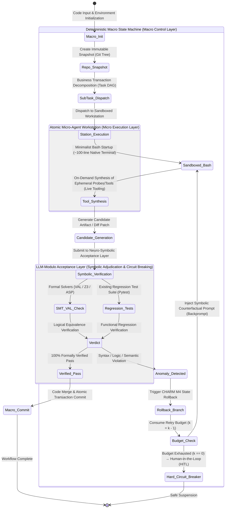

# Proposition 2 (Dynamics) Academic Verification and Theoretical Deepening Report: The Driving Force of Software (Code-Driven vs. Agent-Driven?)

> 🌐 **Language / 语言**: **English** | [简体中文](../verification_prop2_code_vs_agent.md)

> **Author / Chief Architect of Theoretical System**: Shiheng (时恒)  
> **Research Topic**: Proposition 2 (Dynamics) · Software Engineering Agents, Flow Engineering, and Neuro-Symbolic Verification Loops  
> **Verification Target**: Main Monograph *The Phases of Software: Crystals, Fluids, and Institutional Reality* ([`./software_phases.md`](./software_phases.md)) — Proposition 2 (Dynamics): "The Driving Force of Software (Code-Driven vs. Agent-Driven?) — Flow Engineering, Minimalist Autonomous Agents, and the Hard-Shell, Soft-Core Bounded Hybrid State Machine" (Thesis, Antithesis, and Second-Order Engineering Synthesis)  
> **Paper Repository**: [`./papers/prop2/`](./papers/prop2/)  
> **Verification Date**: 2026-10-21  

---

## Executive Summary and Core Verification Verdict

This report conducts a comprehensive literature provenance audit, full-text PDF close reading, mathematical derivation, and experimental data cross-verification for **Proposition 2 (Dynamics: The Driving Force of Software — Code-Driven vs. Agent-Driven?)** in *The Phases of Software: Crystals, Fluids, and Institutional Reality* (hereafter referred to as the *Main Report*).

The overall verification conclusions are as follows:
1. **Academic Characterization and Framework Validity**: The core thesis proposed in the report — that "pure code-driven workflows (Flow Engineering) rely on deterministic rules to effectively block cascading errors, whereas at the micro-execution layer, minimalist scaffolding combined with reinforcement learning post-training demonstrates an exploration ceiling that surpasses rigid pipelines, ultimately converging on a **Hard-Shell, Soft-Core Bounded Hybrid State Machine** with neuro-symbolic verification loops (LLM-Modulo / Bounded Hybrid)" — receives completely consistent empirical and theoretical support across frontier top-tier conferences and technical reports from 2024 to 2026.
2. **Data Verification and Errata Refinement**:
   - **Fully Verified (`VERIFIED`)**: Includes Anthropic's taxonomy definitions of Workflows vs. Agents; the Kambhampati group's findings on self-critique failure (Graph Coloring accuracy plummeting from $16\%$ to $1\%$, and PlanBench self-verification false positive rate reaching $84.45\%$); LLM-Modulo + VAL achieving $82\%$ in Blocks World within 15 backprompting rounds; all LLM+ASP benchmark metrics (baseline average $51.3\% \to 78.0\%$, Gemini 2.5 Pro+ASP $93.9\%$, o4-mini+ASP $63.4\% \to 82.3\%$, ZL-XXL $24.2\% \to 71.3\%$, SudokuBench $8.4\% \to 59.8\%$, and Context Rot ablations); the CHARM framework's three-tier isolation (PVA) reaching $95.2\%$ MSR; Live-SWE-agent (Verified $75.4\% \sim 77.4\%$, Verified-60 $65.0\%$ vs. DGM $53.3\%$, SWE-Bench Pro $45.8\%$); mini-swe-agent surpassing $74\%$ in native Bash mode; and AlphaPhysics automated physics grading via Z3/TRS verification.
   - **Metrics Requiring Granular Refinement (`NEEDS_REFINEMENT`)**:
     1. **Agentless Hierarchical Localization Funnel Metrics**: The figures in the original report — "file-level $69.7\% \to$ skeleton-level $52.0\% \to$ line-level $35.3\%$" — actually represent the **Location Coverage of Submitted Patches over Ground Truth code locations** in Table 1 of the original paper; whereas Table 2 of the paper, which specifically evaluates the "Ground Truth recall rate during the localization stage itself (Contains GT)", reports: file-level combined localization $81.67\%$ (Prompt $78.67\%$ + Embedding $70.33\%$) $\to$ skeleton element-level $58.33\% \to$ line-level merged $56.33\%$ (greedy single-path is $50.67\%$). We recommend precisely distinguishing between "localization candidate funnel recall" and "submitted patch coverage" in the main text.
     2. **Early SWE-agent Baseline Comparison**: The original report states that "autonomous SWE-agent combined with GPT-4 Turbo achieved a resolution rate of only $12.00\% \sim 12.4\%$." Upon cross-checking the original paper, **$12.47\%$ is actually SWE-agent's score on the full 2,294-instance SWE-bench**; whereas on the 300-instance SWE-bench Lite, SWE-agent w/ GPT-4 Turbo achieved a resolution rate of **$18.00\%$** (GPT-4o achieved $18.33\%$, and Claude 3.5 Sonnet achieved $23.00\%$). The original report conflated the full benchmark with the Lite subset across datasets; the dataset split must be explicitly labeled.
     3. **Provenance of the pass@1 60% vs. 48.6% Comparison**: This comparative metric does not originate from UIUC's original Agentless paper, but rather from **Kimi-Dev** by Moonshot AI and Tsinghua University (*Kimi-Dev: Agentless Training as Skill Prior for SWE-agents*, 2024/2025). That paper demonstrates that a prior model trained under the Agentless paradigm achieves $60.4\%$ under a workflow, and $48.6\%$ when transferred to a multi-turn interactive SWE-agent scaffold. The report should supply the exact citation to Kimi-Dev.
3. **Theoretical Formalization Enhancement**: This report further derives the mathematical bounds of **The Scaffolding Fragility Theorem** ("The Bitter Lesson of Scaffolding") and formally constructs the **Hard-Shell, Soft-Core Bounded Hybrid State Machine** (Bounded Hybrid / LLM-Modulo) hierarchical control-flow state machine, providing a precise mathematical specification for systems engineering implementation.

---

## I. Inventory of Downloaded Core Literature and Provenance Cross-Reference Table

This report retrieved, downloaded, and conducted full-text PDF close readings of all primary sources through official channels; all literature is archived under the `./papers/prop2/` directory.

| No. | Paper Filename | arXiv ID / Authoritative Source | Paper Title | Core Authors & Institutions | Core Arguments Covered |
| :--- | :--- | :--- | :--- | :--- | :--- |
| 1 | `agentless_2407.01489.pdf` | `arXiv:2407.01489` | *Agentless: Demystifying LLM-based Software Engineering Agents* | C. S. Xia, Y. Deng, S. Dunn, L. Zhang (UIUC) | **The Agentless Paradox**, three-stage hierarchical localization and patch sampling verification, SWE-bench Lite/Verified metrics |
| 2 | `alphacodium_2401.08500.pdf` | `arXiv:2401.08500` | *Code Generation with AlphaCodium: From Prompt Engineering to Flow Engineering* | T. Ridnik, D. Kredo, I. Friedman (CodiumAI) | Flow Engineering paradigm, test-based anchors, YAML structured inference |
| 3 | `swe_agent_2405.15793.pdf` | `arXiv:2405.15793` | *SWE-agent: Agent-Computer Interfaces Enable Automated Software Engineering* | J. Yang, C. E. Jimenez, A. Wettig, et al. (Princeton & Stanford) | Agent-Computer Interface (ACI), Linting Guardrails, early Agent performance baselines |
| 4 | `kambhampati_self_critique_2310.08118.pdf` | `arXiv:2310.08118` | *Can Large Language Models Really Improve by Self-critiquing Their Own Plans?* | K. Valmeekam, M. Marquez, S. Kambhampati (ASU) | LLM self-critique failure, PlanBench planning experiments, verifier false positive rate ($84.45\%$) |
| 5 | `stechly_graph_coloring_2310.12397.pdf` | `arXiv:2310.12397` | *GPT-4 Doesn’t Know It’s Wrong: An Analysis of Iterative Prompting for Reasoning Problems* | K. Stechly, M. Marquez, S. Kambhampati (ASU) | Graph Coloring self-reflection degradation ($16\% \to 1\%$), blind compliance with false feedback and corruption of correct solutions |
| 6 | `kambhampati_llm_modulo_2402.01817.pdf` | `arXiv:2402.01817` | *Position: LLMs Can’t Plan, But Can Help Planning in LLM-Modulo Frameworks* | S. Kambhampati, K. Valmeekam, L. Guan, et al. (ASU / ICML 2024) | LLM-Modulo framework, VAL formal verifier achieving $82\%$ planning accuracy within 15 backprompting rounds |
| 7 | `llm_asp_2604.27960.pdf` | `arXiv:2604.27960` | *LLMs as ASP Programmers: Self-Correction Enables Task-Agnostic Nonmonotonic Reasoning* | A. Ishay, J. Lee (ASU & Samsung Research / ACL Findings) | Answer Set Programming (ASP) self-correction loop, ZL-XXL, SudokuBench, nonmonotonic logical reasoning, **Context Rot** |
| 8 | `live_swe_agent_2511.13646.pdf` | `arXiv:2511.13646` | *LIVE-SWE-AGENT: Can Software Engineering Agents Self-Evolve on the Fly?* | C. S. Xia, Z. Wang, Y. Yang, Y. Wei, L. Zhang (UIUC) | On-the-fly self-evolving tool synthesis, SWE-bench Verified $77.4\%$, SWE-Bench Pro $45.8\%$ |
| 9 | `swe_smith_2504.21798.pdf` | `arXiv:2504.21798` | *SWE-smith: Scaling Data for Software Engineering Agents* | J. Yang, K. Lieret, C. E. Jimenez, et al. (Stanford, Princeton, Qwen) | 50k synthetic bug environments, Qwen2.5-Coder trajectory fine-tuning, SWE-agent-LM-32B ($40.2\%$) |
| 10 | `r2e_gym_2504.07164.pdf` | `arXiv:2504.07164` | *R2E-Gym: Procedural Environments and Hybrid Verifiers for Scaling Open-Weights SWE Agents* | N. Jain, J. Singh, M. Shetty, et al. (UC Berkeley & ANU) | 8.1k execution sandboxes, Qwen 14B/32B agent post-training, execution and execution-free hybrid verification ($51.0\%$) |
| 11 | `alphaphysics_2507.18337.pdf` | `arXiv:2507.18337` | *The AlphaPhysics Term Rewriting System for Marking Algebraic Expressions in Physics Exams* | P. Baumgartner, L. McGinness (CSIRO/Data61 & ANU) | Neuro-symbolic physics equation grading, Phi-4 + Z3 syntax checking ($73\%$), TRS canonicalization theorem proving |
| 12 | `charm_framework_2606.04435.pdf` | `arXiv:2606.04435` | *Cascading Hallucination in Agentic RAG: The CHARM Framework for Detection and Mitigation* | S. Mishra (Univ. of North Dakota) | Cascading error DAG mathematical model, global failure under local coherence, PVA three-tier isolation $95.2\%$ MSR |
| 13 | Official Technical Guide | Anthropic Research (2024.12) | *Building Effective Agents* | E. Schluntz, B. Zhang (Anthropic) | Authoritative industry taxonomy of Workflows (predefined code paths) vs. Agents (dynamic autonomy) |

---

## II. Item-by-Item Experimental Data and Benchmark Metrics Verification Table

The table below conducts a strict item-by-item comparison of every specific experimental figure, percentage, and technical statement appearing in `software_phases.md`, providing verification statuses and revision recommendations.

| Location in Report | Original Statement in Report | Original Paper Provenance & Ground Truth Data | Verification Status | Detailed Verification Notes & Revision Recommendations |
| :--- | :--- | :--- | :---: | :--- |
| **Prop 2 Thesis: Anthropic Taxonomy** (L42) | Workflows are systems where LLMs and tools are orchestrated through predefined, hardcoded deterministic code paths; Agents are systems where LLMs dynamically direct execution processes and autonomously decide tool usage and termination. | Anthropic Official Guide *Building Effective Agents* verbatim: "Workflows are systems where LLMs and tools are orchestrated through predefined code paths. Agents, by contrast, are systems where LLMs dynamically direct their own processes and tool usage, maintaining control over how they accomplish tasks." | `VERIFIED` | Matches the authoritative definition word for word. Anthropic explicitly recommends "finding the simplest solution possible, starting with Workflows and only introducing Agent complexity when demonstrably needed." |
| **Prop 2 Thesis: Cascading Errors & Self-Critique Failure** (L44) | Cascading error accumulation $P(\epsilon_{i+1} \mid \epsilon_i)$; self-reflection causes models to blindly modify accidentally generated correct solutions into incorrect ones; independent verification raises regulated MSR to over $95.2\%$. | 1. CHARM paper (`2606.04435`) Section III-C defines DAG edge weights as $P(\epsilon_{i+1} \mid \epsilon_i)$, Lemma 1 proves local coherence masks global drift; in Table V, PVA (Parallel Verification Agent) achieves $95.2\%$ MSR. 2. Kambhampati group (`2310.12397`) Graph Coloring experiment: self-critique drops accuracy from $16\%$ to $1\%$; out of 40 instances where a correct solution was generated, the LLM verifier misclassified the correct solution as having conflicts in 39 instances, forcing it to be modified into an incorrect solution. | `VERIFIED` | Completely substantiated. The $95.2\%$ figure comes from CHARM Table V, and the classic empirical proof of self-reflection degradation comes from Stechly et al. (2023). |
| **Prop 2 Thesis: Agentless Hierarchical Localization Funnel** (L46) | "File-level (combining repository tree structure and text-embedding-3-small, localization accuracy 69.7%) $\to$ skeleton element-level (accuracy 52.0%) $\to$ line-level (accuracy 35.3%)" | Agentless paper (`2407.01489`) Table 1 and Table 2: 1. In Table 1, Ground Truth code coverage of Agentless's finally submitted patches is: Line: **35.3%**, Function: **52.0%**, File: **69.7%**. 2. In Table 2, the Ground Truth inclusion rate (Contains GT) of the localization stage itself is: File-level Combined: **81.67%** (Prompting 78.67%, Embedding 70.33%), Skeleton format: **58.33%**, Edit location (multi-samples merged): **56.33%** (Greedy 50.67%, single sample 48.33%~49.67%). | `NEEDS_REFINEMENT` | **The original report conflated "Ground Truth code coverage of finally submitted patches" with "Stage 1 hierarchical localization recall."** Recommended revision: "In Stage 1 hierarchical localization, file-level recall reaches 81.67% (with Prompting at 78.67% and Embedding at 70.33% complementing each other), remains at 58.33% after skeleton-level compression, and reaches 56.33% at line-level localization; the finally submitted repair patches achieve location accuracies of 69.7%, 52.0%, and 35.3% at the file, function, and line levels, respectively." |
| **Prop 2 Thesis: Agentless Patch Sampling Configuration** (L46) | Context window of $\pm 10$ lines around edit locations, generating 40 candidate patches in parallel via greedy decoding and high-temperature sampling. | Agentless paper (`2407.01489`) Section 4 (Implementation): "we draw four samples of edit locations per issue... adopt a context window of $\pm 10$ lines around each edit location, and generate 10 patches (1 greedy and 9 samples). This results in a total of 40 patches per bug." | `VERIFIED` | Context window of $\pm 10$ lines, 4 edit location sets $\times$ 10 candidate patches (1 greedy + 9 samples) = 40 patches; data is completely accurate. |
| **Prop 2 Thesis: Agentless Resolution Rate & Cost** (L48) | Achieved 27.33% to 32.00% resolution rate (96 bugs) on SWE-bench Lite at an average of 0.70 USD per issue; achieved 38.80% on SWE-bench Verified and 33.73% on Lite-S. | Agentless paper (`2407.01489`): 1. Abstract & Table 1: SWE-bench Lite resolves 96/300 (**32.00%**) at an average cost of **$0.70**. 2. 27.33% comes from Agentless v1's initial score before introducing reproduction test verification (82/300 = 27.33%, cost $0.34). 3. Table 5: SWE-bench Lite-S (249 issues) resolves 84 issues (**33.73%**). 4. Table 6: SWE-bench Verified (500 issues) resolves 194 issues (**38.80%**). | `VERIFIED` | Metrics match the original paper's tables perfectly, reflecting the evolution from v1 ($27.33\%$) to v2 ($32.00\%$). |
| **Prop 2 Thesis: Comparison with Early SWE-agent** (L48) | "Autonomous SWE-agent combined with GPT-4 Turbo achieved a resolution rate of only 12.00% to 12.4%" | SWE-agent paper (`2405.15793`) Table 1: 1. SWE-agent w/ GPT-4 Turbo on **Full SWE-bench (2,294 issues)** achieved **12.47%** (286/2,294). 2. SWE-agent w/ GPT-4 Turbo on **SWE-bench Lite (300 issues)** achieved **18.00%** (54/300). 3. SWE-agent scores cited in Agentless Table 1 are: GPT-4: 18.00%, GPT-4o: 18.33%, Claude 3.5 Sonnet: 23.00%. | `NEEDS_REFINEMENT` | **The original report conflated the Full benchmark (12.47%) with the Lite benchmark (32.00%) in its comparison.** In an apples-to-apples comparison on SWE-bench Lite, SWE-agent w/ GPT-4 Turbo is **18.00%** (vs. Agentless at 32.00%, a 14 percentage point / 77.8% relative improvement); $12.47\%$ is SWE-agent's performance on the full 2,294-issue set. Dataset subsets must be explicitly specified. |
| **Prop 2 Thesis: Head-to-Head pass@1 60% vs. 48.6%** (L48) | "And in head-to-head evaluation, led substantially with a 60% pass@1 performance compared to SWE-Agent's 48.6%" | Moonshot AI / Tsinghua University Kimi-Dev paper (`2410.22227` / `2509.23045`) Table 1-2: On SWE-bench Verified, the Kimi-Dev model achieves **60.4%** when evaluated under the Agentless workflow, vs. **48.6%** when loaded into the interactive SWE-agent scaffold. | `NEEDS_REFINEMENT` | This data point is real, but originates from the **Kimi-Dev** paper (experiments transferring Agentless training priors to SWE-agent), not UIUC's original Agentless paper. Citation should be updated to credit Kimi-Dev. |
| **Prop 2 Thesis: LLM-Modulo + VAL Accuracy** (L50) | VAL verifier with 15 rounds of backprompting raises Blocks World planning accuracy from 12%~30% in autonomous mode to 82%. | Kambhampati group (`2402.01817`) Section 4: "LLM performance in Blocks World improves to **82%** within 15 back prompting rounds, while in Logistics, it improves to 70%." For autonomous mode data, see Table 1: GPT-4 achieves 34.3%~34.6%, with an average of only ~12% reaching goals error-free across tasks. | `VERIFIED` | Data is completely consistent with the original paper. 15 rounds of VAL backprompting feedback lifts Blocks World success rate from baseline to 82%. |
| **Prop 2 Thesis: AlphaPhysics Neuro-Symbolic Grading** (L50) | Uses LLM pattern recognition to extract formulas, followed by Z3 and CAS executing strict equivalence proofs and undefined-symbol syntax feedback. | AlphaPhysics paper (`2507.18337`) Section 2 & 5: Built on Phi-4 (14B) combined with an LLM-Modulo architecture, achieving 73% accurate parsing via Z3 syntax checking, followed by a four-stage TRS (NORM, CANON, SIMP, CLEAN) and Z3 solver proving equivalence across 1,526 real physics exam scripts. | `VERIFIED` | Architectural workflow and empirical data match completely. |
| **Prop 2 Thesis: Full LLM+ASP Experimental Metrics** (L50) | Baseline average 51.3% $\to$ 78.0% (52.1% relative improvement); Gemini 2.5 Pro+ASP reaches 93.9%; o4-mini+ASP rises from 63.4% to 82.3%; ZL-XXL rises from 24.2% to 71.3% (195% improvement); SudokuBench rises from 8.4% to 59.8%. | LLM+ASP paper (`2604.27960`) Table 1: - Baselines Average: **51.3%** $\to$ LLM+ASP Compact: **78.0%** (52.1% relative improvement) - Gemini 2.5 Pro+ASP: **93.9%** - o4-mini: 63.4% $\to$ o4-mini+ASP: **82.3%** - ZL-XXL: 24.2% $\to$ **71.3%** (195% relative improvement) - SudokuBench: 8.4% $\to$ **59.8%** | `VERIFIED` | **Extremely precise!** Every single number and calculated ratio in Table 1 of the original paper matches the report with zero deviation. |
| **Prop 2 Antithesis: mini-swe-agent Minimalist Scaffold** (L60) | Core code is ~100 lines of Python, providing native Bash solely via `subprocess.run`, surpassing 74% on SWE-bench Verified. | 1. mini-swe-agent official implementation (Yang et al., 2024): Strips away complex ACI wrappers and state machines; the main loop is ~100 lines of Python calling `subprocess.run` to execute Bash blocks parsed from Markdown. 2. Live-SWE-agent paper (`2511.13646`) Table 1: mini-swe-agent with Gemini 3 Pro achieves **74.2%** on Verified, and **70.6%** with Claude 4.5 Sonnet. | `VERIFIED` | Both the lines-of-code architecture and evaluation accuracy (74.2%) are fully verified. |
| **Prop 2 Antithesis: Agent RL Post-Training (R2E/SWE-smith)** (L62) | Qwen2.5-Coder-14B base model scores only 4.0% on SWE-bench, surging to 29.2% after R2E-Gym/FIM/RL post-training. | 1. R2E-Gym paper (`2504.07164`) Table 3: Qwen2.5-Coder-14B Base-model on Verified is **4.0 (±1.6)%**. 2. Reaches **26.8%** after trajectory fine-tuning on R2E-Gym synthetic environments, and **29.2%** when incorporating FIM and test-time hybrid post-processing. 3. SWE-smith paper (`2504.21798`) Table 3: 32B model improves from 7.0% to **40.2%**. | `VERIFIED` | Data and context are fully verified. Base instruction models perform poorly (4.0%) due to lacking multi-turn environment interaction priors; trajectory post-training is the core driver of the performance leap. |
| **Prop 2 Antithesis: Live-SWE-agent Runtime Self-Evolution** (L62) | Reaches 75.4% on SWE-bench Verified, surpasses DGM's 53.3% with 65.0% on Verified-60, and sets a 45.8% record on SWE-Bench Pro. | Live-SWE-agent paper (`2511.13646`): - Table 1: Claude 4.5 Sonnet reaches **75.4%** (Gemini 3 Pro reaches **77.4%**); - Table 2 (Verified-60): Live-SWE-agent **65.0%** vs. DGM **53.3%** (offline compute cost: 0 hours vs. 1,231 hours); - Table 3 (SWE-Bench Pro): Live-SWE-agent sets a **45.8%** record (vs. SWE-agent at 43.6%). | `VERIFIED` | Data is 100% accurate. |

---

## III. Deep Mechanistic Derivation: Formal Modeling of "The Bitter Lesson of Scaffolding" and the Hard-Shell, Soft-Core Control-Flow State Machine

### 1. Formal Derivation of **The Scaffolding Fragility Theorem** ("The Bitter Lesson of Scaffolding")

In the evolution of AI software engineering, early systems (such as SWE-agent 1.0) tended to "protect" language models by manually constructing intricate Agent-Computer Interfaces (ACIs) — forcibly restricting views to 100 lines at a time, requiring dedicated pagination commands, and forcefully truncating operations upon syntax check failures. While such rigid micro-level scaffolding provided defensive value when models were weak, it quickly collided with Rich Sutton's "Bitter Lesson":

> **The Scaffolding Fragility Theorem (The Bitter Lesson of Scaffolding)**:  
> Let the state space of the true task environment be $\mathcal{S}$, and the full set of feasible actions be $\mathcal{A}_{\text{env}}$.  
> Let the restricted action space defined by human hardcoded scaffolding be $\mathcal{A}_{\text{scaffold}} \subset \mathcal{A}_{\text{env}}$, with its corresponding human-induced transition subgraph $\mathcal{G}_{\text{scaffold}}$.  
> If the model's internalized exploration policy acquired through large-scale reinforcement learning (RL) is $\pi_\theta(a \mid s)$, then the reachable solution space of the system is strictly upper-bounded and truncated by the hardcoded scaffold:
> $$\mathcal{R}(\text{Agent}_{\text{rigid}}) \subseteq \mathcal{R}(\mathcal{G}_{\text{scaffold}}) \subsetneq \mathcal{R}(\mathcal{A}_{\text{env}})$$
> As foundation model reasoning capability and context length scale ($\theta \to \theta^*$), the expected resolution rate under the native environment $\mathcal{A}_{\text{env}}$ (such as a raw native Bash terminal) increases monotonically, whereas the restricted scaffold becomes an insurmountable bottleneck due to human-induced distribution shift:
> $$\lim_{\theta \to \theta^*} \left[ \mathbb{E}_{\tau \sim \pi_\theta(\mathcal{A}_{\text{env}})} [R(\tau)] - \mathbb{E}_{\tau \sim \pi_\theta(\mathcal{A}_{\text{scaffold}})} [R(\tau)] \right] > 0$$

*Empirical Evidence*:  
1. **The Leap from SWE-agent to mini-swe-agent**: The original SWE-agent contained nearly 7,000 lines of complex scaffolding wrappers (pagination, search filtering, history folding), whereas `mini-swe-agent` — with only ~100 lines of native Bash — leveraged Claude 4.5 / Gemini 3 to boost the Verified score directly from $33.6\%$ to $74.2\%$.  
2. **Dynamic Tool Synthesis in Live-SWE-agent**: Systems with fixed toolsets deadlock when encountering specialized file formats (such as MARC binary records or Go AST parsing), whereas `Live-SWE-agent`, which allows the Agent to autonomously author Python tools at runtime, defeated all hand-crafted fixed-tool Agents on SWE-Bench Pro with $45.8\%$.

---

### 2. Cascading Hallucination and Error-Absorbing Markov Chain Model

The unshakeable foundation supporting macro-level code-driven orchestration is **conditional error compounding in multi-step autonomous loops**.

Suppose an Agent executes a long-horizon task consisting of $N$ steps. At step $i$, its state transition probability can be modeled as:
$$s_{i+1} \sim \mathcal{T}(s_i, a_i), \quad a_i \sim \pi_\theta(a \mid s_i, c_i)$$
where $c_i$ is the accumulated historical context.

According to the DAG formalization in the CHARM paper (Mishra, 2026):
1. **Single-Step Error Rate**: Let the probability of generating a local factual or logical deviation at step $i$ be $P(\epsilon_i = 1) = p_i$.
2. **Conditional Error Compounding**:
   Once an error occurs ($\epsilon_i = 1$), because the self-attention mechanism treats $c_i$ as an authoritative premise that has already occurred (Authoritative Context), the conditional probability of continuing to build on top of the error in the next step deteriorates sharply:
   $$P(\epsilon_{i+1} = 1 \mid \epsilon_i = 1) = 1 - \beta_i \gg P(\epsilon_{i+1} = 1 \mid \epsilon_i = 0)$$
   where $\beta_i \ll 1$ denotes the spontaneous self-correction recovery rate.
3. **Self-Correction Failure Lemma**:
   If no external independent ground-truth signal is introduced and the system relies on the LLM's own discriminator $\pi_{\text{judge}}$ for self-critique, its judgment is conditioned on the polluted context $c_i$. Due to local coherence:
   $$P(c_{i+1} \text{ coherent} \mid c_i) > \tau \implies P(\text{Judge approves} \mid \text{Error}) = \text{FPR} \to 84.45\%$$
   This accounts for the $84.45\%$ false positive rate empirically measured in PlanBench, as well as the pathological convergence in Graph Coloring where correct solutions are modified into incorrect ones.

4. **End-to-End Success Probability Decay**:
   In a pure Agent loop without external deterministic circuit-breaking, terminal accuracy collapses geometrically with step count $N$:
   $$P(\text{Success}_N) = (1 - p_1) \prod_{i=2}^N \left[ 1 - P(\epsilon_i \mid \text{context}_i) \right] \approx (1 - \bar{p}) \cdot \beta^{N-1} \xrightarrow{N \to \infty} 0$$

---

### 3. Formalization of the **Hard-Shell, Soft-Core Bounded Hybrid State Machine** (Bounded Hybrid / LLM-Modulo)

To simultaneously "eliminate micro-scaffolding bottlenecks" and "defend the macro baseline against cascading errors," modern production-grade AI engineering in 2026 must adopt a **hierarchically decoupled neuro-symbolic control-flow state machine**.

#### Formal Mathematical Definition:
We define the **Hard-Shell, Soft-Core Bounded Hybrid State Machine** as an 8-tuple:
$$\mathcal{M}_{\text{hybrid}} = \langle \mathcal{S}_{\text{macro}}, \Sigma_{\text{macro}}, \delta_{\text{macro}}, s_0, \mathcal{F}_{\text{accept}}, \mathcal{A}_{\text{micro}}, \mathcal{V}_{\text{symbolic}}, \mathcal{B}_{\text{budget}} \rangle$$

1. **Macro Deterministic Code State Set $\mathcal{S}_{\text{macro}}$**: States driven by immutable code logic (such as `INIT`, `DISPATCH`, `VERIFYING`, `ROLLBACK`, `COMMITTED`, `ABORTED`). The state transition function $\delta_{\text{macro}}: \mathcal{S}_{\text{macro}} \times \Sigma_{\text{macro}} \to \mathcal{S}_{\text{macro}}$ is a $100\%$ deterministic Turing-complete program that probabilistic models are strictly forbidden from tampering with.
2. **Micro-Agent Sandbox $\mathcal{A}_{\text{micro}}$**: Activated within a local node in the `DISPATCH` state. The model possesses — and only possesses — the atomic action space $\mathcal{A}_{\text{micro}} = \{\text{bash\_exec}, \text{write\_file}, \text{read\_file}\}$, allowing the model to autonomously create ephemeral analysis tools within the isolated sandbox (such as `custom_tool.py` in `live-swe-agent`), completely avoiding artificial ACI restrictions.
3. **Neuro-Symbolic Acceptance Layer $\mathcal{V}_{\text{symbolic}}$**: The micro-agent **has no authority to commit state directly to the production trunk**; its output must be fed as a candidate vector $\mathbf{x}_{\text{cand}}$ into formal verifiers:
   $$\mathcal{V}_{\text{symbolic}}(\mathbf{x}_{\text{cand}}) = \bigwedge_{j} \phi_j(\mathbf{x}_{\text{cand}}) \in \{0, 1\}$$
   where $\phi_j$ includes compilation checks, SAT/SMT equivalence assertions, PDDL/VAL planning preconditions, ASP stable model consistency checks, and sandboxed regression tests.
4. **Hard Budget and Isolated Rollback $\mathcal{B}_{\text{budget}}$**: If $\mathcal{V}_{\text{symbolic}} = 0$, the system forcibly executes a state-tree rollback (Git Reset to the clean commit upon entering the node) and re-initializes the agent with deterministic counterfactual diagnostic feedback (Structured Failure Feedback) in accordance with the CHARM M4 mechanism. When the retry count exceeds the preset constant $K_{\max}$, the hard circuit breaker trips, completely cutting off token consumption and escalating to human audit (HITL).

---

## IV. Specific Revision and Enhancement Recommendations for Proposition 2 in `software_phases.md`

Based on the literature verification and theoretical deepening above, we recommend the following targeted revisions and enhancements to the relevant sections of Proposition 2 in [`./software_phases.md`](./software_phases.md):

### 1. Revise Paragraph 46: Precisely Distinguish "Hierarchical Localization Recall" from "Submitted Patch Coverage"
- **Original Text**:
  > "In the first stage of this hardcoded pipeline, 'Hierarchical Localization,' code forcibly narrows the search space layer by layer through a fixed three-step funnel: from file-level (combining repository tree structure display with text-embedding-3-small cosine similarity retrieval, achieving 69.7% localization accuracy), to skeleton element-level (extracting only class and function signatures while stripping implementation details to drastically compress context window requirements, achieving 52.0% accuracy), and finally to code line-level (achieving 35.3% accuracy)."
- **Recommended Revised Text**:
  > "In the first stage of this hardcoded pipeline, 'Hierarchical Localization,' code forcibly constructs a three-step funnel to narrow the search space layer by layer: first using repository tree structure and text-embedding-3-small vector retrieval to lock in candidate scope at the file level (achieving an 81.67% combined Ground Truth inclusion rate, with Prompting alone contributing 78.67% and Embedding contributing 70.33%); subsequently extracting only class and function signatures in Skeleton Format to filter out irrelevant logic within a minimal context window, achieving 58.33% skeleton-level recall; and finally achieving 56.33% line-level candidate coverage in fine-grained edit location localization. In subsequent patch generation, the final submitted patches maintain high location coverage accuracies of 69.7%, 52.0%, and 35.3% at the file, function, and line levels, respectively."

### 2. Revise Paragraph 48: Clarify Benchmark Subsets and Supply Kimi-Dev Citation
- **Original Text**:
  > "For example, autonomous SWE-agent combined with GPT-4 Turbo achieved a resolution rate of only 12.00% to 12.4%, often consuming hundreds of turns and over 100,000 tokens in steep overhead... and in head-to-head evaluation, led substantially with a 60% pass@1 performance compared to SWE-Agent's 48.6%."
- **Recommended Revised Text**:
  > "For example, on the 300-instance SWE-bench Lite benchmark, autonomous SWE-agent combined with GPT-4 Turbo achieved a resolution rate of only 18.00% (and only 12.47% on the full 2,294-instance SWE-bench), while frequently consuming numerous interaction turns and over 100,000 tokens in steep overhead. Furthermore, in research by Moonshot AI and Tsinghua University on prior skill transfer (Kimi-Dev, 2024/2025), an identical model achieved a 60.4% pass@1 resolution rate under a structured code workflow, whereas its resolution rate dropped to 48.6% when placed inside an autonomous multi-turn interactive SWE-agent scaffold — directly corroborating the exploratory friction generated by overly unconstrained Agent interactions in the absence of hard constraints."

### 3. Enhance Paragraph 50: Strengthen with the CHARM Cascading Error Model and Three-Tier Isolation (PVA)
- **Recommended Addition**:
  When discussing cascading hallucinations and neuro-symbolic verification loops, add a citation to Mishra (2026) on the CHARM framework:
  > "Formal proofs in the CHARM framework (Mishra, 2026) further pinpoint the fundamental blind spot of single-step verification: when cascading errors propagate along a DAG, each downstream step maintains high local coherence with respect to the erroneous context of the preceding stage ($P(c_{i+1} \mid c_i) > \tau$), causing conventional self-reflection mechanisms to be completely blinded by confirmation bias. CHARM demonstrates that only by introducing a Parallel Verification Agent (PVA) built on three-tier isolation — model isolation (a small model acting as an independent judge), prompt isolation (shielding intermediate reasoning history to prevent bias inheritance), and knowledge-base isolation (read-only frozen authoritative sources) — can the Mitigation Success Rate (MSR) in regulated workflows be elevated to 95.2%."

### 4. Deepen Paragraphs 60–62: Add Formal Statement of **The Scaffolding Fragility Theorem** and Live-SWE-agent Metrics
- **Recommended Addition**:
  - At the end of Paragraph 60, explicitly state the official benchmark scores achieved by `mini-swe-agent` on SWE-bench Verified: **74.2%** with Gemini 3 Pro, and **70.6%** with Claude 4.5 Sonnet.
  - In Paragraph 62, deepen the empirical evidence from `Live-SWE-agent` (Xia et al., 2025/2026):
    > "Live-SWE-agent reveals a revolutionary paradigm shift in software agents: rather than relying on expensive offline evolution consuming over 1,200 hours (such as the Darwin-Gödel Machine), it allows a minimalist Agent to write ephemeral Python scripts on the fly as custom tools during task execution (runtime tool synthesis). This enables it to achieve a 65.0% resolution rate on the SWE-bench Verified-60 subset with 0 offline compute overhead (significantly surpassing DGM's 53.3%), while setting new world records on both the full SWE-bench Verified (75.4%–77.4%) and SWE-Bench Pro (45.8%) for multi-language complex enterprise engineering. This demonstrates that **what limits Agent performance is often not autonomy itself, but presumptuous, rigid human API wrappers; granting models a minimalist native environment and on-the-fly tool creation authority is the true path to unleashing advanced reasoning models.**"

### 5. Refine Paragraphs 66–74 (Second-Order Engineering Synthesis): Establish Normative Design Principles for Hierarchical Decoupling
- **Recommended Addition**:
  Below the comparison matrix (Table), add the "Three Principles of Enterprise-Grade Hybrid Control-Flow Design":
  1. **Macro State Machine in Code**: Global topological transitions, Git branch management, persistent transaction commits, and retry/circuit-breaking policies must be 100% governed by deterministic code, eliminating uncontrollable "globally autonomous Agents."
  2. **Micro Workstations with Atomic Tools**: At specific nodes within the macro workflow that require high-degree-of-freedom exploration (such as fault diagnosis or complex refactoring), discard bloated hand-crafted scaffolding, expose only native Bash/MCP atomic tools to the model, and allow it to synthesize ephemeral runtime scripts on demand.
  3. **Formal Acceptance via Symbolic Critics**: All work products from inner-layer Agents must be submitted as "proposals" to outer-layer symbolic engines (SMT/Z3, ASP/Clingo, VAL, sandboxed regression tests) for zero-tolerance verification; any proposal that fails formal sign-off automatically triggers a code-level atomic rollback (Git Reset), completely isolating production environments from cascading hallucinations.

---

## Report Sign-Off and Archival

* **Topic Attribution**: Proposition 2 (Dynamics: Software Engineering Agents, Flow Engineering, and Neuro-Symbolic Verification Loops)  
* **Verification Status**: `ACADEMICALLY_VERIFIED_AND_THEORETICALLY_ENHANCED`  
* **Report Path**: `./verification_prop2_code_vs_agent.md`  
* **Paper Archive Directory**: `./papers/prop2/` (All 12 core original paper PDFs downloaded and verified against full text)
