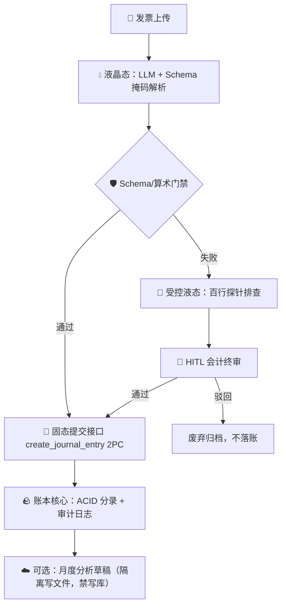

# 《时恒物态架构处方单》示例 · PHASE_SPEC.md Example
## 项目：发票智能入账服务（Invoice-to-Ledger Service）

> 本示例演示 `ask-shiheng` 三问把脉后的标准输出形态。脱敏改写自真实场景，可直接作为你项目的处方单模板。

---

## 一、模块 `[目的, 过程, 结果]` 物态与裁判切分表

| 模块 / 功能点 | `[目的, 过程, 结果]` 坐标 | 所属物态 | 驱动方式与 $L^*$ 降维策略 | 验收门禁档位与具体裁判 |
| :--- | :---: | :---: | :--- | :--- |
| 账务核心（分录、ACID、权限、对账） | `[1, 1, 1]` | 🪨 固态 | 100% 确定性代码（Go + Postgres），状态机锁死 `draft → posted → reversed` 转移 | 🛡️ A：编译器 + 单测 + 数据库约束 |
| 发票解析（PDF/图片 → JSON） | `[1, 0, 1]` | 💧 液晶态 | LLM 单步提取 + Pydantic 强 Schema 掩码，无多轮 Agent | 🛡️ A：Schema 校验器 + 金额/税额算术复核 |
| 异常票据排障探针（解析失败兜底） | `[1, 0, 0]` | 🌊 受控液态 | 百行极简 Bash/Python 探针，只读沙盒，仅产出待审 Proposal | 👀 B：Critic LLM 初筛 + 会计 HITL 终审 |
| 月度经营分析叙事草稿 | `[0, 0, 0]` | ☁️ 无界气态 | 开放采样自由生成 | 👀 B：仅落草稿文件，**禁止写库** |
| 分录提交（唯一写操作） | `[0/液] → [1,1,1]` | 💎 制度性晶体 | `create_journal_entry` Kinetic Action 2PC 写回，提议/提交物理分离 | 🛡️ A：事务 + 快照回滚 + 审计日志 |

## 二、外硬内柔混合状态机拓扑

- **外硬**：阶段跳转、快照与回滚由确定性代码锁死；提交接口是唯一写库入口。
- **内柔**：🌊 探针在只读沙盒内自由探索，只产出 Proposal，不得触碰账本。

## 三、制度性晶体与防上下文腐败红线

- **那根数据线**：唯一真实写操作 = `create_journal_entry(invoice_id, entries[])`，2PC 事务提交。
- **硬编码实体与主键**：`Invoice(invoice_id)`、`LineItem(line_id)`、`Account(account_code)`、`JournalEntry(entry_id)`；`invoice_id → entry_id` 的 Link 关联由确定性代码写死。
- **严禁事项**：LLM 不得裸写生产 SQL Join、不得绕过门禁直接写库；AI 节点仅输出 JSON 提案，提交永远走固态接口。
- **按需作用域投射**：解析节点每次仅挂载 `InvoiceSchema` 与当前票据图片，严禁把全量科目表或历史票据塞入上下文。

## 四、第一步落子建议

1. 写死 `solid_core/`：`create_journal_entry` 接口签名 + 状态机 + 数据库迁移与单测（TDD，先红后绿）；
2. 再写 `liquid_crystal/`：`InvoiceSchema`（Pydantic）+ 单步提取器 + Schema 门禁单测；
3. 最后开 `sandbox/`：🌊 探针最小工具集（只读文件访问、票据 OCR 重试），连接 HITL 审批流。
