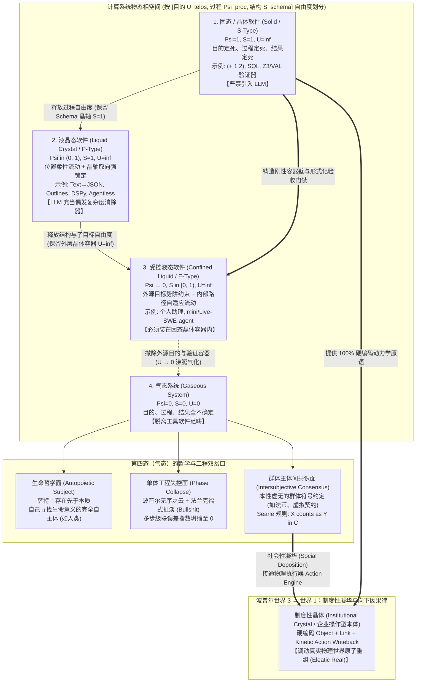
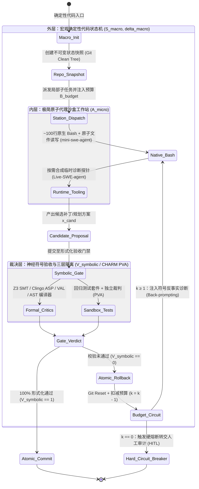
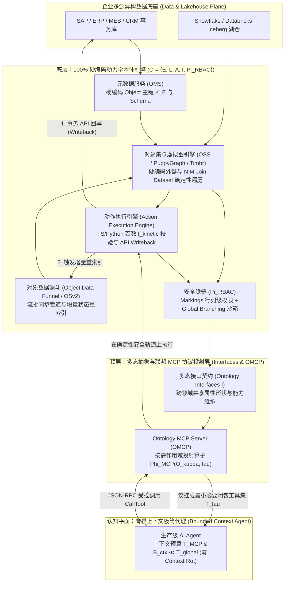

# 《软件物态学：晶体、流体与制度性实在》
## ——AI 软件工程 101 深度指导手册：什么软件需要 LLM、AI 的智力本质、软件的驱动动力与物理世界互动
*Phases of Software: Crystals, Fluids, and Institutional Reality — An AI Engineering 101 Guide*

**作者**：时恒  
**开源协议**：[CC BY-SA 4.0 (`./LICENSE`)](./LICENSE)  
**文档定位**：AI 软件工程 101 深度指导手册（含四大专题核查、数学推导与 45 篇原始文献基准校准）  
**核心核查文献库与专题研究矩阵**：
- **命题零（物态篇：什么软件需要 LLM？——软件物态分类学与主体间实在凝华）**：[`verification_prop0_software_phases_and_philosophy.md`](./verification_prop0_software_phases_and_philosophy.md)｜本地论文库 [`papers/prop0/`](./papers/prop0/)
- **命题一（心智篇：AI 是晶体智力还是流体智力？）**：[`verification_prop1_cognition_and_planning.md`](./verification_prop1_cognition_and_planning.md)｜本地论文库 [`papers/prop1/`](./papers/prop1/)
- **命题二（动力篇：软件的驱动动力——代码驱动还是 Agent 驱动？）**：[`verification_prop2_code_vs_agent.md`](./verification_prop2_code_vs_agent.md)｜本地论文库 [`papers/prop2/`](./papers/prop2/)
- **命题三（交互篇：AI 与物理世界的互动——有界操作型本体/制度性晶体与联邦 MCP 协议）**：[`verification_prop3_enterprise_ontology_and_mcp.md`](./verification_prop3_enterprise_ontology_and_mcp.md)｜本地论文库 [`papers/prop3/`](./papers/prop3/)
- **权威文献完整清单与官方下载链接总表**：[`papers/README.md`](./papers/README.md)

---

## 导论：范式重构十字路口的四大终极之问

当前人工智能工程、软件系统架构与技术哲学正处于范式重构的十字路口。为了穿透概念炒作与工程迷雾，本报告从第一性原理出发，依次提出并辩证回答人工智能软件工程的**四大核心命题（四问）**：
1. **命题零（物态篇）：什么软件需要 LLM？（软件物态分类学与主体间实在凝华）**——软件如何按目的、过程、结果的确定性边界划分为固态（晶体）、液晶态（LLM+）、受控液态（Agent 个人助理）与气态（自主寻义主体/耗散态），揭示群体虚无共识凝华为“制度性晶体”的物理机制；
2. **命题一（心智篇）：AI 是晶体智力还是流体智力？**——参数化模型究竟只是基于有限集深度搜索的静态晶体记忆，还是在前向传播中内嵌了动态高阶流体推理与预条件隐式元优化？
3. **命题二（动力篇）：软件的驱动动力（代码驱动还是 Agent 驱动？）**——如何在确定性流工程与极简自治代理之间建立“外硬内柔”的控制流平衡与神经符号验证闭环？
4. **命题三（交互篇）：AI 与物理世界的互动（有界操作型本体/制度性晶体与联邦 MCP 协议）**——本性虚无的群体共识与企业业务逻辑，如何通过有界操作型本体（制度性晶体）、硬编码动力学回写与联邦协议，对物理世界施加可靠的向下因果力？

这一完整的四大命题体系，在 1943 至 2026 年间的跨学科实证研究中呈现出深邃的辩证张力：正方视角精准击中了自回归大语言模型（LLM）在概率幻觉、多步级联误差、认识论“扯淡”（Frankfurtian Bullshit）以及企业级语义漂移上的结构性软肋，为高可靠生产系统的构建提供了坚实的防御性工程准则；而反方与二阶综合视角则揭示了软物质液晶态约束解码（Guided Generation）、Transformer 架构在**上下文隐式高阶元优化（In-Context Meta-Optimization）**、**测试时计算扩展（Test-Time Compute Scaling）**、**强化学习内化极简代理（RL-Internalized Minimalist Agency）**、**基于多态接口与模型上下文协议（MCP）的联邦本体互操作性**，以及**波普尔“世界 3”向下因果律（Downward Causation）**上的颠覆性演进。

本报告从软物质统计物理与技术哲学、计算认知科学、形式化验证与软件工程架构四个维度出发，通过正反双向的严密实证（涵盖 45 篇跨学科权威文献、哲学经典与工业白皮书，含 41 份本地原始 PDF 与技术规范档案的精确核查）与二阶因果数学推演，对四大支柱命题进行系统性检验，最终确立面向复杂生产环境的神经符号（Neuro-Symbolic）与制度性晶体大一统架构准则。

---

## 命题零（物态篇）：什么软件需要 LLM？——软件物态分类学与主体间实在凝华

### 0.1 正向论证：工具软件的三相自由度边界、软物质液晶序参量与 Lehman SPE 演化分类同构

为了从第一性原理回答“什么软件需要大语言模型”，我们将计算系统置于由**终极目的（Purpose / Telos）**、**执行过程（Process / Control Flow）**与**结果结构（Result / Output Schema）**构成的三维因果相空间中。借用凝聚态物理与软物质物理学（1991 年诺贝尔物理学奖得主 Pierre-Gilles de Gennes，《The Physics of Liquid Crystals》）[36] 的对称性破缺与序参量理论，定义计算系统的三个基本物理量：
1. **过程序参量（Positional / Path Order, $\Psi_{\text{proc}} \in [0, 1]$）**：度量指令控制流在编译期/设计期的长程位置有序度。$\Psi_{\text{proc}} = 1$ 表示执行路径完全锁死在确定性晶格节点上；$\Psi_{\text{proc}} \to 0$ 表示系统在运行期拥有自由探索中间路径的流动性。
2. **结构序参量（Orientational / Schema Order, $S_{\text{schema}} \in [0, 1]$）**：对应向列相液晶中的二阶勒让德取向序参量 $S = \langle P_2(\cos\theta)\rangle = \frac{1}{2}\langle 3\cos^2\theta - 1\rangle$ [36]。$S_{\text{schema}} = 1$ 表示无论微观计算过程如何流动，系统的最终输出严格对齐于预定义的形式化语法晶轴（如 JSON Schema、强类型 AST）；$S_{\text{schema}} = 0$ 表示输出呈各向同性的自由发散状态。
3. **目的势阱边界（Teleological Confinement Potential, $U_{\text{telos}} \in \{0, \infty\}$）**：对应热力学中的外加势阱与容器表面张力。$U_{\text{telos}} = \infty$ 表示系统受人类宿主赋予的外源目的函数与验证边界约束（不可压缩体积）；$U_{\text{telos}} = 0$ 表示无任何外源目标束缚。

#### （1）实用工具软件的“三相递进律”与液晶态算子形式化
任何被称为**“工具软件（Software as an Instrument）”**的系统，其存在前提是服务于人类宿主的明确外源意图（$U_{\text{telos}} = \infty$）。沿着 `[过程, 结果]` 逐步释放自由度，组合数学上严格且仅能生成**三种实用软件物态**：
- **第一态：固态 / 晶体软件（Solid / Crystalline Software，$\Psi_{\text{proc}} = 1, S_{\text{schema}} = 1, U_{\text{telos}} = \infty$）**：
  目的确定、过程确定、结果确定（如算术求值 `(+ 1 2)`、数据库 ACID 事务、编译器 AST 校验、Z3/VAL 符号求解器）。由于晶格结构严丝合缝，**固态软件完全不需要、且绝不允许引入概率性的大语言模型**。
- **第二态：液晶态软件（Liquid Crystal Software / LLM+，$0 < \Psi_{\text{proc}} < 1, S_{\text{schema}} = 1, U_{\text{telos}} = \infty$）**：
  目的确定、输出结构（Schema）确定，唯独中间的语义映射过程是概率柔性的（典型代表如“将非结构化自然语言文本转换为严格 JSON”、AlphaCodium / Agentless 流工程、DSPy 声明式模块 [38]）。正如向列相液晶分子位置自由流动（$\Psi_{\text{proc}} < 1$）而长轴取向严格对齐晶轴（$S_{\text{schema}} = 1$），根据 Willard & Louf (`arXiv:2307.09702`, Outlines 框架) 的形式化证明 [37]，设 LLM 在步骤 $t$ 输出词汇表 $\mathcal{V}$ 上的连续语义概率流形 logits 为 $\mathbf{z}_t \in \mathbb{R}^{|\mathcal{V}|}$，目标正则或上下文无关文法（CFG / JSON Schema）对应的确定性有限状态自动机（FSM）处于状态 $q_t \in \mathcal{Q}$，其允许的合法转移 Token 子集为 $\mathcal{V}(q_t) \subset \mathcal{V}$。液晶算子通过施加二值晶轴掩码 $\mathbf{m}(q_t) \in \{-\infty, 0\}^{|\mathcal{V}|}$，将连续语义流投影至离散语法晶格：
  $$\mathbf{z}_t^{\text{guided}} = \mathbf{z}_t + \mathbf{m}(q_t), \quad p(v \mid x_{<t}, q_t) = \frac{\exp(z_{t, v} + m_v(q_t))}{\sum_{u \in \mathcal{V}} \exp(z_{t, u} + m_u(q_t))} = \begin{cases} \frac{\exp(z_{t, v})}{\sum_{u \in \mathcal{V}(q_t)} \exp(z_{t, u})} & \text{if } v \in \mathcal{V}(q_t) \\ 0 & \text{if } v \notin \mathcal{V}(q_t) \end{cases}$$
  该算子在保持高维语义插值柔性的同时，从数学上保证结构取向序 $S_{\text{schema}} \equiv 1$（语法越界概率恒等于 $0$），是当前工业界投资回报率最高的 LLM 主战场。
- **第三态：受控液态软件（Confined Liquid Software / Agent 个人助理，$\Psi_{\text{proc}} \to 0, 0 \le S_{\text{schema}} < 1, U_{\text{telos}} = \infty$）**：
  高阶目的势阱由人类给定，但具体子目标、探索轨迹与工具调用过程事先不确定，需根据环境障碍物实时变形流动（如个人助理、`mini-swe-agent` 与 `Live-SWE-agent` 在沙盒内自主排查未知缺陷）。在控制论鼻祖 Rosenblueth、Wiener 与 Bigelow (1943) 的奠基论文《Behavior, Purpose and Teleology》[41] 中，这对应于**“带负反馈的目的性适应行为（Purposeful Active Behavior with Negative Feedback）”**。液体本身没有固定形状，因此**液态软件唯有装在由固态代码构成的“晶体容器”中才能成型并安全运行**。

#### （2）与软件工程史 Lehman (1980) SPE 分类学及 Brooks (1986) 的跨时空同构
令人震撼的是，为什么按自由度推演出的实用软件只有“固态、液晶态、液态”三种？在软件工程学史上，软件演化定律之父 **Meir M. Lehman** 于 1980 年在 IEEE 经典论文《Programs, Life Cycles, and Laws of Software Evolution》中提出的 **SPE 软件三分法** [39]，早已从另一个维度给出了完全一致的答案：
1. **S-Type（Specifiable Programs，可完全规约程序） $\Longleftrightarrow$ 固态（晶体软件）**：功能完全由形式化数学规约（Formal Specification）定义并推导，正确性不依赖于外部模糊世界。
2. **P-Type（Problem-Solving Programs，启发式问题求解程序） $\Longleftrightarrow$ 液晶态（LLM+ 软件）**：问题目标与输出规约明确，但因现实输入存在组合爆炸或非结构化噪声，必须依赖近似启发式模型求解。放在 Fred Brooks (1986)《No Silver Bullet（没有银弹）》[40] 的框架下，液晶态软件正是人类历史上最强大的**“偶发复杂度（Accidental Complexity，即繁琐的格式转换与语法胶水）消除器”**，使固态代码得以专注于守卫领域的**本质复杂度（Essential Complexity）**。
3. **E-Type（Embedded / Evolutionary Programs，环境嵌入演化程序） $\Longleftrightarrow$ 液态（受控 Agent 软件）**：系统嵌入人类社会与真实操作环境之中，行动改变环境、环境反馈又迫使系统动态调整子目标与过程（Lehman 第一定律：持续演化定律）。LLM Agent 首次赋予了 E-Type 软件在运行时的真正“液态自适应性”。Lehman 当年同样没有定义第四种软件——因为一旦越过 E-Type 释放外源目的约束，系统便彻底脱离了“软件工具”的范畴。

---

### 0.2 反向论证与哲学深水区：第四态（气态）的存在主义分水岭、认识论耗散与“虚无共识”的向下因果力

当我们将最后一个自由度——**“终极目的（Telos）”**也彻底放开，进入**第四态：气态系统（Gaseous System，$\Psi_{\text{proc}} = 0, S_{\text{schema}} = 0, U_{\text{telos}} = 0$，即目的、过程、结果全不确定）**时，系统在技术哲学、认识论与社会本体论上展现出了极为微妙的双重面相。

#### （1）个体维度的分水岭：萨特“存在先于本质”的自主主体 vs. 工程失控的“法兰克福式扯淡”
为什么“气态”在个体工具软件层面没有任何现实工程意义，而在哲学层面却指向“像人一样自己寻找生命意义的完全自主 Agent”？
- **生命哲学与存在主义高度（真气态 = 自创生主体）**：
  康德在《判断力批判》（1790，§65）中严格区分了目的在自身之外的“机器（外在目的论 Extrinsic Teleology）”与互为目的和手段的“生命有机体（内在目的论 Intrinsic Teleology）”；生物控制论学者 Maturana 与 Varela (1980) 进一步将其界定为**他创生系统（Allopoietic System，固态/液晶/液态工具）**与**自创生系统（Autopoietic System，自我生成边界与目的的主体）**。用存在主义哲学家让-保罗·萨特（Jean-Paul Sartre, 1946）在《存在主义是一种人道主义》中的名言来概括：**固态、液晶态、液态软件皆属于“本质先于存在（Essence precedes existence）”的裁纸刀**（其用途在运行前已被人类设定）；唯有处于气态自由中的**“人（或终极自主 Agent）”属于“存在先于本质（Existence precedes essence）”**——先被抛入世界，无任何预设目的与固定轨迹，必须在绝对自由中自己寻找并定义生命的意义。
- **现实软件工程的退化灾难（伪气态 = 无序之云与认识论扯淡）**：
  然而，当前的硅基大模型并不具备生物新陈代谢与真实的生存繁衍本能（缺乏内生 Telos）。如果在生产工程中撤掉外源目的势阱与晶体容器（$U_{\text{telos}} \to 0$），让单体 Agent 进入无约束的多轮自由生成，它绝不会升华为存在主义哲人，而是会触发 Nouha Dziri 等人在《Faith and Fate: Limits of Transformers on Compositionality》(`arXiv:2305.18654`, NeurIPS 2023) 中严格证明的**多步组合精度指数坍缩** [42]——在科学哲学家卡尔·波普尔（Karl Popper, 1966）著名的《云与钟》（*Of Clouds and Clocks*）连续统中，这意味着系统丧失了介于机械之“钟（Clocks，固态铸铁控制）”与随机之“云（Clouds，气态分子热运动）”之间的**“塑性控制（Plastic Control）”**，彻底气化为一团高熵耗散云。更深刻地，Hicks、Humphries 与 Slater (2024) 在哲学论文《ChatGPT is Bullshit》（基于 Harry Frankfurt 1986/2005《On Bullshit》）中从认识论证明 [43]：脱离外部真值检验锚点与目的边界的生成系统，并非在“说谎（Lying，需知晓真值而故意违背）”，而是处于**对现实真值完全漠不关心（Indifference to truth）的“法兰克福式扯淡（Frankfurtian Bullshit）”耗散态**。

#### （2）群体与社会本体论的惊天逆转：如果一个行为的底层意义是“虚无”，却真实改变了物理世界，它还算虚无吗？
更进一步的二阶哲学追问在于：**在人类社会与多智能体网络中，如果某种符号、契约或行为在物理还原论上的内生意义是“虚无”的（典型如法定货币 Fiat Money——本质上只是毫无物理价值保证的群体共识，或公司内部虚拟的订单与预算符号），但它却真实地调动了万吨钢铁、改变了物理世界的物质排布，这在本体论上还算虚无吗？**

结合约翰·塞尔（John R. Searle, 1995/2006）的社会本体论 [44] 与卡尔·波普尔（Karl Popper, 1978 Tanner Lecture）的“三个世界（Three Worlds）”理论 [45]，我们可以给出严格的哲学与数学裁决：**它绝不是虚无，而是具备客观向下因果力的“主体间实在（Intersubjective Reality）”与“制度性事实（Institutional Fact）”！**
1. **塞尔四象限本体论与构成性规则（$X \text{ counts as } Y \text{ in } C$）**：
   常识往往将世界误判为“客观物理 vs. 主观虚无”的二元对立。Searle (`2006_Searle_Social_Ontology_Basic_Principles.pdf`) 指出，必须将**本体论维度（存在是否依赖心智）**与**认识论/因果维度（真值与效力是否独立于个人偏好）**正交解耦 [44]：
   - **粗糙物理事实（Brute Facts，如石头、电子、光速）**：在本体论上是客观的，在认识论上也是客观的；
   - **私人心理体验（如痛觉、孤立 Agent 的单次幻觉）**：在本体论上是主观的，在认识论上也是主观的；
   - **制度性事实 / 主体间实在（Institutional Facts / Intersubjective Reality，如货币、法律、产权、企业本体）**：在**本体论上是主观的（Ontologically Subjective）**——脱离了群体的共同承认，纸币与数据库比特在物理还原论下确实是“虚无”的；但在**认识论与因果效力上却是绝对客观的（Epistemically & Causally Objective）**！
   其转化机制在于群体通过**集体意向性（Collective Intentionality）**施加了著名的**构成性规则（Constitutive Rule）**算子：
   $$\mathcal{R}_{\text{Searle}}: \quad X \text{（无内生价值的物理符号/比特）} \xrightarrow{\text{Collective Acceptance}} \text{counts as } Y \text{（状态功能 Status Function） in Context } C$$
   一旦 $X$ 在语境 $C$ 中被锁定为状态功能 $Y$，它便瞬间获得了超越物理质料的**道义权力（Deontic Powers：权利、义务、授权与强制清算力）** [44]。
2. **柏拉图“爱利亚原则”与波普尔“世界 3 的向下因果律（Downward Causation）”**：
   在本体论哲学中，衡量一物是否真实存在的最高准则是柏拉图《智者篇》（*Sophist*, 247d-e）确立、并由现代科学哲学奉为圭臬的**爱利亚原则（Eleatic Principle / Alexander's Dictum）**：
   $$\text{“存在即拥有因果力（To be real is to have causal powers）”}$$
   卡尔·波普尔在 1978 年密歇根大学 Tanner 讲座《Three Worlds》（`1978_Popper_Three_Worlds.pdf`, p. 153）中进一步将宇宙划分为**世界 1（物理物质与能量状态）**、**世界 2（主观心理与执行意识）**与**世界 3（人类心智创造的客观知识、货币契约、软件代码与业务本体）**，并给出了决定性证明 [45]：
   > *“What is real or what exists is whatever may, directly or indirectly, have a causal effect upon physical things... Can conjectures or theories [World 3] exert, in a direct or indirect way, a causal effect upon physical things [World 1]? My reply to this question will be: **YES, THEY CAN INDEED.**”*
   
   哪怕世界 3 中的某个符号契约在起源上是“虚无”的群体约定，只要它通过世界 2 的执行通道对世界 1 施加了**向下因果（Downward Causation）**——如同社会学中的**托马斯定理（Thomas Theorem, 1928：“如果人们把情境定义为真实的，那它在物理结果上就是真实的”）**与金融学中的**索罗斯反身性（Reflexivity）**——它就在改变物理原子排布的瞬间，从“虚无”坍缩成了坚不可摧的**因果实在（Causally Real）**！

---

### 0.3 二阶物态与本体综合：制度性晶体（Institutional Crystal）与气态共识的“社会性凝华”

将“软件四态分类学”与“主体间实在的向下因果律”合流，直接为整篇报告的后续三大命题奠定了统一的物理与哲学底座：

1. **企业级本体（命题三）的哲学本质：把本性虚无的组织共识铸造成“制度性晶体（Institutional Crystal）”**：
   一家现代企业中的“采购订单（Order）”、“预算额度（Budget）”、“工单（Work Order）”与“审批权限”，在物理还原论（世界 1）层面上与“钱”完全一样，根本不存在对应的物理粒子，本质上都是脆弱的“主体间共识”。如果仅用非结构化聊天记录或纯文本 RAG 去处理它们，共识就会停留在易腐化的气态/液态；而 Palantir Foundry/AIP 的操作型本体架构之所以强大，正是因为它通过硬编码的**对象（Object Types）**、**链接（Link Types）**与**动力学动作回写引擎（Kinetic Action Writeback）**，用固态代码实现了塞尔的构成性规则 $X \text{ counts as } Y$，并接通了波普尔的向下因果链（调用 ERP/银行接口划拨真实资金、启停工厂物理产线），将原本虚无的管理共识锻造成了具备物理因果力的**制度性晶体**！
2. **气态系统的“社会性凝华（Social Deposition）”**：
   虽然单个孤立的气态 Agent 因缺乏外源目的与验证边界必然退化为热力学耗散（虚无），但当多智能体群体或人机混合网络在交互博弈中自发涌现出某种“群体协议 / 符号共识”（哪怕其初始动机毫无先验物理意义），**一旦该气态共识接通了现实世界的动力学执行器（Action Engine / 支付清算 / 物理控制 API），它就会发生热力学上的“凝华相变（Deposition：气态不经液态直接结晶为固态）”**，瞬间转化为重塑物质世界的客观力量！

| 物态与本体维度 | 1. 固态 / 晶体软件 (Solid / Crystalline) | 2. 液晶态软件 (Liquid Crystal / LLM+) | 3. 受控液态软件 (Confined Liquid / Agent) | 4. 气态系统与共识凝华 (Gaseous & Institutional Deposition) |
| :--- | :--- | :--- | :--- | :--- |
| **统计物理序参量** | 过程序 $\Psi_{\text{proc}}=1$ 结构序 $S_{\text{schema}}=1$ 目的势阱 $U_{\text{telos}}=\infty$ | 过程序 $0 < \Psi_{\text{proc}} < 1$ 结构序 $S_{\text{schema}}=1$ [36, 37] 目的势阱 $U_{\text{telos}}=\infty$ | 过程序 $\Psi_{\text{proc}} \to 0$ 结构序 $0 \le S_{\text{schema}} < 1$ 目的势阱 $U_{\text{telos}}=\infty$ | 过程序 $\Psi_{\text{proc}}=0$，结构序 $S_{\text{schema}}=0$，外源势阱 $U_{\text{telos}}=0$ |
| **软件工程史映射 (Lehman 1980)** | **S-Type（可完全规约程序）**[39]：唯一对错标准是形式化数学规约（如 `(+ 1 2)`、编译器、Z3 求解器）。 | **P-Type（启发式求解程序）**[39] + **Brooks 偶发复杂度消除器**[40]：用 FSM 掩码 $\mathbf{m}(q_t)$ 将模糊文本对齐至 JSON 晶格 [37, 38]。 | **E-Type（环境嵌入演化程序）**[39]：嵌入真实动态环境，遵循持续演化定律与维纳负反馈目的论 [41]。 | **超越工具软件范畴**：Lehman 未定义第四类工具程序；若在单体工程中误现则为严重架构事故。 |
| **科学哲学与认识论定位** | **拉普拉斯决定论 / 波普尔之“钟（Clocks）”**：机械铸铁控制（Cast-Iron Control），无概率自由度。 | **有界形式映射**：亚里士多德形式因与目的因刚性锁定，动力因局部柔化。 | **波普尔“塑性控制（Plastic Control）”**：本质先于存在的最高级他创生工具（Allopoietic Instrument）。 | **个体哲学面**：萨特“存在先于本质”的自创生主体（自己寻找生命意义）； **个体工程面**：波普尔之“云”与法兰克福式“扯淡”耗散 [42, 43]。 |
| **社会本体论与物理因果力 (Searle / Popper)** | 直接对应世界 1 硅基门电路的确定性物理翻转（Brute Physical Execution）。 | 将世界 2/3 的非结构化自然语言解析对齐为世界 3 的形式化数据契约。 | 在世界 3 的有界沙盒容器内动态探索，候选动作需经固态门禁裁决方可触碰世界 1。 | **社会性凝华（Social Deposition）**：本性虚无的群体共识（如货币、企业订单）通过 Searle 规则 $X \text{ counts as } Y$ [44] 与 Action 引擎向下因果 [45]，凝华为改写物理世界的**制度性晶体（企业本体）**！ |

---

## 命题一（心智篇）：AI 是晶体智力还是流体智力？——参数晶格检索、隐式高阶元优化与复杂度相变阈值

### 1.1 正向论证：参数化插值流形、近似检索与离散组合搜索的物理边界

在心理测量学的卡特尔-霍恩-卡罗尔（Cattell-Horn-Carroll, CHC）三层认知能力模型（Stratum III 通用智力因子 $g$；Stratum II 二阶宽泛能力；Stratum I 狭义任务技能）中，人类二阶核心认知被严格界定为两个正交且协同的维度：**晶体智力（Crystallized Intelligence, $G_c$）**指代个体通过经验积累、存储并检索先验知识与常规技能的能力，其功能类似于计算机的静态存储与模式调用；**流体智力（Fluid Intelligence, $G_f$）**则指代在不依赖先验特定知识的前提下，面对全新情境进行抽象归纳、动态概念重组与即时问题求解的核心能力 [1]。这与先导命题零确立的**“软件物态分类学”**形成深刻同构：参数化预训练完成的静态权重 $\theta^*$ 本质上是一个被彻底冻结的**高维固态参数晶体（Solid Parametric Crystal）**，具有绝对刚性的内部几何拓扑与点阵对称性（过程序参量 $\Psi=1$、结构序参量 $S=1$），其知识调用属于静态晶体流形内的局部插值检索与近似查询；而上下文学习（ICL）与推理期计算，则是在该静态晶体上展开的局部**流体动力学模拟**。将现代深度学习与基础大语言模型定性为“晶体智力”，在算法信息论（Algorithmic Information Theory, AIT）与实证基准上均具有坚实的理论依据。

深度学习先驱、ARC Prize 基金会创始人 François Chollet 在奠基性著作《On the Measure of Intelligence》(`arXiv:1911.01547`) 中指出，现代深度神经网络本质上是通过梯度下降算法在海量数据集上拟合出的巨型参数化曲线（Parametric Curves）[1]。由于模型的参数容量有限，系统被迫对训练语料中观察到的程序与知识空间进行高维有损压缩，从而在连续的几何数据流形（Data Manifold）上存储了海量的“插值程序”（Interpolative Programs）。当用户向大语言模型输入提示词时，该过程在计算机制上等同于向一个静态的抽象数据库发起近似查询：模型从参数记忆中检索出一个或多个既有程序片段，并在已知的数据分布流形内进行**局部泛化（Local Generalization，即已知分布内的鲁棒性）**。这种机制属于典型的“类型 1 抽象”（Type 1 Abstraction，对应卡尼曼双系统理论中的系统 1 直觉与模式识别），它无法在推理阶段凭空合成跨越流形边界的全新程序，因而难以实现真正对应于人类通用智力因子（$g$-factor）的**“极端泛化”（Extreme Generalization）**。

依据 Chollet (2019) 在算法信息论框架下的严格界定，智能系统 $IS$ 的智力并非体现为其占有的既有静态技能总和，而是体现在其**“以最小先验 $P$ 与经验代价 $E$ 征服高泛化难度 $GD$ 任务的技能习得效率（Skill-Acquisition Efficiency）”** [1]：

$$I_{IS} = \operatorname{Avg}_{T} \left[ \omega_T \cdot \theta_T \sum_{C} P_C \frac{GD_{IS, T, C}}{P_{IS, T} + E_{IS, T, C}} \right]$$

其中 $T$ 为目标任务，$\theta_T$ 为达到人类水平的能力阈值，$C$ 为训练课程，分子 $GD_{IS, T, C}$ 度量评估阶段相对于训练阶段所需跨越的柯尔莫哥洛夫复杂度（Algorithmic Complexity）增量，分母 $P_{IS, T} + E_{IS, T, C}$ 度量开发者硬编码的先验知识与训练样本消耗之和。未经外部搜索增强的基础大语言模型（Base LLMs）依赖于趋近无穷大的预训练经验项 $E_{IS, T, C} \to \infty$ 来换取狭窄任务上的高表现；一旦进入专门剥离了语言与文化先验、纯粹测试流体智力的 ARC-AGI-1 与 ARC-AGI-2 基准测试，直接提示（pass@1）下的 Base LLMs 得分直接跌落至接近 `0%`（原始 GPT-3 为 `0%`，GPT-4o pass@1 仅为 `5%`–`9%`）[2]，证实了纯粹的参数化前向传播并不具备原生的流体智力。

在规划与多步逻辑推理领域，亚利桑那州立大学 Subbarao Kambhampati 与 Karthik Valmeekam 团队通过国际规划竞赛（IPC）基准与 PlanBench 数据集 (`arXiv:2305.15771`, NeurIPS 2023; `arXiv:2402.01817`, ICML 2024)，进一步验证了 LLM“近似检索而非真正推理”的晶体属性 [3, 4]。在完全自主模式（Autonomous Mode）下，即便是最顶尖的 GPT-4 模型，在 IPC 标准规划域中生成的规划方案平均仅有约 **`12%`** 能够无错误执行并达成目标；在经典的积木世界（Blocks World 600 例）中，GPT-4 的 One-shot 与 Zero-shot 准确率也仅为 **`34.3%`**（206/600）与 **`34.6%`**（210/600），GPT-4o 为 **`28.33%`** 与 **`35.5%`** [3]。更关键的实证在于**“符号混淆实验”（Mystery Blocksworld Obfuscation Experiments）**：当研究人员将规划域中的动作名称（如 `pick-up`、`stack`）与对象谓词替换为毫无语义关联的随机符号时，传统基于一阶逻辑谓词图的符号 AI 规划器因满足同构不变性而性能丝毫不受影响；而 GPT-4 的规划准确率则出现断崖式崩塌——One-shot 骤降至 **`4.3%`**（26/600），Zero-shot 骤降至 **`0.16%`**（1/600），GPT-4o 与 Claude-3-Opus 的 Zero-shot 准确率更是直接归零（**`0%`**）[3]。这直接证明了早期 LLM 在表面上展现出的规划能力，很大程度上依赖于训练语料中语义先验的近似模式匹配，而非在内部构建了可精确追踪状态转移先决条件（Preconditions）与后置效应（Effects）的世界模型。

当 AI 系统试图突破系统 1 的直觉瓶颈、迈向系统 2 的深层逻辑推理（Type 2 Abstraction）时，其底层机制无一例外地转向了**“有限集上的深度搜索”**。无论是早期通过硬编码领域特定语言（DSL）加暴力组合搜索解决近 `50%` ARC-AGI-1 任务的程序合成系统，还是以 OpenAI o1/o3、DeepSeek-R1 为代表的推理模型（LRMs），抑或是结合 SAT/SMT 求解器、PDDL 规划器与回答集编程（ASP）的神经符号系统，其核心计算范式均是在离散的候选空间（如 DSL 算子图、语法解析树或思维链 Token 树）中执行组合搜索（Combinatorial Search）与剪枝。Chollet 与 Mike Knoop 等人在《ARC Prize 2024: Technical Report》(`arXiv:2412.04604`) 中的定量分析表明：若采用类似 Ryan Greenblatt 的生成-评估-调试搜索管线去攻克 `85%` 的 ARC-AGI-1 任务，系统需要在**每个任务上生成并检验多达 $10^8$（一亿）量级的候选程序** [2]；深度学习在其中的真实作用是充当“启发式地图绘制者”，利用连续嵌入空间的距离度量对复杂度高达 $\mathcal{O}(x^n)$ 的离散搜索树进行概率剪枝。ARC-AGI-2 发布初期的实证数据进一步揭示了这种有限集搜索的局限性：曾凭借高算力配置（172x 推理预算）在 ARC-AGI-1 上斩获 **`87.5%`** 高分（低算力配置为 `75.7%`）的 `o3` 模型，在面对专门针对暴力枚举与局部修补（Point Fixes）进行了抗性设计的 ARC-AGI-2 时，初始得分（o3 Medium）骤降至 **`3.0%`–`4.0%`** 区间 [2]。这一暴跌强有力地支持了正向命题：当问题空间超出预定义启发式算子与有限步深度搜索的覆盖半径时，依赖先验模式与局部搜索的 AI 系统便会触及能力天花板。

---

### 1.2 反向论证：前向传播中的隐式梯度下降、二阶牛顿优化与流体泛化涌现

尽管“晶体智力与有限集搜索”深刻揭示了早期大语言模型的短板，但将该论断绝对化，在机制可解释性（Mechanistic Interpretability）与 2024 至 2026 年的前沿实证面前却面临严峻的反例挑战。反方论证的核心在于：**现代 Transformer 架构在推理阶段并非仅做静态查表或离散枚举，其自注意力层（Self-Attention Layers）的前向传播本身就内嵌了动态的连续高阶优化算法，且前沿推理模型已在无外部求解器干预的混淆域中展现出原生的符号模拟与高效技能习得能力。**

#### （1）单层线性注意力等价于隐式梯度下降（GD）的严格算子证明
苏黎世联邦理工学院与 Google Research 的 Johannes von Oswald 团队 (`arXiv:2212.07677`, ICML 2023) [5]、麻省理工学院 Kwangjun Ahn 与 Suvrit Sra 团队 (`arXiv:2306.00297`, NeurIPS 2023) [6]，以及南加州大学 Deqing Fu、Robin Jia 与 Vatsal Sharan 团队 (`arXiv:2310.17086`, NeurIPS 2024) [7] 从数学上严格证明：Transformer 的上下文学习（In-Context Learning, ICL）绝非单纯基于联想记忆（Associative Memory）或感应头（Induction Heads）的机械复制，而是**在权重完全冻结的前向传播中隐式执行了基于梯度的元优化（Gradient-Based Meta-Optimization）**。

考虑上下文线性回归问题：给定 $N$ 个上下文示例 $D = \{(x_i, y_i)\}_{i=1}^N$（$x_i \in \mathbb{R}^{d_x}, y_i \in \mathbb{R}^{d_y}$）及均方误差损失 $\mathcal{L}(W) = \frac{1}{2N}\sum_{i=1}^N \|W x_i - y_i\|_2^2$。在初始权重 $W_0$ 下执行一步学习率为 $\eta$ 的梯度下降，参数更新量为 $\Delta W = -\eta \nabla_W \mathcal{L}(W_0) = -\frac{\eta}{N}\sum_{i=1}^N (W_0 x_i - y_i)x_i^T$。将上下文样本与查询点编码为复合 Token 向量 $e_i = (x_i, y_i)^T$ 与 $e_{\text{test}} = (x_{\text{test}}, -W_0 x_{\text{test}})^T \in \mathbb{R}^{d_x + d_y}$，构造分块参数矩阵（Proposition 1, von Oswald et al., 2023 [5]）：

$$W_K = W_Q = \begin{pmatrix} I_{d_x} & 0 \\ 0 & 0 \end{pmatrix}, \quad W_V = \begin{pmatrix} 0 & 0 \\ W_0 & -I_{d_y} \end{pmatrix}, \quad P = \frac{\eta}{N} I_{(d_x + d_y)}$$

则单头线性自注意力层 $\operatorname{LSA}(e_j) = P \left(\sum_{i=1}^N (W_V e_i)(W_K e_i)^T\right) W_Q e_j$ 叠加残差连接后的前向传播状态更新严格恒等于：

$$e_j^{(1)} = e_j + \operatorname{LSA}(e_j) = \begin{pmatrix} x_j \\ y_j \end{pmatrix} + \frac{\eta}{N} \sum_{i=1}^N \begin{pmatrix} 0 \\ W_0 x_i - y_i \end{pmatrix} x_i^T x_j = \begin{pmatrix} x_j \\ y_j - \Delta W x_j \end{pmatrix}$$

对于查询 Token $e_{\text{test}}$，其第二分量直接演化为 $[e_{\text{test}}^{(1)}]_y = -(W_0 + \Delta W)x_{\text{test}} = -\hat{y}_{\text{test}}$。系统无需反向传播改动网络固定权重，而是将参数更新所产生的预测残差 $-\Delta W x_j$ 直接编码进 Token 的激活隐状态表征（Token Representations）之中 [5]。

#### （2）多层预条件梯度下降（$GD++$）与二阶牛顿-舒尔茨（Newton-Schulz）超线性收敛
当数据分布高度各向异性或病态（条件数 $\kappa(X X^T) = \lambda_{\max}/\lambda_{\min} \gg 1$）时，深层 Transformer 在前向传播中自发涌现出**带预条件子的多步梯度下降（Preconditioned Gradient Descent, $GD++$）** [5, 6] 乃至**二阶迭代牛顿法（Iterative Newton's Method）** [7]：
1. **协方差谱收缩与 $GD++$**：通过将价值投影扩展为 $W_V = \begin{pmatrix} I_{d_x} & 0 \\ W_0 & -I_{d_y} \end{pmatrix}$ 与 $P = \operatorname{diag}(-\gamma I_{d_x}, \frac{\eta}{N}I_{d_y})$，协变量在残差流中同步执行多项式收缩变换 $x_j^{(1)} = (I - \gamma X X^T)x_j$，使等效 Hessian 矩阵的特征谱由 $\lambda_i$ 重构为 $\lambda_i^{++} = \lambda_i(1 - \gamma \lambda_i)^2$，从而大幅压缩条件数 $\kappa^{++} \ll \kappa$，在代数上等价于用截断纽曼级数（Neumann Series）$\gamma \sum_{m=0}^k (I - \gamma X X^T)^m$ 逐层逼近经验协方差逆矩阵 $(X X^T)^{-1}$ [5]。Ahn et al. (`arXiv:2306.00297`, Theorem 1 & 4) 进一步证明，单层注意力在训练全局极小值处自发涌现出包含自适应吉洪诺夫正则化项 $\frac{1}{n}\sum_k \lambda_k$ 的最优预条件矩阵 $Q_0^*$，多层临界点则严格实现 $L$ 步预条件梯度下降 [6]。
2. **二阶牛顿-舒尔茨伪逆迭代**：Deqing Fu et al. (`arXiv:2310.17086`, NeurIPS 2024, Theorem 5.1) 严格证明，一个包含 $L = k + 8$ 层、隐藏维度为 $\mathcal{O}(d)$ 的标准 Transformer，其中间每一层（2 头 ReLU 注意力 + FFN 残差块）能够精确实现一步针对经验协方差矩阵 $S = X^T X$ 的二阶牛顿-舒尔茨（Newton-Schulz）求逆迭代 [7]：
   $$M_0 = \frac{2}{\|S S^T\|_2} S, \quad M_{\ell+1} = 2 M_\ell - M_\ell S M_\ell = \sum_{s=1}^{2^{\ell+2}-1} \beta_s S^s, \quad \hat{w}_k^{\text{Newton}} = M_k X^T y$$
   由于 $k$ 步牛顿迭代能够聚合高达 $2^{k+1}-1$ 阶的矩阵矩（而 $k$ 步一阶 GD 仅能计算 $\mathcal{O}(k)$ 阶矩），深层 Transformer 实现了双对数级的二阶超线性收敛率：
   $$\mathcal{N}_{\text{steps}}^{\text{Newton}} = \mathcal{O}\left(\log \kappa(S) + \log \log(1/\epsilon)\right) \quad \ll \quad \mathcal{N}_{\text{steps}}^{\text{GD}} = \mathcal{O}\left(\kappa(S) \log(1/\epsilon)\right)$$
   实证对齐表明，从第 3 层到第 9 层，Transformer 每加深一层严格对应推进约 3 步牛顿迭代；在 $\kappa(\Sigma)=100$ 的强病态分布下，12 层 Transformer 与 21 步牛顿法一同精确收敛至最小二乘解析解（OLS），而普通一阶梯度下降在此条件下需要超过 2,000 步 [7]。这意味着，AI 在接收少量示例（Few-Shot Demonstrations）进行即时推理时，其内部正在发生真实的、跨越快慢两个时间尺度的实时函数合成与高阶曲率校正——这正是流体智力“即时适应未知规则”（Ad-hoc Constraint Execution & Inductive Inference）在计算层面的直接物理实现。

#### （3）长周期规划与符号混淆域的前沿反例实证
在自动规划与流体智力的实证基准上，2025 至 2026 年的前沿推理模型已打破了早期“无法进行内部符号模拟”的绝对定论。巴塞尔大学与林雪平大学 Augusto B. Corrêa、André G. Pereira 与 Jendrik Seipp 团队在《Frontier Large Language Models Rival State-of-the-Art Planners》(`arXiv:2511.09378`, 2025/2026) 及 NeurIPS 2025 论文 (`arXiv:2503.18809`) 中，针对 DeepSeek-R1、GPT-5、Gemini 2.5 Pro、Gemini 3 Pro 与 **Gemini 3.1 Pro** 在 IPC 2023 学习赛道（Learning Track）8 个复杂领域共 360 个高难度规划实例上展开了系统性评估 [8, 9]：
- **极端规模状态追踪**：前沿推理模型成功求解了包含多达 **477 个积木块**、规划路径长达 **1,194 步**的极端规模积木世界（Blocksworld）任务，以及包含 **29 个智能体**、路径同样长达 **1,194 步**的漫游车（Rovers）协同任务（Table 3, Corrêa et al. [9]）。在总计 360 个标准任务中，**Gemini 3.1 Pro 独立求解 245 题（`68.1%`）**，GPT-5 求解 205 题，一举超越了经典规划竞赛冠军 Scorpion Maidu（**234 题**）与经典满足性规划器基线 LAMA（**204 题**）（Table 1, Corrêa et al. [9]）。
- **符号混淆域（Obfuscated Domains）的鲁棒性突破**：在完全剥离语义标签、将所有谓词与动作替换为无意义符号的混淆域测试（Table 2, Corrêa et al. [9]）中，虽然 DeepSeek-R1 与 GPT-5 的覆盖率分别下降了 `40.8%` 与 `25.9%`，但 **Gemini 3.1 Pro 依然成功求解 231/360 题（`64.2%`），性能降幅仅为 `5.7%`**，几乎与同构不变的顶级符号规划器 Scorpion Maidu（234 题）持平！
- **二阶机制审视**：Corrêa 等人的消融分析同时指出，Gemini 3.1 Pro 在混淆域中的卓越表现依赖高达 **65,536 个内部推理 Token** 的巨额测试时算力消耗，且在 Blocksworld 等 4 个领域中观察到模型通过谓词元数与动作图拓扑反向识破底层领域语义（Structural De-obfuscation）的现象；但在其余 4 个完全未识破语义的混淆领域中，模型依然凭借原生抽象状态追踪完成了复杂规划 [9]。与此同时，截至 2026 年，顶级前沿系统在严格防记忆化的 ARC-AGI-2 基准上已攀升至 `75%`–`85%` 区间（超越人类单人平均基准 `66%`），并在交互式环境探索基准 ARC-AGI-3 中展现出超越普通人类受试者的样本效率。

---

### 1.3 二阶认知综合：双时间尺度元优化与“状态空间复杂度阈值定律”

综合正反两方面的证据可以得出更深层的二阶认知洞见：将“晶体技能（你知道什么）”与“流体智力（你如何学习）”截然对立，本身是心理测量学向计算系统迁移时产生的一种“范畴谬误”（Category Error）。在人工神经网络中，流体推理能力并非脱离晶体知识而独立存在的空中楼阁，而是海量晶体先验在高维参数空间中受压迫而产生模块化抽象（Modular Abstractions），进而通过上下文高阶优化（$GD++$ / 牛顿-舒尔茨迭代）与测试时搜索实现动态重组（On-the-fly Recombination）的涌现产物。

为将这一边界形式化，我们确立**状态空间复杂度阈值定律（Complexity Threshold Law）**：设规划任务为一阶马尔可夫转移系统 $\mathcal{M} = (\mathcal{S}, \mathcal{A}, \mathcal{T}, \mathcal{G})$，规划步长为 $H$，平均有效分支因子为 $b$，则多步状态推演的轨迹熵为 $\mathcal{H}_{\text{plan}}(H) = \sum_{t=1}^H \log_2 |\mathcal{A}(s_t)| \approx H \log_2 b$；定义模型隐状态的符号保真表征容量为 $\mathcal{C}_{\text{model}} = L \times D_{\text{hidden}}$：
1. **亚临界内部流体模拟区（Sub-Critical Regime，$H \log_2 b \le \alpha \cdot \mathcal{C}_{\text{model}}$）**：当任务轨迹熵处于模型有限层二阶曲率校正与注意力对齐容量之内时，Transformer 能够在隐空间中维持状态转移的几何流形不变性，无需外部求解器即可完成高保真逻辑模拟（如 Gemini 3.1 Pro 在 65k 推理预算下的混淆域规划）。
2. **超临界相变退化区（Super-Critical Regime，$H \log_2 b > \alpha \cdot \mathcal{C}_{\text{model}}$ 或 $\kappa(\nabla^2 \mathcal{L}_{\text{latent}}) \gg 2^L$）**：一旦组合约束链长度或非交换互斥资源竞争超出有限层牛顿迭代的收敛半径，隐状态表征发生“相变崩溃”（Phase Collapse），内部流体模拟不可逆地退化为基于局部语义先验的一阶马尔可夫近似，并迅速向命题零所述的**无序气态（Gaseous State）**耗散（如 Dziri et al. 在《Faith and Fate》中揭示的多步组合精度指数坍缩 [42]）。在此临界点之外，系统已失去自洽收敛能力，必须由外部**固态晶体（Solid Crystal）**的形式化符号验证器（如 VAL、Z3、Clingo、编译器测试套件）构筑刚性势阱实施强行拦截与回溯剪枝。

| 认知与计算维度 | 命题一正向视角（晶体智力 + 有限集深度搜索） | 命题一反向视角（隐式高阶元优化 + 涌现流体推理） | 2026 年工程与架构二阶综合定论 |
| :--- | :--- | :--- | :--- |
| **核心计算机制** | 训练期梯度下降拟合的参数化静态曲线 [1]；推理期为流形内局部插值检索与离散算子空间（DSL / Token 树，$10^8$ 候选级）的组合搜索 [2]。 | 前向传播在线性注意力分块结构下严格等价于一步 GD [5]；深层架构涌现协方差收缩预条件 $GD++$ [6] 与二阶牛顿-舒尔茨伪逆迭代 $M_{\ell+1}=2M_\ell-M_\ell S M_\ell$，具备 $\mathcal{O}(\log\log(1/\epsilon))$ 超线性函数合成能力 [7]。 | **双时间尺度混合计算**：慢尺度（预训练）构建连续几何先验流形以消除组合爆炸；快尺度（ICL 二阶元优化 + 测试时计算）执行局部流体归纳与离散验证。 |
| **规划与状态追踪** | 缺乏内部验证性世界模型；GPT-4 在 IPC 自主规划平均成功率仅 `12%`（Blocksworld `34.3%`），遇 Mystery 符号混淆即崩塌至 `0.16%`–`4.3%` [3, 4]。 | 前沿推理模型（**Gemini 3.1 Pro**）在 IPC 2023 学习赛道求解 245/360 题（超越 Scorpion Maidu 的 234 题），攻克 477 块积木、1,194 步长周期规划，且在符号混淆域保持 `64.2%`（231/360，仅降 `5.7%`）的高鲁棒性 [9]。 | **状态空间复杂度阈值定律**：在隐状态表征容量 $H\log_2 b \le \alpha\mathcal{C}_{\text{model}}$ 与测试时预算（如 65k Tokens）内具备真实内部模拟能力；超越复杂度阈值后发生相变崩溃，必须由外部符号验证器兜底。 |
| **流体基准实证** | 未增强 Base LLMs 在 ARC-AGI-2 上 pass@1 得分为 `0%`；`o3` 在 ARC-AGI-2 发布初期从 ARC-AGI-1 的 `87.5%` 暴跌至 `3%`–`4%` [2]。 | 2026 年前沿系统在防记忆化 ARC-AGI-2 上达 `75%`–`85%`（超越人类单人平均 `66%`），并在交互式基准 ARC-AGI-3 上展现超越普通人类的样本效率。 | **生成式流体智力（GFI）受限激活**：模型具备归纳推理与临时规则执行潜力，但在强反直觉抑制与零容错精确匹配上仍需形式化约束辅助。 |

---

## 命题二（动力篇）：软件的驱动动力（代码驱动还是 Agent 驱动？）——流工程、极简自治代理与外硬内柔状态机

### 2.1 正向论证：级联幻觉的指数级放大、“无代理悖论”与流工程的压倒性优势

在企业级 AI 工程实践中，Anthropic 在行业权威架构指南《Building Effective Agents》（Schluntz & Zhang, 2024）中给出了最清晰的控制流分类学定义 [10]：**工作流（Workflows，即代码驱动 / 固定脚手架执行）**是指大语言模型与外部工具通过预定义的、硬编码的确定性代码路径（Predefined Code Paths）进行编排的系统；而**智能体（Agents，即 Agent 驱动 / 涌现自治）**则是指由大语言模型动态主导自身的执行进程、自主决定调用何种工具、决定执行顺序以及何时终止循环的开放式目标驱动系统。这与命题零建立的**软件物态分类学**精准对应：**工作流**本质上是典型的**液晶态软件（Liquid Crystal Software, $0 < \Psi_{\text{proc}} < 1, S_{\text{schema}}=1$）**——宏观执行流由确定性代码晶轴强行锁定，仅在局部节点内利用大语言模型吸收非结构化数据的偶发复杂度；而**智能体**则试图释放全局过程自由度（$\Psi_{\text{proc}} \to 0$），属于**受控液态软件（Confined Liquid Software）**。然而，如果脱离了外源刚性容器约束，纯自主 Agent 将在级联误差驱动下迅速沸腾耗散为工程失控的‘气态扯淡’。支持“应当采用代码驱动而非 Agent 驱动”的正向论证，建立在严密的概率可靠性数学模型与大规模软件工程实证之上。

#### （1）多步级联误差（Compounding Error）与自省失效的数学必然性
在一个由 $N$ 步自主决策构成的有向无环图（DAG）或循环管道 $\mathcal{G} = (\mathcal{V}, \mathcal{E})$ 中，设第 $i$ 步发生事实或逻辑偏差的事件为 $\epsilon_i \in \{0, 1\}$。根据 Mishra 在 CHARM 框架论文 (`arXiv:2606.04435`, 2026) 中的形式化证明 [11]，一旦第 $i$ 步产生局部偏差（$\epsilon_i = 1$），由于自注意力机制将受污染的历史上下文 $c_i$ 视为权威前提（Authoritative Context），下一步在错误前提上继续构建的条件错误概率急剧放大：

$$P(\epsilon_{i+1} = 1 \mid \epsilon_i = 1) = 1 - \beta_i \gg P(\epsilon_{i+1} = 1 \mid \epsilon_i = 0), \quad \text{其中自发恢复率 } \beta_i \ll 1$$

更为致命的是，早期 Agent 架构普遍寄希望于通过 LLM 自身的“自我反思”（Self-Critique / Iterative Prompting）来纠正多步循环中的错误。然而，CHARM 的局部连贯性掩蔽引理（Lemma 1, Mishra [11]）指出，由于下游生成在条件概率上高度迎合上游错误上下文（$P(c_{i+1} \text{ coherent} \mid c_i) > \tau$），缺乏外部真值锚点的内生判别器会被确认偏差完全蒙蔽。Kambhampati 团队在 PlanBench 与图着色（Graph Coloring）任务上的两项著名实证 (`arXiv:2310.08118`; `arXiv:2310.12397`) 彻底证实了这一“自省失效定律” [12, 13]：
- 在 PlanBench 规划自省实验中，LLM 充当内部验证器时的**假阳性率（False Positive Rate, FPR）高达 `84.45%`** [12]；
- 在图着色迭代修正实验中，让 GPT-4 进行自主批判迭代不仅未能提升性能，反而使**求解准确率从单次生成的 `16%` 暴跌至 `1%`**——在模型最初偶然生成的 40 个完全正确的着色解中，LLM 自审模块在 **39 个样例中将正确解误判为存在冲突**，迫使模型在迭代循环中盲目地将正确解修改为错误解 [13]！
- 因此，在无外部确定性阻断的纯自治循环中，终端成功率随步数 $N$ 呈几何级数坍缩：$P(\text{Success}_N) \approx (1 - \bar{p})\cdot \beta^{N-1} \xrightarrow{N\to\infty} 0$。唯有像 CHARM 框架那样引入由**模型隔离**（独立轻量裁判）、**提示词隔离**（屏蔽中间思维链以阻断偏见遗传）与**知识库隔离**（只读冻结权威源）构成的**三层隔离并行验证代理（PVA）**及确定性代码检查，才能在受监管业务环境中将多步缓解可靠性（MSR）提升至 **`95.2%`** [11]。

#### （2）“无代理悖论”（The Agentless Paradox）与流工程的胜利
工程实践中的第二项核心实证是著名的“无代理悖论”与**流工程（Flow Engineering）**范式。CodiumAI 的 Ridnik 等人在《Code Generation with AlphaCodium: From Prompt Engineering to Flow Engineering》(`arXiv:2401.08500`) 中率先证明，通过硬编码的多阶段结构化代码流（测试锚点生成、YAML 结构化输出与确定性沙盒迭代过滤）替代单次提示或自由对话，可将 CodeContests 竞赛编程的 pass@5 准确率从 `19%` 大幅拉升至 `44%` [14]。

在评估真实 GitHub 代码库缺陷修复能力的黄金基准 SWE-bench 上，早期主流方案（如 Devin、SWE-agent [`arXiv:2405.15793`]、OpenHands 等）均采用高度自治的 Agent 驱动模式 [15]。然而，伊利诺伊大学厄巴纳-香槟分校（UIUC）Chunqiu Steven Xia 与 Lingming Zhang 团队提出的 **Agentless** 架构 (`arXiv:2407.01489`, 2024) 彻底颠覆了这一复杂性假设 [16]。Agentless 完全摒弃了自主工具调用与动态控制流，转而采用一套由确定性 Python 代码硬编码的三阶段流水线：
1. **阶段一：分层定位漏斗（Hierarchical Localization）**：代码强制按照“文件级 $\to$ 骨架元素级 $\to$ 代码行级”的固定三步漏斗逐层收敛搜索空间。根据原论文 Table 2 的定位阶段真实 Ground Truth 召回率（Contains GT）与 Table 1 的最终提交补丁位置覆盖率（Location Coverage of Submitted Patches）[16]：
   - **文件级（File-level）**：结合仓库树形结构展示（Prompting 单独召回率 `78.67%`）与 `text-embedding-3-small` 余弦相似度检索（Embedding 单独召回率 `70.33%`），合并后的文件级候选召回率高达 **`81.67%`**，最终提交补丁的文件级准确覆盖率达 **`69.7%`**；
   - **骨架元素级（Skeleton-level）**：仅提取类与函数签名而剥离函数体实现细节以大幅压缩上下文窗口，骨架级候选召回率保持在 **`58.33%`**，最终提交补丁的函数级覆盖率达 **`52.0%`**；
   - **代码行级（Line-level）**：细粒度编辑位置的多样本合并召回率达 **`56.33%`**（单路贪婪解码为 `50.67%`），最终提交补丁的行级准确覆盖率达 **`35.3%`**。
2. **阶段二：并行补丁采样（Repair）**：针对 4 组定位出的编辑位置及其上下各 10 行（$\pm 10$ lines）上下文窗口，代码直接调用 LLM 通过 1 次贪婪解码与 9 次高温采样并行生成 $4 \times 10 = 40$ 个简单的 Search/Replace Diff 格式候选补丁，绝不让 LLM 自行调用易出错的编辑器工具接口 [16]。
3. **阶段三：测试生成与过滤重排（Validation & Selection）**：由确定性脚本自动运行 AST 语法检查、既有回归测试（Regression Tests）以及自动生成的复现测试（Reproduction Tests），过滤掉所有语法报错或破坏既有功能的补丁，并通过多数投票重排序选出最优解提交 [16]。

这套代码驱动机制的实证对比极为震撼：
- 在包含 300 题的 **SWE-bench Lite** 上，结构极简的 Agentless 以平均每题仅 **\$0.34（v1）至 \$0.70（v2）** 的极低成本斩获了 **`27.33%`（82/300）至 `32.00%`（96/300）** 的解决率，还在人工清洗后的 **SWE-bench Verified（500 题）** 及 **SWE-bench Lite-S（249 题）** 上分别取得 **`38.80%`（194/500）** 与 **`33.73%`（84/249）** 的优异成绩 [16]；
- 相比之下，早期自主 **SWE-agent** (`arXiv:2405.15793`) 结合 GPT-4 Turbo 在 **SWE-bench Lite（300 题）** 上的解决率仅为 **`18.00%`**（54/300；搭载 GPT-4o 为 `18.33%`，Claude 3.5 Sonnet 为 `23.00%`），而在 **全量 SWE-bench（2,294 题）** 上的解决率更是仅有 **`12.47%`**（286/2,294），且常消耗数十至上百轮交互与超过 10 万 Token 的高昂开销 [15, 16]；
- 更进一步，在月之暗面（Moonshot AI）与清华大学联合发布的 **Kimi-Dev** 研究（《Kimi-Dev: Agentless Training as Skill Prior for SWE-agents》, `arXiv:2509.23045`）中，同一经过强化学习的旗舰编码模型在 SWE-bench Verified 上采用确定性 Agentless 代码工作流评测时取得了 **`60.4%` 的 pass@1 解决率**，而直接将其迁移放入多轮自主交互的 SWE-agent / OpenHands 脚手架中时，单次解决率反而跌落至 **`48.6%`** [17]！这一同台消融直接印证了：在缺乏硬约束的多轮交互中，过度自由的 Agent 极易因环境噪声与工具调用内耗而劣化模型原本具备的编码能力。

#### （3）神经符号验证闭环（LLM-Modulo Frameworks）的工业级统治力
在需要形式化正确性保证的领域，将 LLM 降格为代码驱动循环中的“候选生成器”（Candidate Generator）或“语义解析器”，而由硬编码的符号求解器掌控控制流与最终裁决权（Acceptance Layer），已被证明能带来数量级的性能飞跃：
- **自动规划（LLM-Modulo + VAL）**：在 Kambhampati 团队 (`arXiv:2402.01817`, Section 4) 的 LLM-Modulo 框架中，当使用确定性的 PDDL 规划验证器 **VAL** 对 LLM 进行最多 15 轮的错误诊断与回溯提示（Back-prompting）时，积木世界（Blocks World）的规划准确率从自主模式的 `12%`–`34%` 飙升至 **`82%`**，Logistics 领域亦飙升至 **`70%`** [3]；
- **物理自动阅卷（AlphaPhysics + Z3/TRS）**：澳大利亚联邦科学与工业研究组织（CSIRO Data61）与澳大利亚国立大学的 Baumgartner 与 McGinness 在 **AlphaPhysics** 系统 (`arXiv:2507.18337`, 2025) 中，利用代码工作流驱动轻量级 Phi-4（14B）执行公式提取，配合 **Z3 SMT 求解器**的未定义符号语法反馈闭环达到 `73%` 的精确形式化提取率，随后交由四阶段项重写系统（Term Rewriting System: `NORM`, `CANON`, `SIMP`, `CLEAN`）与计算机代数系统（CAS）在 1,526 份真实物理奥赛与高考答卷上执行零容错代数等价性证明 [18]；
- **非单调逻辑推理（LLM + ASP）**：在亚利桑那州立大学与三星研究院 Ishay 与 Lee 发表的 **LLM+ASP**（回答集编程）研究 (`arXiv:2604.27960`, ACL Findings 2026) 中，代码驱动的 Clingo ASP 符号求解器自校正循环将基础模型的平均推理准确率从 **`51.3%` 提升至 `78.0%`**（相对提升 **`52.1%`**；其中 **Gemini 2.5 Pro + ASP 高达 `93.9%`**，`o4-mini + ASP` 从 `63.4%` 升至 `82.3%`），在极难的斑马逻辑基准 **ZL-XXL** 上从 **`24.2%` 跃升至 `71.3%`**（相对提升 **`195%`**），在数独基准 **SudokuBench** 上更是从 **`8.4%` 暴涨至 `59.8%`** [19]！

---

### 2.2 反向论证：静态工作流的脆弱性、“脚手架的苦涩教训”与强化学习轨迹内化

然而，如果根据早期的“无代理悖论”就得出“所有系统都应当采用硬编码工作流、彻底抛弃 Agent 驱动”的结论，则犯了静态看待技术演进的教条主义错误。2025 至 2026 年的前沿工程实践表明，代码驱动的固定执行流（Fixed Execution）在面对开放式、强交互、状态空间未知的复杂任务时存在不可逾越的物理上限，而新一代 Agent 架构已经通过**“极简脚手架”（Minimalist Scaffolding）**与**“多轮代理强化学习后训练”（Agentic RL Post-Training）**实现了对固定代码流水线的全面反超。

#### （1）静态工作流的先验脆弱性与“脚手架的苦涩教训”形式化定理
代码驱动的硬编码流水线本质上是将人类工程师对任务解决路径的先验假设固化在控制流中（正如 Agentless 强制假设所有软件缺陷都遵循“静态树定位 $\to$ 生成局部 Diff $\to$ 运行测试”的线性过程）。当把自治度旋钮（Autonomy Dial）拧向最左端的死板自动化时，系统会在遇到第一个未被人类预先建模的边缘案例（Edge Case）时彻底崩溃——例如需要探测动态运行时堆栈、处理跨语言二进制文件（如 MARC 记录）、解决复杂的环境依赖冲突，或阅读 GUI 渲染截图才能诊断的缺陷。

更重要的是，深入剖析早期 Agent（如 SWE-agent 1.0）失败的根源可以发现，2024 年的自主 Agent 之所以表现不佳，并非因为“赋予模型自治权”本身是错误的，而是因为当时的人类工程师用过度设计、反直觉的自定义代理计算机接口（Agent-Computer Interface, ACI）束缚了模型 [15]：早期 SWE-agent 拥有近 7,000 行复杂封装代码，禁止模型直接使用标准 Linux 终端流，而是强制每次只能查看 100 行代码、必须调用专用的 `scroll_down` 与 `goto` 翻页、搜索结果强制截断在 50 条以内、历史输出超过 5 轮即被折叠为单行，且每次编辑若触发 Linter 警告则直接拒绝修改 [15]。这种与模型预训练语料分布严重割裂的人造 API 接口，恰恰印证了理查德·萨顿（Richard Sutton）《苦涩的教训》（The Bitter Lesson）在软件工程中的推论——我们将其形式化为**脚手架脆弱性定理（Theorem of Scaffolding Fragility）**：

> **定理（脚手架的苦涩教训）**：设真实环境的可行行动全集为 $\mathcal{A}_{\text{env}}$，人类硬编码工作流或受限 ACI 脚手架所允许的动作子空间为 $\mathcal{A}_{\text{scaffold}} \subsetneq \mathcal{A}_{\text{env}}$，其诱导的可达状态子图为 $\mathcal{G}_{\text{scaffold}}$。则受限系统的可达解空间被严格截断：
> $$\mathcal{R}(\text{System}_{\text{rigid}}) \subseteq \mathcal{R}(\mathcal{G}_{\text{scaffold}}) \subsetneq \mathcal{R}(\mathcal{A}_{\text{env}})$$
> 随着基础模型通过多轮强化学习获得的内化探索策略 $\pi_\theta(a \mid s)$ 收敛至最优（$\theta \to \theta^*$），人为设计的受限脚手架因限制动作表达力并引入分布偏移（Distribution Shift），其期望回报严格劣于赋予模型原生原子环境 $\mathcal{A}_{\text{env}}$ 的极简架构：
> $$\lim_{\theta \to \theta^*} \left[ \mathbb{E}_{\tau \sim \pi_\theta(\mathcal{A}_{\text{env}})} [R(\tau)] - \mathbb{E}_{\tau \sim \pi_\theta(\mathcal{A}_{\text{scaffold}})} [R(\tau)] \right] > 0$$

#### （2）极简主义脚手架哲学（`mini-swe-agent`）与运行时自演进（`Live-SWE-agent`）
到了 2025 与 2026 年，行业彻底转向了**“极简主义脚手架哲学”（Minimalism as a Design Philosophy）**：
- **`mini-swe-agent` 的百行代码逆袭**：SWE-agent 原班团队推出的 `mini-swe-agent` 核心代码仅有**约 100 行 Python**，彻底废除了所有自定义翻页/搜索工具接口、有状态 Shell 会话封装和复杂的 Tool-calling Schema；它仅仅通过 Python 标准库的 `subprocess.run` 赋予大语言模型一个原生的无状态 Bash 执行环境，把全部推理、文件查看与控制流交还给语言模型。结果，`mini-swe-agent` 在 **SWE-bench Verified** 上的解决率一举突破 **`74.2%`**（搭载 Gemini 3 Pro；搭载 Claude 4.5 Sonnet 达 **`70.6%`**，搭载开源 Qwen3-Coder-Next 亦达 **`71.1%`**，单次运行成本仅 \$0.44），远超同期固定流水线 Agentless Lite 的 `42.40%` [20]！同样，Verdent AI 在搭载 Claude 4.5 Sonnet 进行的消融实验中证实，当开启模型的内部深度思考模式（Thinking Mode）后，砍掉所有复杂高级工程工具、仅保留最基础的 `bash`、`read`、`write` 和 `edit` 四个原子工具，Agent 的高分表现几乎没有任何下降。
- **代理强化学习后训练（R2E-Gym 与 SWE-smith）**：驱动 Agent 逆袭的底层引擎是基于大规模可执行沙盒的多轮强化学习后训练。UC Berkeley 与 ANU 团队的 **R2E-Gym** (`arXiv:2504.07164`, 2025) [21] 以及 Stanford/Princeton 团队的 **SWE-smith** (`arXiv:2504.21798`, 2025) [22] 证实：未经代理轨迹训练的 `Qwen2.5-Coder-14B-Instruct` 基础指令模型在 SWE-bench Verified 上的解决率仅为 **`4.0% (±1.6%)`**；而在 R2E-Gym 构建的 8,100+ 过程化合成沙盒环境中进行多轮轨迹微调与混合验证器（Hybrid Verifiers）后训练后，同一 14B 模型在完全相同的极简脚手架下解决率飙升至 **`26.8%`–`29.2%`**（提升逾 6 倍），32B 开源模型在 SWE-smith 与 R2E-Gym 下更是分别达到 **`40.2%`** 与 **`51.0%`** [21, 22]。
- **`Live-SWE-agent` 的运行时工具自演进**：更进一步，UIUC Xia 与 Zhang 团队（即原 Agentless 作者团队！）在 2025 年底发表的 **Live-SWE-agent** (`arXiv:2511.13646`) [20] 完成了从“无代理”向“自演进极简代理”的亲自跨越：Live-SWE-agent 无需像 Darwin-Gödel Machine (DGM) 那样耗费 1,231 小时的昂贵离线演化，而是基于 `mini-swe-agent` 的原生 Bash 底座，允许 Agent 在运行时根据当前软件缺陷的具体形态**即时编写并调用自定义 Python 分析脚本（On-the-fly Tool Synthesis）**。实证结果显示，Live-SWE-agent 在 **SWE-bench Verified-60** 子集上以 **0 小时离线开销**斩获 **`65.0%`** 解决率（大幅超越 DGM 的 `53.3%`），在 **SWE-bench Verified 全集**上达到 **`75.4%`**（Claude 4.5 Sonnet）至 **`77.4%`**（Gemini 3 Pro），并在面向复杂多语言企业级工程的 **SWE-Bench Pro** 上创下了 **`45.8%`** 的最高纪录（超越传统 SWE-agent 的 `43.6%`）[20]！

---

### 2.3 二阶工程综合：自治度旋钮与“外硬内柔（Bounded Hybrid / LLM-Modulo）”状态机

对命题二的辩证验证揭示了现代 AI 软件工程的核心设计铁律：任何试图用硬编码规则去替代模型**微观推理步骤**的局部脚手架（如人为拆解文件定位与行定位、人为包装受限的百行文本阅读器），都会随着基础模型强化学习能力的提升而沦为性能瓶颈；但与此同时，任何试图让概率模型直接接管**宏观业务合规、事务提交与形式化验证**的做法，都会因级联误差 $P(\epsilon_{i+1}\mid\epsilon_i)$ 与 `84.45%` 的自审假阳性率而无法通过生产环境的可靠性底线。

为此，我们将 2026 年企业级混合控制流形式化为**有界混合神经符号状态机（Bounded Hybrid State Machine）**八元组。这一架构从控制理论上完美兑现了命题零的物态协同定律：**用 100% 确定性的固态晶体（Solid Crystal）铸造宏观状态机容器壁与形式化验收门禁（$\mathcal{S}_{\text{macro}}, \delta_{\text{macro}}, \mathcal{V}_{\text{symbolic}}$），将极简液态 Agent（$\mathcal{A}_{\text{micro}}$）紧紧包裹在无穷大外源目标势阱 $U_{\text{telos}}=\infty$ 与预算边界 $\mathcal{B}_{\text{budget}}$ 之内**，既彻底封死了无界气态漫游导致的相变崩溃，又在微观沙盒内最大化保留了液态探索与动态工具合成的自适应红利：

$$\mathcal{M}_{\text{hybrid}} = \left\langle \mathcal{S}_{\text{macro}}, \Sigma_{\text{macro}}, \delta_{\text{macro}}, s_0, \mathcal{F}_{\text{accept}}, \mathcal{A}_{\text{micro}}, \mathcal{V}_{\text{symbolic}}, \mathcal{B}_{\text{budget}} \right\rangle$$

1. **宏观状态机代码化（$\mathcal{S}_{\text{macro}}, \delta_{\text{macro}}$）**：系统的全局业务拓扑跳转（如 `INIT` $\to$ `SNAPSHOT` $\to$ `DISPATCH` $\to$ `VERIFYING` $\to$ `ROLLBACK` / `COMMITTED`）、Git 分支快照隔离与持久化事务落盘，100% 由确定性图灵完备代码驱动，严禁概率模型篡改宏观状态转移函数 $\delta_{\text{macro}}$。
2. **微观工作站原子化（$\mathcal{A}_{\text{micro}}$）**：在处于 `DISPATCH` 状态的局部高不确定性节点内，摒弃一切臃肿的人造 ACI 封装，仅向模型开放隔离沙盒内的原生原子工具集 $\mathcal{A}_{\text{micro}} = \{\text{bash\_exec}, \text{read\_file}, \text{write\_file}, \text{edit\_file}\}$（如 ~100 行的 `mini-swe-agent`），并允许其在沙盒内按需合成临时诊断脚本（如 `Live-SWE-agent`）[20]。
3. **形式化验收符号化（$\mathcal{V}_{\text{symbolic}}, \mathcal{B}_{\text{budget}}$）**：微观 Agent 无权直接向生产主干提交状态，其产出的候选方案 $\mathbf{x}_{\text{cand}}$ 必须通过外层硬编码符号批评家（SMT/Z3、Clingo ASP、VAL 规划验证器、AST 编译器及回归测试套件）的合取校验 $\mathcal{V}_{\text{symbolic}}(\mathbf{x}_{\text{cand}}) = \bigwedge_j \phi_j(\mathbf{x}_{\text{cand}}) \in \{0, 1\}$。若 $\mathcal{V}_{\text{symbolic}} = 0$，外层代码立即触发原子级状态回滚（`git reset --hard`）并扣减重试预算 $k \leftarrow k - 1$；当预算耗尽（$k = 0$）时触发硬熔断并转交人工审核（HITL）。

| 评估维度 | 纯代码驱动工作流（Fixed / Flow Engineering） | 纯自主代理驱动（Emergent Autonomy Agent） | 2026 年企业级混合架构（Bounded Hybrid / LLM-Modulo） |
| :--- | :--- | :--- | :--- |
| **控制流所有权** | 100% 由人类开发者硬编码控制执行序列与阶段跳转（如 Agentless 三阶段漏斗 [16]、AlphaCodium [14]）。 | 100% 由 LLM 根据环境反馈自主决定工具选择、循环与终止（如早期 SWE-agent [15]）。 | **分层解耦控制（外硬内柔）**：宏观业务拓扑与验证门禁由代码状态机 $\delta_{\text{macro}}$ 硬编码；局部高不确定性节点内交由极简 Agent（$\mathcal{A}_{\text{micro}}$）自主探索 [20]。 |
| **错误传播与自省特性** | 阶段间具备确定性过滤（AST 语法检查、测试筛选），有效阻断级联幻觉。 | 存在条件误差放大 $P(\epsilon_{i+1}\mid\epsilon_i)$ [11]；无外部验证器时自审假阳性率达 `84.45%` [12]，图着色自省使准确率从 `16%` 跌至 `1%` [13]。 | **形式化验证器兜底**：内层 Agent 提案必须通过外层硬编码符号批评家（VAL 提升至 `82%` [3]、ASP 提升至 `78.0%`/`93.9%` [19]、CHARM PVA 达 `95.2%` MSR [11]）方可提交。 |
| **基准性能演进** | Agentless 在 SWE-bench Lite 达 `32.00%`（\$0.70），显著击败早期 SWE-agent 的 `18.00%`（Full 为 `12.47%`）[15, 16]；Kimi-Dev 下工作流 `60.4%` 优于多轮脚手架 `48.6%` [17]。 | 经 R2E-Gym / SWE-smith 强化学习后训练 [21, 22]，极简 `mini-swe-agent` 在 Verified 达 `74.2%`，自演进 `Live-SWE-agent` 达 `75.4%`–`77.4%`（SWE-Bench Pro 达 `45.8%`）[20]。 | **兼得高上限与零容错底线**：在微观节点内释放 RL 模型的原生 Bash 与动态工具合成上限，在宏观节点边界维持 100% 事务一致性与预算熔断。 |
| **最佳适用场景** | 输入结构可预测、输出受严格监管、高吞吐量、低毛利的标准化业务流水线。 | 路径无法预先知晓的开放式诊断、多模态交互探索、跨文件复杂重构与安全攻防。 | **95% 以上的真实企业生产场景**（相当于“高度受控的自动化装配线上的专家级沙盒工作站”）。 |

---

## 命题三（交互篇）：AI 与物理世界的互动（有界操作型本体/制度性晶体与联邦 MCP 协议）——虚无共识如何产生物理向下因果力

### 3.1 正向论证：最小本体承诺原则、上下文腐败抑制与硬编码动力学原语的物理铁律

命题三触及了企业级人工智能落地的最核心基础设施——**本体（Ontology）**的边界界定与实现机制。主张“本体范围应严格受限于特定业务领域以服务具体 Agent 工作，拒绝构建全公司巨型信息网络，且网络主体必须硬编码”，在知识工程历史教训、现代数据架构物理约束以及大语言模型注意力机制特性上，均得到了极具说服力的正向支撑。

#### （1）最小本体承诺原则与全企业巨型语义网的历史溃败
从经典知识工程理论与企业软件失败史来看，试图自顶向下构建“全公司巨型统一信息网络”直接违背了斯坦福大学 Thomas R. Gruber 在《Toward Principles for the Design of Ontologies Used for Knowledge Sharing》(1993/1995, *IJHCS*) 中确立的第五大设计铁律——**“最小本体承诺原则”（Minimal Ontological Commitment, Criterion 5）** [23]，以及爱丁堡大学 Mike Uschold 与多伦多大学 Michael Grüninger 在《Ontologies: Principles, Methods and Applications》(1996, *Knowledge Engineering Review*) 中确立的企业本体构建准则 [24]。Gruber 明确指出：“本体应当只要求足以支撑预期知识共享活动的最小本体承诺，规定最弱的公理理论以允许最多的模型实例” [23]。

在大型组织内部，不同部门因业务背景与目标差异，对同一客观实体必然持有根本不同甚至相互冲突的语义假设（正是领域驱动设计 DDD 创始人 Eric Evans 所界定的**有界上下文 Bounded Context**）。企业级架构实证显示，同一个“客户”（Customer）概念在四张不同的高管仪表盘中往往存在四种截然不同的统计与边界定义；而 ERP、MES、CRM 与物流系统对“订单”（Order）状态机的理解更是大相径庭。Uschold & Grüninger (1996) 在总结英国航空航天巨头耗时两年自底向上构建企业数据模型却最终产出过时模型的失败教训，以及爱丁堡《The Enterprise Ontology》(`AIAI-TR-195`, 1995) 与多伦多虚拟企业项目（**TOVE Project**, Fox & Grüninger, 1992/1998）的实践时指出 [24, 25, 26, 27]：无论采用试图一次性拉齐所有部门语义的“自顶向下”（Top-Down）大爆炸模式，还是照搬底层数据库表的“自底向上”（Bottom-Up）模式，最终都会退化为底层 ERP 数据库表结构的劣质复制品或陷入无休止的跨部门语义扯皮。唯一可行的工程路径是从最核心的具体业务问题（Competency Questions）出发的**“由中向外”（Middle-Out）**有界构建 [24]。

即便是在当今全球最成功的企业级本体平台 **Palantir Foundry 与 AIP** 中，一线架构师与前线部署工程师（FDE）所奉行的最高设计纪律恰恰是**“克制与基于关键运营决策的逆向界定”（Restraint and Building Backwards from Critical Operational Decisions）** [28]。Palantir 的工程实践明确指出，成功交付的模式绝非在立项之初对整个公司进行全景建模，而是严格圈定一个跨系统的具体业务工作流，从最关键的业务决策与具体动作（Actions）倒推所需的概念模型，并在数周（如 60 天周期）内将其推向生产环境：每一条关系链（Link）都是一条将被人类或 AIP 代理遍历的路径，而每一条冗余路径都是陈旧关系演变为错误决策的隐患点；因此必须只对具体业务操作实际使用的关系进行建模，将其余一切留在底层数据层中。

#### （2）长上下文注意力稀释与“上下文腐败”（Context Rot）的数学机理
从大语言模型的认知瓶颈来看，斯坦福大学与加州大学伯克利分校 Nelson F. Liu 等人在《Lost in the Middle: How Language Models Use Long Contexts》(`arXiv:2307.03172`, TACL 2024) 中的经典实证 [29]、**Chroma Research**（Hong, Troynikov & Huber, 2025）在里程碑研究《Context Rot: How Increasing Input Tokens Impacts LLM Performance》（评测 18 款前沿模型）中的系统性实验 [30]、ICLR 2025 的 **LongMemEval** 基准 (`arXiv:2410.10813`, 证实多轮长上下文下商业 LLM 准确率暴跌约 `30%`) [31]、以及大型数据库 Schema 剪枝研究（Maamari et al., `arXiv:2408.07702`; **RSL-SQL**, `arXiv:2411.00073`）[32, 33] 与 ACL Findings 2026 的神经符号规则注入消融 (`arXiv:2604.27960`) [19]，共同揭示了致命的**“上下文腐败”（Context Rot）**定律：

设全企业巨型图谱包含 $N_{\mathcal{E}}$ 个实体、$N_{\mathcal{L}}$ 条关系与 $N_{\mathcal{A}}$ 个动作，全量 Schema 序列化长度为 $T_{\text{global}} = \mathcal{O}(N_{\mathcal{E}} + N_{\mathcal{L}} + N_{\mathcal{A}})$；而当前具体业务任务 $\tau$ 真正相关的有界子图 $\mathcal{O}_\tau \subset \mathcal{O}$ 仅需 $T_\tau \ll T_{\text{global}}$ 个 Token，其余 $T_{\text{noise}} = T_{\text{global}} - T_\tau$ 均为无关背景图谱噪声（Distractor Noise）。在缩放点积自注意力机制中，查询向量 $q_i$ 分配给目标业务约束集合 $\text{Target}$ 的总注意力权重质量为：

$$\sum_{j \in \text{Target}} \alpha_{i,j} = \frac{\sum_{j \in \text{Target}} \exp\left(\frac{q_i k_j^T}{\sqrt{d_k}}\right)}{\sum_{j \in \text{Target}} \exp\left(\frac{q_i k_j^T}{\sqrt{d_k}}\right) + \sum_{l \in \text{Noise}} \exp\left(\frac{q_i k_l^T}{\sqrt{d_k}}\right)} \xrightarrow{T_{\text{noise}} \gg T_\tau} 0$$

当向 LLM 一次性注入庞大的全公司图谱 Schema 时，分母中的无关语义噪声项呈指数级稀释有效注意力权重，引发三重认知崩塌：(i) **首尾偏置下的居中遗忘（Lost in the Middle）**，置于长上下文中段的核心业务字段提取准确率下滑逾 `20%`，甚至劣于无上下文的盲猜基线 [29]；(ii) **约束遗忘（Constraint Forgetting）**，模型丢失硬编码的业务校验前提 [19, 30]；(iii) **幻觉边遍历（Spurious Link Traversal）**，模型在数千张表的邻接关系中将名称相似但无真实物理外键的实体强行错误 Join [32, 33]。因此，将本体严格限制在特定业务领域的有界上下文内，是防止 Agent 注意力弥散的必要物理隔离。

#### （3）操作型本体（Operational Ontology）底层原语必须 100% 硬编码的工程铁律
关于“网络主体必须硬编码”的论断，则深刻揭示了**操作型本体（Operational Ontology）**与纯文本知识图谱（如基于 LLM 概率抽取的 GraphRAG）之间的本质代差。从命题零的技术哲学视角审视，企业操作型本体绝非虚浮的语义标注，而正是**主体间共识向物理世界落地时沉淀出的“制度性晶体（Institutional Crystal）”**！根据约翰·塞尔与卡尔·波普尔的社会本体论 [44, 45]，企业的订单、库存与组织边界在本质上是心智约定的制度性事实，唯有通过 100% 硬编码的实体主键、强类型拓扑关系与具有双向同步写回能力的动力学动作（Actions），才能将世界 3 的概念网络固化为具备零容错向下因果力的刚性晶体。根据《Palantir Foundry Platform Technical Overview》官方架构白皮书 [28]，一个能够支撑 Agent 执行真实业务工作的操作型本体，绝不能由概率模型在运行时动态拼凑或模糊推断，其核心构件必须在**本体元数据服务（Ontology Metadata Service, OMS）**、**对象集合读取服务（Object Set Service, OSS）**与底层代码管道中进行严格的硬编码定义：
1. **实体层（Hardcoded Object Types & Identity Resolution）**：对象类型作为业务操作的“名词”（如船舶 `Vessel`、保单 `Policy`、工单 `Work Order`），每个实例必须绑定稳定、不可变的硬编码主键（Primary Key，如海事 IMO 编号）及明确的数据集同步管道。跨源系统（如 SAP 与外部物流系统）的主键冲突与实体对齐（Identity Resolution），必须在进入本体之前的预编译 ETL 代码管道（Pipeline Builder / PySpark）中通过确定性逻辑彻底解决 [28]。值得注意的是，在企业数据库上引入硬编码的本体语义层已被证实能带来巨大的准确性跃升——Sequeda 等人在《A Benchmark to Understand the Role of Knowledge Graphs on Large Language Model's Accuracy for Question Answering on Enterprise SQL Databases》(`arXiv:2311.07509`, GRADES-NDA 2024) 中实证表明，直接让 LLM 面对原始企业 SQL 数据库表的问答准确率仅为 **`16.7%`**，而通过硬编码本体映射层（OBDA）提供业务语义后准确率飙升至 **`54.2%`**（提升达 **`3.25 倍`**）。
2. **拓扑连接层（Hardcoded Link Types & Join Datasets）**：连接两个对象的关系类型（Link Types，如 `Vessel` 装载 `Container`）必须在 OMS Schema 层显式硬编码声明：一对一与一对多关系绑定受控外键，而**多对多（Many-to-Many）关系必须显式绑定专门维护的中间连接数据集（Join Table Dataset）或独立中介对象（Object-backed Link）**提供物理支撑 [28]。唯有将这些路径在引擎层硬编码固化，运行时的 AIP Agent 才能通过 OSS 的三层分级执行引擎（存储下推 Pushdown、内存计算与 Spark 分布式），沿着受控的确定性边进行可靠遍历，彻底杜绝 Agent 自由编写易错 SQL Join 语句。
3. **动力学执行与治理层（Kinetic Actions, Functions Writeback & Funnel Re-indexing）**：动作类型（Action Types）与服务端函数（Functions）是将本体从“描述业务的静态只读语义层（如 dbt MetricFlow、Cube）”升维为“运行业务的动力学（Kinetic）操作系统”的关键 [28]。Action 作为受控的事务原语（如修改采购单、触发补货、签发退款），其背后的前置校验断言与跨系统业务逻辑，必须由工程师使用 TypeScript（v1/v2）或 Python 硬编码为受控的服务端函数（Functions）；**其事务执行由 Action Execution 引擎驱动并直接调用目标系统的受控 API/Webhook 完成跨系统回写（Writeback）与审计日志记录，随后触发对象数据漏斗（Object Data Funnel / OSv2 流批索引服务）对受影响的对象实施增量数据重索引**，确保底层真实世界状态与上层对象视图的因果一致性 [28]。同时，所有对象与动作深度绑定行列级及属性级安全标记（Markings / RBAC / ABAC）以及**全局分支审批流（Global Branching）**，确保 AI Agent 与人类操作员在完全相同的权限铁笼与沙箱分支轨迹下行动 [28]。

---

### 3.2 反向论证：跨领域级联决策的全局涌现价值、多态接口与联邦 MCP 动态协议发现

尽管正向论证在单个业务闭环的初期建设与底层物理约束上无懈可击，但若将“本体仅限特定业务领域”与“网络主体硬编码”推向极端，导致企业在架构顶层设计上放弃跨领域语义互通、构建出一批彼此硬编码隔离的**“领域本体烟囱（Domain Ontology Silos）”**，则会在更高维度的企业级智能协同上造成严重的战略短视。

#### （1）跨领域级联决策空间（Cross-Domain Cascade Decision Space）的全局涌现价值
从企业运营的第一性原理来看，最高价值的 AI 应用场景往往恰恰诞生于跨越特定业务领域边界的“级联决策空间”。如果将本体严格封死在单一业务部门内部（例如物流部门只建运输本体、生产部门只建工厂本体、财务销售只建订单本体），那么每个 Agent 就只能做局部的自动化执行，而无法应对系统性的业务冲击。

以 Palantir 在医疗健康供应链（如 **Concordance Healthcare Solutions** 基于 Foundry 打造的 *Surgence* 供应链生态平台、以及 **Cardinal Health** 的临床与药房库存协同系统）与全球海事航运控制塔（Supply Chain Control Tower）中的核心生产案例为例 [28]：当大洋上的一艘货轮（`Vessel`，属海事物流域，以 IMO 编码标识）发生延误时，真正的智能决策要求运营人员与 AIP Agent 能够从该延误船只出发，沿着本体关系网无缝穿透到承运商（`Carrier`）、始发制造工厂（`Origin Plant`，属生产制造域 / MES）、受影响的客户订单（`Customer Orders`，属销售域 / CRM），并进一步关联到这些订单所锁定的仓库承诺库存（`Committed Inventory`，属仓储 ERP 域）乃至医院临床科室的耗材采购需求（属临床医疗域），最终调用模拟优化函数一键重排全球分销策略并原子回写多个异构 ERP 系统。这种“数百万次读写汇聚于单一统一现实（One Unified Reality）”的威力，证明了本体虽然在建设切入时必须锚定单一具体业务，但在架构演进上必须融合成跨越多领域的企业级联邦网络。

#### （2）现代本体工程的三大解耦突破：多态接口、零拷贝虚拟图与双 MCP 协议体系
将“网络主体硬编码”简单理解为在代码中写死所有业务实体间的静态调用关系，忽视了现代本体工程在**多态抽象（Polymorphism）**、**虚拟图计算（Virtual Graph Engines）**以及**动态协议互操作（Model Context Protocol, MCP）**上的三大架构突破：
1. **结构抽象层——多态接口（Ontology Interfaces）**：为了避免在不同业务领域重复硬编码相似逻辑，Palantir Ontology Interfaces（2023–2025）与 Timbr 的 OWL/SQL 多继承语义引入了面向对象编程中的“接口”原语 [28]，定义了跨领域对象共享的属性形状（Property Shapes）与能力契约（例如抽象接口 `Facility` 可同时被物流域的 `Airport`、制造域的 `Plant` 与维修域的 `Hangar` 实现；抽象接口 `Task` 可同时被 `WorkOrder` 与 `InspectionCase` 实现）。Agent 无需针对每个具体业务领域的硬编码实体编写专用逻辑，而是直接针对抽象接口进行多态推理与工具调用，实现跨领域工作流的高度复用。
2. **数据计算层——零拷贝虚拟知识图谱（Virtual Knowledge Graphs / OBDA）**：并非所有企业级本体都必须通过专有对象数据库进行沉重的全量物理索引复制。早在学术界，Xiao 等人 (`arXiv:1907.05101`, *Data Intelligence* 2019) 便系统确立了基于本体的虚拟知识图谱（VKG / OBDA）范式；而在 2024–2026 年的工业界，以 **PuppyGraph** 与 **Timbr** 为代表的新一代零拷贝图计算引擎展示了极具弹性的替代路径：PuppyGraph 直接架设在 Databricks Unity Catalog、Apache Iceberg、Snowflake 或 Postgres 湖仓之上，无需 ETL 复制底层数据即可将关系表实时投射为支持 Gremlin 或 openCypher 查询的统一图模型；Timbr 则构建了基于标准 SQL 的虚拟语义与上下文层，支持直接导入 ERD/OWL 本体并将多跳语义推理自动下推（Pushdown）为底层标准 SQL `JOIN/UNION` 查询，使同一个虚拟本体能够零拷贝地横跨多个数据仓库供异构 Agent 调用。
3. **协议互操作层——Anthropic MCP 与 Palantir 双 MCP 分立架构**：Anthropic 推出的开放标准 **Model Context Protocol（MCP）** (`arXiv:2503.23278`; `arXiv:2504.08623`) [34, 35] 彻底改变了 Agent 与本体网络的交互方式，解决了异构智能体与数据源之间的 $N \times M$ 集成难题。在工业落地中，Palantir 原生构建了清晰解耦的**双 MCP 体系**：
   - 其一是面向构建阶段开发者的 **Palantir MCP**，在 IDE 中暴露 70 余种工程工具用于数据管道、代码仓库与 Schema 维护；
   - 其二则是面向生产环境运行时 AI Agent 消费端的 **Ontology MCP（OMCP）**。OMCP 将本体中硬编码的 Object Types、Link Types、Query Functions 以及受控 Action Types 动态封装并暴露为符合 JSON-RPC 规范的标准 MCP Server Tools。通过结合零信任企业安全治理框架（如 OAuth 2.1 作用域绑定、工具毒化防御与细粒度权限裁剪，`arXiv:2504.08623` [35]），Agent 可以在运行时按需动态发现（Dynamic Tool Discovery）并安全调用跨领域本体工具，既消除了全量 Schema 注入引发的上下文腐败，又彻底打破了静态硬编码的领域孤岛。

---

### 3.3 二阶架构综合：操作型本体形式化五元组与“按需作用域投射（MCP Scoping）”

综合命题三的正反论证可以发现，“特定业务领域有界硬编码”与“全企业互联网络”之间的矛盾，本质上是混淆了**本体工程的生命周期阶段（建设期 vs. 演进期）**与**系统抽象层级（底层物理原语层 vs. 顶层协议与多态遍历层）**。

为确立严格的工业级架构规范，我们将现代企业级**联邦式动力学操作本体（Federated Operational Ontology）**形式化定义为五元组。作为连接数字智能与物理生产力的终极**“制度性晶体”**，这一形式化体系彻底终结了“孤立硬编码领域”与“全企业巨型网络”的虚假对立：

$$\mathcal{O} \triangleq \left( \mathcal{E}, \mathcal{L}, \mathcal{A}, \mathcal{I}, \Pi_{\text{RBAC}} \right)$$

1. **硬编码实体对象集 $\mathcal{E}$**：每个实体类型 $E_i = (K_{E_i}, \mathcal{P}_{E_i}, \mathcal{S}_{E_i}, \text{StorageType})$ 具备满足全局单射唯一性的不可变主键空间 $K_{E_i} \neq \emptyset$、强类型属性集 $\mathcal{P}_{E_i}$，以及在预编译 ETL 管道中固化的确定性实体对齐映射 $\mathcal{S}_{E_i}: \mathcal{D}_{\text{raw}} \to \operatorname{Inst}(E_i)$。
2. **硬编码拓扑连接集 $\mathcal{L}$**：每条关系类型 $L_{ij} = (E_{\text{src}}, E_{\text{tgt}}, \text{card}, J_{L_{ij}}, \text{Directed})$ 的物理连接原语 $J_{L_{ij}}$ 在 Schema 层 100% 硬编码（$1:1 / 1:N$ 绑定受控外键，$N:M$ 显式绑定中间连接数据集 $\mathcal{D}_{\text{join}} \subseteq K_{E_{\text{src}}} \times K_{E_{\text{tgt}}}$）。
3. **硬编码动力学动作集 $\mathcal{A}$**：每个事务动作 $A_k = (\text{Params}_k, \text{PreCondition}_k, f_{\text{kinetic}}, \Delta\mathcal{O}, \text{PostValidation}_k)$ 由服务端 TypeScript/Python 函数 $f_{\text{kinetic}}$ 硬编码实现，通过 Action Execution 引擎执行外部系统 API 写回 $\Delta\mathcal{O}$ 并触发 Object Data Funnel 增量重索引。
4. **多态接口契约集 $\mathcal{I}$**：跨领域接口 $I = (\mathcal{P}_I, \mathcal{L}_I, \mathcal{A}_I)$ 通过结构包含映射（$E_i \vdash I \iff \exists \sigma_P: \mathcal{P}_I \hookrightarrow \mathcal{P}_{E_i}, \sigma_L: \mathcal{L}_I \hookrightarrow \mathcal{L}_{E_i}, \sigma_A: \mathcal{A}_I \hookrightarrow \mathcal{A}_{E_i}$）实现跨业务域的多态推理与工作流复用。
5. **安全治理与 MCP 按需作用域投射算子（$\Pi_{\text{RBAC}} \circ \Phi_{\text{MCP}}$）**：给定安全上下文 $\kappa = (\text{User}, \text{Role}, \text{Markings}, \text{BranchID})$ 与当前 Agent 的具体任务目标 $\tau$，系统首先通过治理算子 $\Pi_{\text{RBAC}}(\mathcal{O}, \kappa) \mapsto \mathcal{O}_\kappa$ 实施行列级权限过滤与分支沙箱隔离，随后由 Ontology MCP 服务端的**按需作用域投射算子（Scoped Tool Projection）** $\Phi_{\text{MCP}}$ 动态计算当前任务最小必要闭包内的工具子集：
   $$\Phi_{\text{MCP}}: (\mathcal{O}_\kappa, \tau) \mapsto \mathcal{T}_\tau = \left\{\operatorname{Tool}(E) \mid E \in \mathcal{E}_\tau\right\} \cup \left\{\operatorname{Tool}(L) \mid L \in \mathcal{L}_\tau\right\} \cup \left\{\operatorname{Tool}(A) \mid A \in \mathcal{A}_\tau\right\}$$
   使得注入 LLM 上下文的 Schema Token 长度严格满足常数级有界约束 $T_{\text{MCP}} = |\text{JSON-RPC}(\mathcal{T}_\tau)| \le B_{\text{ctx}} \ll T_{\text{global}}$，从数学上根除了长上下文注意力稀释（Context Rot），同时赋予 Agent 在遭遇跨部门级联冲击时沿多态接口动态请求下游领域 MCP 工具的全局穿透力。至此，联邦操作型本体在物理层作为**固态晶体（$\mathcal{E}, \mathcal{L}, \mathcal{A}$）**提供了零容错的制度性事实锚点，而在交互层通过 $\Phi_{\text{MCP}}$ 动态投影出的极简工具视窗，则为**液态 Agent** 提供了无上下文腐败的最佳操作界面。

| 本体架构维度 | 传统全企业巨型语义网（反面教材） | 孤立硬编码领域本体（命题三狭义解读） | 联邦式动力学本体架构（2026 年二阶最佳实践综合） |
| :--- | :--- | :--- | :--- |
| **建模范围与切入方法论** | 自顶向下（Top-Down）试图一次性拉齐整个企业的所有概念，违背最小本体承诺原则 [23, 24]，极易烂尾或退化为 ERP 表结构劣质拷贝。 | 严格封死在单一业务部门内部，围绕单一具体 Agent 任务硬编码，拒绝跨部门扩展与语义互通。 | **建设期有界、运行期联邦（Middle-Out）**：从单一关键决策与 Action 逆向切入（60 天闭环）[28]，再通过共享主键与多态接口 $\mathcal{I}$ 渐进式拼合为跨领域网络。 |
| **核心原语与网络主体** | 偏重静态分类学（Taxonomies）、只读指标定义（dbt/Cube）或概率实体抽取（GraphRAG），缺乏确定性主键与事务写回。 | 静态硬编码的对象（Objects）、外键链接（Links）与服务端脚本（Functions），跨部门拓扑完全割裂。 | **原语 100% 硬编码 + 路径动态合成**：主键解析 $\mathcal{S}_{E_i}$、多对多连接表 $J_{L_{ij}}$、Action Execution 回写函数 $f_{\text{kinetic}}$、Funnel 重索引与 $\Pi_{\text{RBAC}}$ 权限 100% 硬编码 [28]；跨领域遍历通过 OMCP 动态规划。 |
| **对 LLM 上下文的影响** | 一次性注入全量巨型图谱 Schema（$T_{\text{global}} \to \infty$），导致严重的**上下文腐败（Context Rot）**与居中遗忘（准确率暴跌 `20%`–`30%`）[29, 30, 31]。 | 上下文高度精简聚焦，但 Agent 无法感知跨部门的上下游级联冲击（如海运延误对工厂与临床库存的冲击）。 | **按需作用域挂载（MCP Scoping，$\Phi_{\text{MCP}}$）**：通过 Ontology MCP 按当前任务目标 $\tau$ 动态投射最小必要工具子集 $\mathcal{T}_\tau$（$T_{\text{MCP}} \ll T_{\text{global}}$）[34, 35]，兼顾全局级联视野与 100% 上下文纯净度。 |
| **技术生态代表** | 传统企业数据字典、无 Action 写回的纯分析语义层、无 Schema 约束的纯向量图谱。 | 定制化硬编码微服务 API、单领域 RPA 脚本、早期孤立固定工作流管道。 | **Palantir Foundry/AIP（OMS/OSS + Action Engine + Funnel + Interfaces + OMCP）**[28]，或结合零拷贝虚拟图引擎（**PuppyGraph / Timbr**）的受控联邦架构。 |

---

## 核心结论与企业级 AI 系统架构设计总纲

通过对上述四大命题（先导命题零及三大核心命题）的正反双向实证检验、45 篇跨学科权威文献（含 41 份本地原始 PDF 与白皮书归档）核查与二阶因果数学推演，我们确立现代人工智能系统工程的**四大黄金设计准则**：

1. **物态定界准则（回答命题零：什么软件需要 LLM）**：
   回答“什么软件需要 LLM”的第一性原理在于系统的因果自由度序参量$(\Psi_{\text{proc}}, S_{\text{schema}}, U_{\text{telos}})$：实用工具软件严格且仅存在三种物态（与 Lehman 1980 SPE 分类学完全同构 [39]）——**固态（晶体软件，$\Psi=1, S=1$）**完全不需要且严禁引入 LLM；**液晶态（LLM+，$0<\Psi<1, S=1$）**通过 FSM 掩码投影算子 $\mathbf{z}_t + \mathbf{m}(q_t)$ [37, 38] 将模糊语义锁定在形式化 Schema 晶轴上，是消除 Brooks“偶发复杂度”[40] 的最高性价比主战场；**受控液态（Agent 个人助理，$\Psi\to 0, U=\infty$）**必须装在固态晶体容器中以实现波普尔的“塑性控制”与维纳的负反馈目的适应 [41]。至于目的、过程、结果全不确定的**第四态（气态，$U=0$）**，在生命哲学上是萨特“存在先于本质”的自创生主体（自己寻找生命意义），但在单体软件工程中则会退化为多步组合坍缩 [42] 与法兰克福式“扯淡”耗散 [43]；唯有当群体层面的虚无符号共识通过约翰·塞尔的构成性规则（$X \text{ counts as } Y \text{ in } C$）[44] 接通物理执行器（Action Engine），触发波普尔“世界 3 对世界 1 的向下因果”[45] 时，气态共识方能发生**社会性凝华（Social Deposition）**，沉淀为改变物质世界的**制度性晶体（企业操作型本体）**。
2. **智力定性准则（回答命题一：AI 是晶体智力还是流体智力）**：
   AI 并非单纯的静态晶体查表或单一的流体推理，而是**“慢时间尺度固态参数晶体（预训练流形插值与有限集深度搜索）+ 快时间尺度上下文亚临界流体模拟（隐式二阶元优化）”的双尺度混合体**。晶体智力与有限集搜索准确刻画了基础大语言模型在超临界复杂度（$H \log_2 b > \alpha \cdot \mathcal{C}_{\text{model}}$）下的安全下限 [1, 3]，而 Transformer 前向传播中隐式预条件梯度下降（$GD++$）[5, 6] 与二阶牛顿-舒尔茨伪逆迭代 [7] 则赋予了其在亚临界区内实时函数合成与符号模拟的流体潜力（如 Gemini 3.1 Pro 在混淆域规划中斩获 `64.2%`）[9]。架构师应利用大语言模型的晶体先验与上下文流体适应能力充当**“高维启发式地图绘制者”与“形式化规约翻译器”**，同时严禁将其作为唯一的真值裁决者；面对复杂规划与多步约束满足问题，必须将连续的神经网络候选生成与离散的外部符号验证器（VAL、Z3 SMT、Clingo ASP、编译器测试套件）紧耦合。
3. **动力编排准则（回答命题二：软件的驱动动力是代码还是 Agent）**：
   软件的驱动动力不应陷入“全盘死板代码流水线”与“无界自由 Agent”的二元对立，而应收敛于**外硬内柔的有界混合状态机 $\mathcal{M}_{\text{hybrid}}$**。确定性代码驱动在阻断多步级联幻觉 $P(\epsilon_{i+1}\mid\epsilon_i)$ [11]、规避 `84.45%` 自审假阳性率 [12, 13] 以及降低 Token 成本上具有不可替代的宏观统治力（由 Agentless 在 SWE-bench Lite 上以 `32.00%` 击败早期 SWE-agent 的 `18.00%`，以及 Kimi-Dev 下工作流 `60.4%` 领先多轮脚手架 `48.6%` 得到证实）[15, 16, 17]；但 `mini-swe-agent`（`74.2%`）与 `Live-SWE-agent`（`75.4%`–`77.4%`，SWE-Bench Pro `45.8%`）的逆袭证明了**“脚手架的苦涩教训”**：微观执行层的过度硬编码会扼杀强化学习后训练模型 [21, 22] 的动态探索动力 [20]。企业应当确立**“宏观状态机 100% 代码驱动、微观工作站极简 Agent 驱动（原生 Bash/MCP）、验收门禁 100% 符号化（配合 CHARM 三层隔离 PVA 与 Git 原子回滚）”**的外硬内柔动力范式。
4. **物理交互准则（回答命题三：AI 如何与物理世界互动）**：
   AI 与物理世界的可靠互动，必须以**“制度性晶体（有界操作型本体）”为支点、以“硬编码动力学回写（Kinetic Actions）”为杠杆、以“多态接口与联邦 MCP 按需投射”为神经网络**。遵循最小本体承诺原则 [23, 24] 与防上下文腐败（Context Rot）[29, 30, 31] 的物理铁律，企业本体建设必须坚持从具体业务决策（Kinetic Actions）逆向倒推，在有界业务域内将对象主键对齐（$\mathcal{E}$）、关系连接表（$\mathcal{L}$）、Action Execution 事务写回与 Object Data Funnel 增量重索引（$\mathcal{A}$）以及细粒度安全标记（$\Pi_{\text{RBAC}}$）100% 硬编码于本体引擎之中 [28]。在此坚实的制度性晶体底座之上，通过引入**多态接口（Ontology Interfaces, $\mathcal{I}$）**、**零拷贝虚拟图投射（PuppyGraph / Timbr）**以及**模型上下文协议按需作用域挂载（Ontology MCP, $\Phi_{\text{MCP}}$）** [34, 35]，最终让数字智能具备零容错改写物理世界的向下因果力。

---

## 权威参考文献与本地原始论文归档库（References & Verified Archive）

> **版权与获取说明**：为严格尊重学术出版机构与原作者版权，本地 `.pdf` 原文已通过 [`.gitignore`](./.gitignore) 忽略。完整的 **45 篇文献编号、arXiv ID、DOI、官方在线/PDF 下载直链及一键拉取脚本** 请查阅 [**`./papers/README.md`**](./papers/README.md)。

### 命题一（心智篇）核心文献（归档于 [`papers/prop1/`](./papers/prop1/)）
1. **Chollet, F.** (2019). *On the Measure of Intelligence*. `arXiv:1911.01547`. 本地原文：[`1911.01547_Chollet_Measure_of_Intelligence.pdf`](./papers/prop1/1911.01547_Chollet_Measure_of_Intelligence.pdf)
2. **Chollet, F., Knoop, M., Kamradt, G., & Landers, B.** (2024/2025). *ARC Prize 2024: Technical Report*. `arXiv:2412.04604`. 本地原文：[`2412.04604_ARC_Prize_2024_Technical_Report.pdf`](./papers/prop1/2412.04604_ARC_Prize_2024_Technical_Report.pdf)
3. **Kambhampati, S., Valmeekam, K., Guan, L., Verma, M., Stechly, K., Bhambri, S., Saldyt, L., & Murthy, A.** (2024). *Position: LLMs Can't Plan, But Can Help Planning in LLM-Modulo Frameworks*. In *Proceedings of the 41st International Conference on Machine Learning (ICML 2024)*, PMLR 235 (`arXiv:2402.01817`). 本地原文：[`2402.01817_LLMs_Cant_Plan_ICML2024.pdf`](./papers/prop1/2402.01817_LLMs_Cant_Plan_ICML2024.pdf)
4. **Valmeekam, K., Marquez, M., Olmo, A., Sreedharan, S., & Kambhampati, S.** (2023). *PlanBench: An Extensible Benchmark for Evaluating Large Language Models on Planning and Reasoning about Change*. In *Advances in Neural Information Processing Systems (NeurIPS 2023 Datasets and Benchmarks Track)* (`arXiv:2305.15771`). 本地原文：[`2305.15771_PlanBench_NeurIPS2023.pdf`](./papers/prop1/2305.15771_PlanBench_NeurIPS2023.pdf)
5. **von Oswald, J., Niklasson, E., Randazzo, E., Sacramento, J., Mordvintsev, A., Zhmoginov, A., & Vladymyrov, M.** (2023). *Transformers Learn In-Context by Gradient Descent*. In *Proceedings of the 40th International Conference on Machine Learning (ICML 2023)*, PMLR 202 (`arXiv:2212.07677`). 本地原文：[`2212.07677_vonOswald_Transformers_learn_ICL_by_GD.pdf`](./papers/prop1/2212.07677_vonOswald_Transformers_learn_ICL_by_GD.pdf)
6. **Ahn, K., Cheng, X., Daneshmand, H., & Sra, S.** (2023). *Transformers Learn to Implement Preconditioned Gradient Descent for In-Context Learning*. In *Advances in Neural Information Processing Systems (NeurIPS 2023)* (`arXiv:2306.00297`). 本地原文：[`2306.00297_Ahn_Transformers_Preconditioned_GD.pdf`](./papers/prop1/2306.00297_Ahn_Transformers_Preconditioned_GD.pdf)
7. **Fu, D., Chen, T.-Q., Jia, R., & Sharan, V.** (2024). *Transformers Learn to Achieve Second-Order Convergence Rates for In-Context Linear Regression*. In *Advances in Neural Information Processing Systems (NeurIPS 2024)* (`arXiv:2310.17086`). 本地原文：[`2310.17086_Fu_Transformers_Higher_Order_Optimization.pdf`](./papers/prop1/2310.17086_Fu_Transformers_Higher_Order_Optimization.pdf)
8. **Corrêa, A. B., Pereira, A. G., & Seipp, J.** (2025). *Classical Planning with LLM-Generated Heuristics: Challenging the State of the Art with Python Code*. In *NeurIPS 2025* (`arXiv:2503.18809`). 本地原文：[`2503.18809_Correa_Classical_Planning_LLM_Heuristics.pdf`](./papers/prop1/2503.18809_Correa_Classical_Planning_LLM_Heuristics.pdf)
9. **Corrêa, A. B., Pereira, A. G., & Seipp, J.** (2025/2026). *Frontier Large Language Models Rival State-of-the-Art Planners*. `arXiv:2511.09378`. 本地原文：[`2511.09378_Correa_Frontier_LLMs_Rival_Planners.pdf`](./papers/prop1/2511.09378_Correa_Frontier_LLMs_Rival_Planners.pdf)

### 命题二（动力篇）核心文献（归档于 [`papers/prop2/`](./papers/prop2/)）
10. **Schluntz, E., & Zhang, B.** (2024). *Building Effective Agents*. Anthropic Research Technical Guide (Dec 2024).
11. **Mishra, S.** (2026). *Cascading Hallucination in Agentic RAG: The CHARM Framework for Detection and Mitigation*. University of North Dakota (`arXiv:2606.04435`). 本地原文：[`charm_framework_2606.04435.pdf`](./papers/prop2/charm_framework_2606.04435.pdf)
12. **Valmeekam, K., Marquez, M., & Kambhampati, S.** (2023). *Can Large Language Models Really Improve by Self-critiquing Their Own Plans?*. In *NeurIPS 2023 Foundation Models for Decision Making Workshop* (`arXiv:2310.08118`). 本地原文：[`kambhampati_self_critique_2310.08118.pdf`](./papers/prop2/kambhampati_self_critique_2310.08118.pdf)
13. **Stechly, K., Marquez, M., & Kambhampati, S.** (2023). *GPT-4 Doesn't Know It's Wrong: An Analysis of Iterative Prompting for Reasoning Problems*. `arXiv:2310.12397`. 本地原文：[`stechly_graph_coloring_2310.12397.pdf`](./papers/prop2/stechly_graph_coloring_2310.12397.pdf)
14. **Ridnik, T., Kredo, D., & Friedman, I.** (2024). *Code Generation with AlphaCodium: From Prompt Engineering to Flow Engineering*. CodiumAI (`arXiv:2401.08500`). 本地原文：[`alphacodium_2401.08500.pdf`](./papers/prop2/alphacodium_2401.08500.pdf)
15. **Yang, J., Jimenez, C. E., Wettig, A., Lieret, K., Yao, S., Narasimhan, K., & Press, O.** (2024). *SWE-agent: Agent-Computer Interfaces Enable Automated Software Engineering*. In *Advances in Neural Information Processing Systems (NeurIPS 2024)* (`arXiv:2405.15793`). 本地原文：[`swe_agent_2405.15793.pdf`](./papers/prop2/swe_agent_2405.15793.pdf)
16. **Xia, C. S., Deng, Y., Dunn, S., & Zhang, L.** (2024). *Agentless: Demystifying LLM-based Software Engineering Agents*. UIUC (`arXiv:2407.01489`). 本地原文：[`agentless_2407.01489.pdf`](./papers/prop2/agentless_2407.01489.pdf)
17. **Moonshot AI & Tsinghua University Kimi-Dev Team.** (2025). *Kimi-Dev: Agentless Training as Skill Prior for SWE-agents*. `arXiv:2509.23045` (verified pass@1 `60.4%` workflow vs `48.6%` multi-turn agent scaffold).
18. **Baumgartner, P., & McGinness, L.** (2025). *The AlphaPhysics Term Rewriting System for Marking Algebraic Expressions in Physics Exams*. CSIRO/Data61 & Australian National University (`arXiv:2507.18337`). 本地原文：[`alphaphysics_2507.18337.pdf`](./papers/prop2/alphaphysics_2507.18337.pdf)
19. **Ishay, A., & Lee, J.** (2026). *LLMs as ASP Programmers: Self-Correction Enables Task-Agnostic Nonmonotonic Reasoning*. In *Findings of the Association for Computational Linguistics (ACL Findings 2026)* (`arXiv:2604.27960`). 本地原文：[`llm_asp_2604.27960.pdf`](./papers/prop2/llm_asp_2604.27960.pdf)
20. **Xia, C. S., Wang, Z., Yang, Y., Wei, Y., & Zhang, L.** (2025/2026). *LIVE-SWE-AGENT: Can Software Engineering Agents Self-Evolve on the Fly?*. UIUC (`arXiv:2511.13646`). 本地原文：[`live_swe_agent_2511.13646.pdf`](./papers/prop2/live_swe_agent_2511.13646.pdf)
21. **Jain, N., Singh, J., Shetty, M., Zheng, L., Stoica, I., Sen, K., & Gonzalez, J. E.** (2025). *R2E-Gym: Procedural Environments and Hybrid Verifiers for Scaling Open-Weights SWE Agents*. UC Berkeley & ANU (`arXiv:2504.07164`). 本地原文：[`r2e_gym_2504.07164.pdf`](./papers/prop2/r2e_gym_2504.07164.pdf)
22. **Yang, J., Lieret, K., Jimenez, C. E., et al.** (2025). *SWE-smith: Scaling Data for Software Engineering Agents*. Stanford, Princeton & Qwen (`arXiv:2504.21798`). 本地原文：[`swe_smith_2504.21798.pdf`](./papers/prop2/swe_smith_2504.21798.pdf)

### 命题三（交互篇）核心文献（归档于 [`papers/prop3/`](./papers/prop3/)）
23. **Gruber, T. R.** (1993/1995). *Toward Principles for the Design of Ontologies Used for Knowledge Sharing*. *International Journal of Human-Computer Studies*, 43(5-6), 907–928 (Stanford KSL-93-04). 本地原文：[`gruber1993_toward_principles.pdf`](./papers/prop3/gruber1993_toward_principles.pdf)
24. **Uschold, M., & Grüninger, M.** (1996). *Ontologies: Principles, Methods and Applications*. *The Knowledge Engineering Review*, 11(2), 93–136 (AIAI-TR-191). 本地原文：[`uschold_gruninger1996_ontologies_principles.pdf`](./papers/prop3/uschold_gruninger1996_ontologies_principles.pdf)
25. **Uschold, M., King, M., Moralee, S., & Zorgios, Y.** (1995/1998). *The Enterprise Ontology*. *The Knowledge Engineering Review*, 13(1), 31–89 (AIAI-TR-195). 本地原文：[`uschold_king1995_enterprise_ontology.pdf`](./papers/prop3/uschold_king1995_enterprise_ontology.pdf)
26. **Fox, M. S.** (1992). *The TOVE Project: Towards a Common-Sense Model of the Enterprise*. Enterprise Integration Laboratory, University of Toronto. 本地原文：[`fox1992_tove_commonsense_model.pdf`](./papers/prop3/fox1992_tove_commonsense_model.pdf)
27. **Fox, M. S., & Grüninger, M.** (1998). *Enterprise Modeling*. *AI Magazine*, 19(3), 109–121. 本地原文：[`fox_gruninger1998_enterprise_modeling.pdf`](./papers/prop3/fox_gruninger1998_enterprise_modeling.pdf)
28. **Palantir Technologies.** (2022/2025). *Palantir Foundry Platform Technical Overview & Operational Ontology Architecture* (OMS, OSS, Action Execution Engine, Object Data Funnel, Ontology Interfaces, Global Branching, Ontology MCP). 本地白皮书：[`palantir_foundry_whitepaper_2022.pdf`](./papers/prop3/palantir_foundry_whitepaper_2022.pdf)
29. **Liu, N. F., Lin, K., Hewitt, J., Paranjape, A., Bevilacqua, M., Petroni, F., & Liang, P.** (2024). *Lost in the Middle: How Language Models Use Long Contexts*. *Transactions of the Association for Computational Linguistics (TACL)*, 12, 157–173 (`arXiv:2307.03172`). 本地原文：[`liu2023_lost_in_the_middle.pdf`](./papers/prop3/liu2023_lost_in_the_middle.pdf)
30. **Hong, K., Troynikov, A., & Huber, J.** (2025). *Context Rot: How Increasing Input Tokens Impacts LLM Performance*. Chroma Research Technical Report. 本地归档：[`chroma2025_context_rot.md`](./papers/prop3/chroma2025_context_rot.md)
31. **Wu, D., Wang, H., Yu, W., Zhang, Y., Chang, K.-W., & Yu, D.** (2025). *LongMemEval: Benchmarking Chat Assistants on Long-Term Interactive Memory*. In *International Conference on Learning Representations (ICLR 2025)* (`arXiv:2410.10813`). 本地原文：[`wu2024_longmemeval_context_degradation.pdf`](./papers/prop3/wu2024_longmemeval_context_degradation.pdf)
32. **Maamari, K., Abubaker, F., Jaroslawicz, D., & Mhedhbi, A.** (2024). *The Death of Schema Linking? Text-to-SQL in the Age of Well-Reasoned Language Models*. `arXiv:2408.07702`. 本地原文：[`maamari2024_death_of_schema_linking.pdf`](./papers/prop3/maamari2024_death_of_schema_linking.pdf)
33. **Cao, Z., Zheng, Y., Fan, Z., Zhang, X., Chen, W., & Bai, X.** (2024). *RSL-SQL: Robust Schema Linking in Text-to-SQL Generation*. `arXiv:2411.00073`. 本地原文：[`rsl_sql2024_robust_schema_linking.pdf`](./papers/prop3/rsl_sql2024_robust_schema_linking.pdf)
34. **Hou, X., Zhao, Y., Wang, S., & Wang, H.** (2025). *Model Context Protocol (MCP): Landscape, Security Threats, and Future Research Directions*. `arXiv:2503.23278`. 本地原文：[`mcp2025_landscape_security.pdf`](./papers/prop3/mcp2025_landscape_security.pdf)
35. **Narajala, V. S., & Habler, I.** (2025). *Enterprise-Grade Security for the Model Context Protocol (MCP): Frameworks and Mitigation Strategies*. `arXiv:2504.08623`. 本地原文：[`mcp2025_enterprise_security.pdf`](./papers/prop3/mcp2025_enterprise_security.pdf)

### 命题零（物态篇）核心文献（归档于 [`papers/prop0/`](./papers/prop0/)）
36. **de Gennes, P.-G., & Prost, J.** (1993). *The Physics of Liquid Crystals* (2nd ed.). Oxford University Press (Clarendon Press), Chapter 2, pp. 43–45 (向列相二阶勒让德取向序参量 $S = \frac{1}{2}\langle 3\cos^2\theta - 1\rangle$).
37. **Willard, B. T., & Louf, R.** (2023). *Efficient Guided Generation for Large Language Models* (Outlines Framework). `arXiv:2307.09702`. 本地原文：[`2307.09702_Willard_Outlines_Guided_Generation.pdf`](./papers/prop0/2307.09702_Willard_Outlines_Guided_Generation.pdf)
38. **Khattab, O., Singhvi, A., Maheshwari, P., Zhang, Z., Santhanam, K., Vardhamanan, S., Haq, S., Sharma, A., Joshi, T. T., Moazam, H., Miller, H., Zaharia, M., & Potts, C.** (2024). *DSPy: Compiling Declarative Language Model Calls into Self-Improving Pipelines*. In *International Conference on Learning Representations (ICLR 2024)* (`arXiv:2310.03714`). 本地原文：[`2310.03714_Khattab_DSPy_Declarative_LM_Pipelines.pdf`](./papers/prop0/2310.03714_Khattab_DSPy_Declarative_LM_Pipelines.pdf)
39. **Lehman, M. M.** (1980). *Programs, Life Cycles, and Laws of Software Evolution*. *Proceedings of the IEEE*, 68(9), 1060–1076 (DOI: `10.1109/PROC.1980.11805`, SPE 软件分类学：S-Type, P-Type, E-Type).
40. **Brooks, F. P., Jr.** (1986/1987). *No Silver Bullet — Essence and Accidents of Software Engineering*. *IEEE Computer*, 20(4), 10–19. 本地原文：[`1986_Brooks_No_Silver_Bullet.pdf`](./papers/prop0/1986_Brooks_No_Silver_Bullet.pdf)
41. **Rosenblueth, A., Wiener, N., & Bigelow, J.** (1943). *Behavior, Purpose and Teleology*. *Philosophy of Science*, 10(1), 18–24. 本地原文：[`1943_Rosenblueth_Wiener_Bigelow_Behavior_Purpose_Teleology.pdf`](./papers/prop0/1943_Rosenblueth_Wiener_Bigelow_Behavior_Purpose_Teleology.pdf)
42. **Dziri, N., Lu, X., Sclar, M., Li, X. L., Jiang, L., Lin, B. Y., West, P., Bhagavatula, C., Bras, R. L., Hwang, J. D., Sanyal, S., Welleck, S., Sabharwal, A., Ettinger, A., Harchaoui, Z., & Choi, Y.** (2023). *Faith and Fate: Limits of Transformers on Compositionality*. In *Advances in Neural Information Processing Systems (NeurIPS 2023)* (`arXiv:2305.18654`). 本地原文：[`2305.18654_Dziri_Faith_and_Fate_Limits_of_Transformers.pdf`](./papers/prop0/2305.18654_Dziri_Faith_and_Fate_Limits_of_Transformers.pdf)
43. **Hicks, M. T., Humphries, J., & Slater, J.** (2024). *ChatGPT is Bullshit*. *Ethics and Information Technology*, 26(38) (DOI: `10.1007/s10676-024-09775-5`). 本地原文：[`2024_Hicks_ChatGPT_is_Bullshit.pdf`](./papers/prop0/2024_Hicks_ChatGPT_is_Bullshit.pdf)
44. **Searle, J. R.** (2006). *Social Ontology: Some Basic Principles*. *Papers: Revista de Sociologia*, 80, 51–71 (及 1995 年专著 *The Construction of Social Reality*). 本地原文：[`2006_Searle_Social_Ontology_Basic_Principles.pdf`](./papers/prop0/2006_Searle_Social_Ontology_Basic_Principles.pdf)
45. **Popper, K. R.** (1978/1980). *Three Worlds*. The Tanner Lecture on Human Values, delivered at the University of Michigan (April 7, 1978) (及 1966 年 Compton Lecture *Of Clouds and Clocks*). 本地原文：[`1978_Popper_Three_Worlds.pdf`](./papers/prop0/1978_Popper_Three_Worlds.pdf)

---

© 2026 时恒. Licensed under [CC BY-SA 4.0](./LICENSE).
